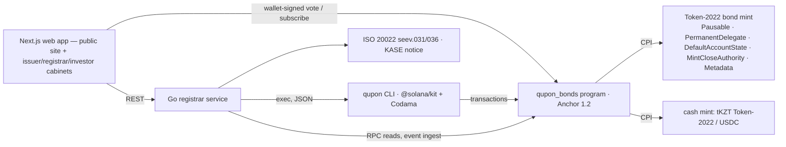

# Qupon — corporate actions for tokenized bonds on Solana

[](https://github.com/savvax/qupon/actions/workflows/ci.yml)

**Qupon is the corporate-actions engine for tokenized bonds: identify holders → calculate entitlements → settle → record, on-chain, following Kazakhstan market rules and emitting ISO 20022 messages.** Built for the KASE × Superteam Kazakhstan side track of Colosseum's Crypto World's Fair. Devnet only.

- Program: [`QPN1zdVm6PgMdJo4YxemtDxxbUczqaAk9sDsJQsJ2qd`](https://explorer.solana.com/address/QPN1zdVm6PgMdJo4YxemtDxxbUczqaAk9sDsJQsJ2qd?cluster=devnet) (Anchor 1.2, Token-2022) — verifiable build, IDL published on-chain
- One command runs every scenario on devnet and writes a report with a link for every transaction: [`reports/demo-full.md`](reports/demo-full.md) — 60 linked transactions
- Secondary trades settle through the Solana Foundation's DvP program with the record date protected — a second devnet run, every transaction linked: [`reports/demo-trade.md`](reports/demo-trade.md) — 20 linked transactions
- 116 program tests (LiteSVM integration + unit), the brief's worked example as named tests, shared test vectors checked in Rust, Go and TypeScript
- Judge path, no sign-in: a **sandbox** bond that lives a whole coupon cycle in minutes, a curated **showcase** serviced by an autopilot and a **/proof** page that re-verifies every action in the browser — see [Try it](#try-it--the-judge-path)

## Try it — the judge path

- **Sandbox — “Try it in 3 minutes”**: [/sandbox/new](https://qupon.fun/sandbox/new) issues the visitor **their own bond on devnet** on a compressed demo clock (a bond day passes in seconds, a whole coupon cycle in minutes). Watch the autopilot run record date → snapshot → fund → pay, view it as issuer / registrar / investor, skip the funding to see the default declared and then cured, and claim a payout with your own wallet (`?wallet=<address>` adds you as a holder). No sign-in needed.
- **Curated showcase with autopilot**: the public bond board features four seeded series (`make seed-showcase`) that the registrar's autopilot loop services end to end on its own schedule — announce, record date, snapshot, pay, complete — [`reports/showcase.md`](reports/showcase.md).
- **/proof — in-browser verification**: every series has a public certificate page that rereads devnet over RPC and recomputes every check **in your browser** (snapshot fingerprint, per-holder math, escrow money in/out), with an explorer link per transaction; `pnpm build:proof` exports the same pages as static HTML ([picker](https://qupon.fun/proof)).
- **Plan-15 servicing instructions**, all live on devnet ([`reports/demo-plan15.md`](reports/demo-plan15.md)): holder-signed payout routes (`set_payout_route`; bank-routed payouts go to the paying agent, which confirms with `confirm_bank_payout` — transfer SIMULATED), default and cure (`declare_default` one series day after a missed payment, late funding cures it and the record-date holders are paid), the seev.031 disclosure hash anchored on-chain (`attach_disclosure`), DvP trades that carry accrued interest (`TradeAccrued`), and redemptions that pay and burn in one instruction.
- The UI speaks **English, Russian and Kazakh**.

## Product tour — every role in the browser

The whole engine is driven from the web app at **https://qupon.fun**, in English, Russian or Kazakh, on a laptop or a phone. Open [/login](https://qupon.fun/login) and sign in with one click — **demo issuer**, **demo registrar** or **demo investor** (the demo investor is a server-signed custodial wallet, labelled as such on every screen; connect your own wallet instead if you prefer).

| Role | Cabinet | What you can do |
| --- | --- | --- |
| Issuer | [`/issuer`](https://qupon.fun/issuer) | create a bond series in a 3-step wizard (terms → schedule preview → issue on-chain), announce a coupon / redemption / early call, call a bondholder meeting, fund the escrow |
| Registrar | [`/registrar`](https://qupon.fun/registrar) | onboard an investor (SAS KYC attestation, SIMULATED provider, + on-chain registration), run record date → snapshot → pay → complete step by step, reconcile, download ISO 20022 and the KASE notice, browse the audit trail, create and settle secondary trades on the Solana DvP program (`/registrar/trades`) |
| Investor | [`/investor`](https://qupon.fun/investor) | portfolio with a tx link per payment, subscribe at par, fund your leg of a secondary trade, vote in meetings, seev.036 statements |

Every action step confirms with a toast carrying its explorer link. The screenshots below are real devnet runs driven through this UI (local registrar + the deployed program; log: [`reports/live-check-local.md`](reports/live-check-local.md)):

| Step | Screenshot |
| --- | --- |
| Coupon INTR run to **Completed** — 500.00 / 1,250.00 / 3,250.00 ₸ to the 10 / 25 / 65-bond holders | [`reports/ui/live-local/coupon-completed.png`](reports/ui/live-local/coupon-completed.png) |
| Registrar onboards a fresh wallet: SAS attestation + registration, two txs | [`reports/ui/live-local/registrar-onboarded.png`](reports/ui/live-local/registrar-onboarded.png) |
| Demo investor subscribes 1 bond at par (65 → 66) | [`reports/ui/live-local/investor-subscribed.png`](reports/ui/live-local/investor-subscribed.png) |
| Investor votes For in the meeting (66 of 101 units) | [`reports/ui/live-local/investor-voted.png`](reports/ui/live-local/investor-voted.png) |
| Meeting approved and applied — coupon rate 10% → 12% on-chain | [`reports/ui/live-local/meeting-applied.png`](reports/ui/live-local/meeting-applied.png) |

The deployed site is checked the same way — live e2e 4/4 and a full coupon through the cabinets on production: [`reports/live-deploy.md`](reports/live-deploy.md), screenshots in [`reports/ui/live/`](reports/ui/live).

Every page × EN/RU/KK × 1440/390 px is swept by `apps/web/e2e/sweep.spec.ts` (no console errors — that is where missing translations surface — and no horizontal scroll at 390 px); the 323 shots live in [`reports/ui/sweep/`](reports/ui/sweep). Public pages need no sign-in: [landing](https://qupon.fun/) · [bond board](https://qupon.fun/bonds).

## Platform v2 — accounts, KYC, KASE data, cash assets, admin

Beyond the three demo roles, Qupon now runs as a multi-user platform (spec: [`docs/superpowers/specs/2026-10-06-qupon-platform-v2-design.md`](docs/superpowers/specs/2026-10-06-qupon-platform-v2-design.md)):

| Area | What is there |
| --- | --- |
| **Investor accounts** | Self sign-up at `/signup` (email + password, EN/RU/KK) → onboarding banner → link a Solana wallet by signing a message (no transaction, no fee) → KYC application at `/investor/kyc`: upload an ID / proof of address (PDF/PNG/JPEG ≤ 10 MB, real upload progress), investor type, tax residency (withholding 0 % resident / 15 % non-resident — SIMULATED rules), issues to join. `/account`: profile, interface language, password, linked wallets. |
| **KYC review** | Registrar queue `/registrar/kyc` → application with documents → **Approve** attests the wallet on the Solana Attestation Service and registers it in every requested issue (per-issue result with tx links, safe to retry) or **Reject** with a reason the investor sees. Review is SIMULATED (no KYC vendor); the attestation and registration are real devnet transactions. |
| **Issuer organisations** | An issuer works as an organisation: `/issuer/organization` (profile), `/issuer/team` (one-time invite links, members), `/issuer/documents` (prospectus and other series documents, public on the bond page); issuers see and act only on their organisation's series. |
| **Onboarding and reports** | `/investor` walks a new investor through five devnet steps (account → wallet → KYC → test tenge from the faucet → first subscription), highlighting the next one. `/investor/reports`: payout statement for a period and an annual tax summary (CSV and a print/PDF view); `/registrar/reports`: holder register per issue. |
| **Notifications** | Ingested on-chain events fan out to the holders of the series (linked wallets): coupon/redemption announced, meeting opened/finalised, payment received, KYC decision. Bell in every cabinet (live count, latest notices), `/account/notifications`. Idempotent per user and event. |
| **kase.kz data** | Public kase.kz bond data read through the registrar (cached, rate-limited, degrades instead of failing): KASE panel on bond pages (quotes, schedule), **Import from KASE** in the issuance wizard (prefills ISIN, face, rate, frequency, day count, dates and compares the schedule), a **schedule check** on each action (KASE fixation date vs the on-chain record date) and a **disclosure package** (RU + EN notices, seev.031, schedule) — submission to KASE is SIMULATED. |
| **Cash-asset registry** | Admin-managed list of settlement tokens, each verified on-chain when added (mint, decimals, token program, freeze/mint authority warnings): tKZT and USDC (devnet), KZTE-dev and dKZT test tenge tokens with an investor faucet; the issuance wizard offers every enabled asset. Evo's KZTE (the digital-tenge-backed stablecoin on Solana) is listed for mainnet, disabled until its official mint is added by address. |
| **Admin panel** | `/admin`: overview KPIs, users (create, roles, disable, one-time password-reset links) and organisations, system health (RPC, operator balances with low-SOL alerts, executor, scheduler, ingest lag, kase.kz cache), series visibility/featured/KASE ticker, cash assets, audit search with CSV export, network readiness. |
| **Mainnet-ready** | One code base, a network profile per deployment (`config/devnet.json`, `config/mainnet-beta.json`): on mainnet demo sign-in is off and every write needs a typed confirmation (`X-Confirm-Network`), the UI shows a red network badge and confirms each write. `ops/deploy-mainnet.sh` is a dry run by default. **Not deployed to mainnet.** |
| **Wallet UX** | Wallet Standard detection: one installed wallet connects in one click, several open a picker, none explains how to install one (desktop and mobile deep links) or view any address read-only. |
| **Quality** | EN/RU/KK with controls that keep their size in every language (`e2e/locale-stability.spec.ts`), locale dates and numbers, phone layouts without horizontal scroll (every route swept at EN/RU/KK × 1440/390 px), motion that runs only after hydration and stops under reduced motion. |

## The problem

KASE became Kazakhstan's first licensed digital-financial-asset platform operator in May 2026 and plans tokenized notes first, bonds and equities from December 2026; the Central Securities Depository may now keep DFA holder registers (July 2026). Tokenizing a bond is the easy part — **servicing it for its whole life** (coupons, redemption, early calls, bondholder meetings) is where depositories spend their effort, and nothing on Solana does it in a standardized, verifiable way. Sources: [`docs/research/01-market-kase-iso20022-prior-art.md`](docs/research/01-market-kase-iso20022-prior-art.md).

## What Qupon does

| Verb                       | How                                                                                                                                                                                                                                                                                       | Where                                                     |
| -------------------------- | ----------------------------------------------------------------------------------------------------------------------------------------------------------------------------------------------------------------------------------------------------------------------------------------- | --------------------------------------------------------- |
| **Identify holders**       | Only KYC'd wallets can hold the bond (Token-2022 `DefaultAccountState = Frozen`; the registrar thaws on registration, which requires the wallet's KYC attestation on the Solana Attestation Service). On the record date the mint is **paused** and every holder is snapshotted on-chain. | `register_investor`, `strike_record`, `snapshot_batch`    |
| **Calculate entitlements** | Integer math in u128, 30E/360 or ACT/365, rounded half-up **per holder**, withholding tax per investor class; the program recomputes everything from civil dates and series terms.                                                                                                        | `crates/entitlement`, `announce_action`, `snapshot_batch` |
| **Settle**                 | Issuer pre-funds an escrow owned by the action PDA; batches pay net to each holder and tax to a tax vault; reconciliation before the register is resumed.                                                                                                                                 | `fund_action`, `pay_batch`, `complete_action`             |
| **Record**                 | Every transition emits an event; state lives in PDAs; ISO 20022 seev.031/seev.036 and a KASE-style notice are generated from chain state.                                                                                                                                                 | 28 event types, `services/registrar`                      |

## Settlement layer below, servicing layer above

On 6 October 2026, during the hackathon, the Solana Foundation announced [Solana DvP](https://explorer.solana.com/address/dvp34bdbcEm4f4FCUjGV4mDAkDshaQR4LkK8fdcsyZq?cluster=devnet) — an audited, open-source program for atomic delivery-versus-payment settlement of tokenized securities, built with input from J.P. Morgan. It settles a trade; it has no notion of a record date. Qupon is the servicing layer on top of it: it decides which DvP escrow may hold a regulated bond, makes sure a trade in flight can never cost a holder their coupon, and lets the registrar unwind a trade the parties cannot. Secondary trades of Qupon bonds settle through that program on devnet: [`reports/demo-trade.md`](reports/demo-trade.md).

## Scenarios (all on devnet — see [`reports/demo-full.md`](reports/demo-full.md) and [`reports/demo-trade.md`](reports/demo-trade.md))

| Scenario                                          | What happens                                                                                                                                                             | Proof                                                                                                                                                                                                                                                                                                                                                                                                               |
| ------------------------------------------------- | ------------------------------------------------------------------------------------------------------------------------------------------------------------------------ | ------------------------------------------------------------------------------------------------------------------------------------------------------------------------------------------------------------------------------------------------------------------------------------------------------------------------------------------------------------------------------------------------------------------- |
| S0 Issuance & registry                            | Token-2022 bond mint with validated extensions, 3 investors registered, an unregistered wallet is refused, placement at par 10/25/65                                     | [subscribe 65 bonds](https://explorer.solana.com/tx/CD3gN7Mb15mUfD6NqnzAzY7ppXDKGxLh44j62bEsFuEKtNsCzJxJR5jSrWNpSir2L9kkfhsZ8HALaSL3mSPgDrb?cluster=devnet) · registry refusal in the report                                                                                                                                                                                                                  |
| S1 Coupon payment (required 1)                    | INTR #1: 10 bonds → **500.00**, 25 → 1,250.00, 65 → 3,250.00 (the brief's example)                                                                                       | [INTR #1 action](https://explorer.solana.com/address/DkSQMx7w2UNjLzPxjAfTxRwNr3oYWhhYCod35HXuYP16?cluster=devnet) · [pay](https://explorer.solana.com/tx/4timJdNAASBt2MTVgWR9ryUxk5SAeaDdKxw3dFEwdv1KDEnWKmYNtzy4ivY3hpVrX8nqeDG3fA4ooaHumQUFJzye?cluster=devnet)                                                                                                                                                   |
| S2 Redemption (required 2)                        | Principal + final coupon, units burned via permanent delegate, mint closed, metadata `status=REDEEMED`                                                                   | [REDM action](https://explorer.solana.com/address/GmK726FMUFruUwhrWVMGi9uiFqdbLuZYqiKT2ZRrhUZo?cluster=devnet) · [retire](https://explorer.solana.com/tx/5EyyhishaQbpTAG4xP6FeY7HGBsk8Wv4tibn5RqqToyvvzixYVUFKvUSk1XCFcuiJ17sMHJoZmWf7SZyuEFAC8pd?cluster=devnet) · [close](https://explorer.solana.com/tx/3a7g7HtY68C1t4kEhLYJCnKak9fWVPcbEH4YaQoSbPcPBczhyfLrp9Nv2Lr5dTQ9d7EgAXk5HWmby3XhVkvsM2N6?cluster=devnet) |
| S3 Bondholder meeting → terms change (required 3) | Snapshot-weighted vote 65 For / 25 Against / 10 Abstain → Approved → coupon 10% → 12% on the series and in the token metadata; next coupons 600.00 / 1,500.00 / 3,900.00 | [apply 12%](https://explorer.solana.com/tx/5dLcjcTjiMafLRq4cGKNJYshVnkq5EUgS1JnwVWLitezEKNiSRbRoUQCLeZeAgXHr14TVuVTtezj2m7rNPEg6VSP?cluster=devnet) · [INTR #2 at 12%](https://explorer.solana.com/address/FDxcyBd3hCtPWgXgEypszcvoL6e2k3Aa6m8hoYGCyLdt?cluster=devnet)                                                                                                                                             |
| S4 Early redemption (bonus)                       | USDC series (BTRKb33 terms, 15.95%): MCAL after 47 accrued days, burn, close                                                                                             | [MCAL action](https://explorer.solana.com/address/AfQStcMFk4PT2KxoiVLtMV1AaKhftCdaQcHeHjiDPkPo?cluster=devnet) · [close](https://explorer.solana.com/tx/4gWyNCgL6RnCk5e5kiKdziYpVzgXoSCHCuv8HaMfGLHD6QRQ15ibmrd21hGs9cP8UsoraXo8rNC5n4NTxg2GtY9S?cluster=devnet)                                                                                                                                                    |
| S5 Secondary trade (Solana DvP)                  | investor3 sells 5 bonds at par to investor1 through the Solana Foundation's DvP program — both legs move in one transaction. A second trade still open at the record date makes `strike_record` fail with `TradesInFlight`; after the registrar cancels it the coupon is paid on 15 / 25 / 60 bonds | [settle](https://explorer.solana.com/tx/2BhUpZ2GwZuxJ7wyMi4yqFR299KJo2P7nFv9SB7MdRLY3gjJNRq2YPPR2qQxErB2bnF5LQkAa6WeqMjGaTrfnUrT?cluster=devnet) · [create + admit](https://explorer.solana.com/tx/7Dp3KP2843vkxTFwyDPmBkPrqxnWCvEEQz5wnpceAHhh36Mse7Y5ak7LPFjQ1d62xdK6YAobYo72cQ2uTY67cXp?cluster=devnet) · [cancel](https://explorer.solana.com/tx/4c819YTNENmMchjeyhxxtTZnNFdeVm9bCH7eTdDLZK5weLhbvFRMAjjkCdhPfg2TmfDpPPWpjGRF9pqtaq4U6Ye?cluster=devnet) |

## Architecture



| Component         | Path                        | Role                                                                |
| ----------------- | --------------------------- | ------------------------------------------------------------------- |
| On-chain program  | `programs/qupon_bonds`      | 28 instructions, 5 account types, 44 error codes, 28 events         |
| Entitlement math  | `crates/entitlement`        | `no_std` Rust crate shared by the program and tests                 |
| TS client + CLI   | `clients/ts`                | Codama-generated client, `qupon` CLI (JSON on stdout), demo scripts |
| Registrar service | `services/registrar`        | Go: chain reader, reconciler, ISO 20022, notices, REST read models  |
| Web app           | `apps/web`                  | Next.js public site + issuer / registrar / investor cabinets        |
| Test vectors      | `fixtures/entitlement.json` | One contract for Rust, Go and TS                                    |

## Record-date mechanism

1. `announce_action` — the program re-derives accrual days from the civil dates (`yyyymmdd`) and ties them to Almaty-midnight timestamps; period start, rate and end must match the series schedule (`EntitlementCalcMismatch` otherwise). One open action per series.
2. `strike_record` — only when `clock ≥ record_at`; CPI **pause** on the bond mint: no transfers, mints or burns can change the register.
3. `snapshot_batch` (≤ 8 holders/tx, idempotent) — one `Entitlement` PDA per holder with units and amounts; `snapshot_hash = sha256(prev ‖ owner ‖ units_le)` over holders sorted by owner, recomputed off-chain by the reconciler.
4. `finalize_snapshot` — Σ snapshotted units **must equal the mint supply** (nobody can be missed while the mint is paused) and Σ gross must be within ½ minor unit per holder of supply × the exact per-unit coupon.

Kazakhstan rule mirrored: coupon is paid to holders registered at the start of the last day of the period (Law "On the Securities Market", art. 31) — `docs/03-domain.md` §1.

## Entitlement math

```
gross     = round_half_up(units × face × rate_bps × accrual_days, 10 000 × basis)    basis = 360 (30E/360) or 365 (ACT/365)
tax       = round_half_up(gross × tax_bps, 10 000)
net       = gross − tax
principal = units × face            (REDM / MCAL; PCAL: × factor_bps / 10 000)
payout    = net + principal         (tax goes to the series tax vault)
```

The brief's example — face 1,000, 10% annual, semi-annual, 10 bonds → **500** — is the test `coupon_10_bonds_is_500`; redemption 10,000 + final coupon is `redemption_pays_principal_plus_final_coupon` (`programs/qupon_bonds/tests/brief.rs`). The other brief tests: `three_holders_sum_to_supply_times_coupon`, `unregistered_wallet_cannot_hold`, `record_date_before_time_rejected`, `paused_mint_blocks_transfer`, `rerun_batches_is_noop`, `underfunded_escrow_rejected`. Every vector in [`fixtures/entitlement.json`](fixtures/entitlement.json) (incl. MCAL 47 days with tax, ACT/365, a half-up tie, u128 safety) runs in `crates/entitlement/tests/fixtures.rs`, the Go mirror `services/registrar/internal/entitlement` and the TS library `clients/ts/src/lib/entitlement.ts`.

## Settlement flow

`fund_action` (issuer or paying agent) moves cash into an escrow ATA owned by the **action PDA**; the action becomes `Funded` only when the escrow covers net + tax + principal. `pay_batch` (crank, ≤ 5/tx on-chain, 4/tx from the CLI) pays each holder's **registered** cash account and the tax vault, marking entitlements `Paid` (re-sent batches are no-ops). `complete_action` reconciles — every holder paid and `total_paid == total_net + total_principal` — then resumes the register: coupons advance the schedule (computed from the issue date, never by stepping, so end-of-month dates do not drift); a partial call (PCAL) pays `factor × face` per unit and keeps every unit: the outstanding face shrinks by what was repaid, so later coupons and the final redemption accrue on the remainder; full redemptions move to `retire_batch` (burn via the permanent delegate, thawing suspended holders first) and `close_series` (supply 0 → metadata `REDEEMED`, mint closed). `fund_action` never takes more than the shortfall, and `sweep_escrow` returns anything left in a finished action's escrow to the issuer and closes it (the registrar runs it after every completion). The Go reconciler recomputes entitlements and the snapshot hash from chain data: `GET /actions/{pda}/reconcile`.

## Scale — what is designed and what is measured

- **Designed:** no holder cap in the program — every holder has its own PDAs (`Investor`, `Entitlement`, `Checkpoint`) and the series/action counters are `u32`. Snapshot runs in batches of 8 holders per transaction and payment in batches of 4 (CLI), so an action over **N holders takes ⌈N/8⌉ + ⌈N/4⌉ transactions** — about 375 for 1,000 holders. Every crank step is permissionless and the snapshot hash is order-independent, so batches can be sent in parallel by anyone.
- **Measured:** program tests and devnet runs use up to 5 holders per series. **We have not run 1,000 holders** — the figure above is arithmetic, not a measurement. The web pages that list holders (bond page, registrar register, `/proof`) and the registrar's event ingest are untested at that size.

## Solana components

- **Token-2022 bond mint** (decimals 0, 1 token = 1 bond): `MetadataPointer` + `TokenMetadata` (registrar is update authority), `DefaultAccountState = Frozen`, `PermanentDelegate`, `Pausable`, `MintCloseAuthority`, mint and freeze authority = series PDA. `init_series` rejects any other extension or authority (`docs/SECURITY_NOTES.md`).
- **PDAs**: `Series ["series", mint]`, `Investor ["investor", series, owner]`, `CorporateAction ["action", series, index]`, `Entitlement ["entitlement", action, owner]`, `TradeAdmission ["trade", series, swap_dvp]`.
- **Instructions** (28): `init_series`, `register_investor`, `suspend_investor`, `reinstate_investor`, `subscribe` (placement at par: payment and mint in one instruction), `issue_units`, `announce_action`, `cancel_action`, `strike_record`, `snapshot_batch`, `finalize_snapshot`, `fund_action`, `pay_batch`, `complete_action`, `retire_batch`, `close_series`, `cast_vote`, `finalize_meeting`, `apply_terms_change`, `admit_trade`, `release_trade` (secondary trades settled by the Solana DvP program), `sweep_escrow`, `init_hook` / `execute` (transfer-hook record-date gate, new series), `set_payout_route` / `confirm_bank_payout` (holder-signed payout routes), `declare_default` (default and cure), `attach_disclosure` (notice hash on-chain). Full table: [`docs/02-architecture.md`](docs/02-architecture.md).
- **Events** on every state transition; the Go service ingests them into an activity feed.

## ISO 20022 and the KASE notice

From chain state the registrar serves `seev.031` (corporate action notification) and `seev.036` (movement confirmation per holder) — `urn:iso:std:iso:20022:tech:xsd:seev.031.001.15` / `seev.036.001.16`, well-formed XML (XSD validation is out of scope) — and a KASE-style disclosure notice in English and Russian (`GET /actions/{pda}/notice?lang=en|ru`). Golden files: `fixtures/iso20022/`, `fixtures/notices/`.

## Implemented vs simulated

| Element | Status |
|---|---|
| Bond token, holder registry, record date, entitlement math, coupon payment, redemption, burn/close, voting, terms change, on-chain events | **Implemented on Solana devnet** |
| Cash leg | Real token transfers: USDC devnet (Circle) and test tKZT (Token-2022); fiat KZT and Evo/digital tenge are **simulated** by our mint |
| KYC | **Attested on-chain, provider simulated**: a KYC-provider keypair issues a Solana Attestation Service attestation per wallet (type, residency, tax rate); `register_investor` refuses a wallet without a live, matching attestation. The provider is a demo keypair, not a licensed KYC firm |
| KYC document review | **Simulated vendor**: documents are uploaded and stored (content-addressed, owner/registrar access only); a registrar decides by hand. Approval produces real SAS attestations and registrations on devnet |
| ISO 20022 seev.031 / seev.036 | Generated from on-chain state; Swift network delivery **simulated** (downloadable files) |
| ARDFM registration of terms change | **Simulated** by registrar signature step |
| KASE disclosure notice | Generated automatically; publication on kase.kz **not** integrated |
| kase.kz | **Read integration** with public kase.kz data (bond terms, schedule, market data — cached); disclosure-package **submission simulated** |
| Secondary settlement | **Implemented on Solana devnet** through the Solana Foundation's DvP program: Qupon admits the trade's bond escrow, refuses a record date while a trade is open and can return escrowed bonds to the seller. Order matching and a trading venue are not included |
| Term-sheet import | **Experimental** — pasted KASE text is parsed into series terms by an LLM (Z.ai GLM) with a SIMULATED regex fallback; every field is confirmed by the issuer before issuance |
| Multisig issuer approval (Squads) | Demo: a 2-of-3 Squads vault is the paying agent and funds a coupon (`make demo-squads`, report `reports/demo-squads.md`); multisig registrar is roadmap |
| Digital tenge / KZT tokens | Devnet stand-ins KZTE-dev and dKZT (our mints, faucet for investors); Evo KZTE on mainnet is registered as a disabled asset pending its official mint — **no mainnet deployment** |
| Mainnet | **Ready, not deployed** — one code base with a network profile per deployment, typed write confirmations and a dry-run deploy script; everything runs on devnet |

One table, canonical in [`docs/TECHNICAL_OVERVIEW.md`](docs/TECHNICAL_OVERVIEW.md); this is a verbatim copy.

Meeting thresholds (quorum 50%, approval ⅔ of votes cast) are **series configuration**, not asserted as Kazakh law.

## Quickstart

```bash
bash ops/bootstrap.sh          # Agave 4.3.0, Anchor 1.2.0, Node 22, pnpm 9, Go 1.26
cp .env.example .env           # RPC_URL (Helius devnet), keypair paths
make verify                    # build + all tests + lint (no network)
bash ops/wallets.sh            # devnet keypairs; fund via faucet.solana.com / faucet.circle.com
make demo-coupon               # S1 on devnet → reports/demo-coupon.md
make demo                      # S0–S4 on devnet → reports/demo-full.md
make api                       # Go registrar on :8080 (REST + ISO 20022 + notices)
```

### UI without keys (mock mode)

The web app runs with no keys and no registrar service — fixture mock, full UI:

```bash
cd apps/web && pnpm install
pnpm exec playwright install chromium   # once, for the e2e suite
cp .env.example .env.local              # mock-mode vars
pnpm dev                                # mock mode via .env.local → http://localhost:3000
pnpm e2e                                # mock-mode Playwright suite (starts its own dev server on :3210)
```

## Deployed (devnet)

| What | URL |
| --- | --- |
| Site (landing, bond board) | https://qupon.fun |
| Sign in — one-click demo issuer, registrar or investor | https://qupon.fun/login |
| Registrar API                                               | https://api.qupon.fun/healthz (OpenAPI: [`services/registrar/openapi.yaml`](services/registrar/openapi.yaml)) |

One VPS, Docker Compose: registrar API (Go + the `qupon` CLI as executor) and web app (Next.js), behind HTTPS (the box's shared
reverse proxy; `sslip.io` resolves the hostnames to the server IP). The web app reads devnet state; wallet actions are signed in the
browser; back-office writes go through a session proxy (`/api/bo/*`): the session token lives only in an httpOnly cookie
and every operator-key action is role-checked by the Go API. Deploy or update with one command (needs ssh access and the
devnet keypairs in `.env`):

```bash
ops/deploy-vps.sh                                 # primary: user@185.216.25.91 (compose.shared.yml, /home/user/qupon)
```

Fresh demo data (every demo coupon consumes one scheduled period): `make demo-seed` creates a new series with three
KYC'd holders (10 / 25 / 65 bonds) and nothing announced; `REINDEX=1 ops/deploy-vps.sh` restarts the registrar so the
cabinets list it.

Env reference: [`.env.example`](.env.example) (root) and [`services/registrar/.env.example`](services/registrar/.env.example). Server-side secrets written by the deploy script to
$QUPON_DIR/registrar.env (mode 600; `/home/user/qupon` on the primary, `/opt/qupon` by default elsewhere): `RPC_URL`, `DEMO_LOGIN=1`, `QUPON_USERS`, and the operator keypair JSON arrays the
executor signs with — registrar, issuer, paying agent, KYC provider (`~/.config/qupon/kyc-provider.json`) and the demo
investor's custodial wallet (`~/.config/qupon/investor3.json`, powers `POST /demo/investor/*`).

## Reproducible build & verification

The deployed program is a deterministic `solana-verify` docker build (solana-verify 0.5.2, image `solanafoundation/solana-verifiable-build:4.3.0`):

- Program id: [`QPN1zdVm6PgMdJo4YxemtDxxbUczqaAk9sDsJQsJ2qd`](https://explorer.solana.com/address/QPN1zdVm6PgMdJo4YxemtDxxbUczqaAk9sDsJQsJ2qd?cluster=devnet)
- Build hash (SHA-256, on-chain match confirmed): `4a2e46778847f8b6277194a74ee89e9145fc8c03f8e4e8c9ede3bdda752a3505`

```bash
# reproduce the build and compare with the deployed program
cargo install solana-verify --locked   # 0.5.2
solana-verify verify-from-repo https://github.com/savvax/qupon \
  --program-id QPN1zdVm6PgMdJo4YxemtDxxbUczqaAk9sDsJQsJ2qd \
  --library-name qupon_bonds \
  --base-image solanafoundation/solana-verifiable-build:4.3.0

# fetch the published IDL (Program Metadata Program)
anchor idl fetch QPN1zdVm6PgMdJo4YxemtDxxbUczqaAk9sDsJQsJ2qd --provider.cluster devnet
```

The IDL is also readable in the [explorer's IDL tab](https://explorer.solana.com/address/QPN1zdVm6PgMdJo4YxemtDxxbUczqaAk9sDsJQsJ2qd/idl?cluster=devnet).

## Devnet addresses

| What                                      | Address                                                                                    |
| ----------------------------------------- | ------------------------------------------------------------------------------------------ |
| Program                                   | `QPN1zdVm6PgMdJo4YxemtDxxbUczqaAk9sDsJQsJ2qd`                                              |
| tKZT (test tenge, Token-2022, 2 decimals) | `HQWXGhNN3SUuaauG1z3vTjzfHRshJxdRYLF9gzzhFmsF`                                             |
| USDC (Circle devnet)                      | `4zMMC9srt5Ri5X14GAgXhaHii3GnPAEERYPJgZJDncDU`                                             |
| Demo series and wallets                   | [`config/devnet.json`](config/devnet.json), [`reports/demo-full.md`](reports/demo-full.md) |

## Roadmap

Token ACL (sRFC-37) instead of the custom registry thaw · order matching for secondary trades (their settlement already runs on Solana DvP) · a Squads multisig registrar (a 2-of-3 Squads vault already funds a coupon as paying agent — [reports/demo-squads.md](reports/demo-squads.md)) · a licensed KYC provider issuing the SAS attestations · confidential coupon amounts · tax-vault remittance · KASE disclosure publication through an IRIS account · mainnet launch with Evo KZTE (or a bank deposit token) as the cash leg once the official mint and operator wallets are in place.

## License

MIT.
