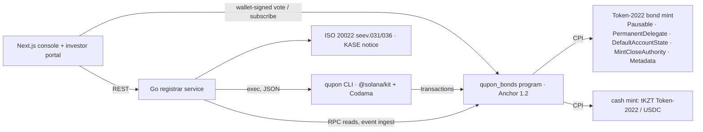

# Qupon — corporate actions for tokenized bonds on Solana

[](https://github.com/savvax/qupon/actions/workflows/ci.yml)

**Qupon is the corporate-actions engine for tokenized bonds: identify holders → calculate entitlements → settle → record, on-chain, following Kazakhstan market rules and emitting ISO 20022 messages.** Built for the KASE × Superteam Kazakhstan side track of Colosseum's Crypto World's Fair. Devnet only.

- Program: [`QPN1zdVm6PgMdJo4YxemtDxxbUczqaAk9sDsJQsJ2qd`](https://explorer.solana.com/address/QPN1zdVm6PgMdJo4YxemtDxxbUczqaAk9sDsJQsJ2qd?cluster=devnet) (Anchor 1.2, Token-2022) — verifiable build, IDL published on-chain
- One command runs every scenario on devnet and writes a report with a link for every transaction: [`reports/demo-full.md`](reports/demo-full.md) (69 transactions)
- 50 program tests (LiteSVM integration + unit), the brief's worked example as named tests, shared test vectors checked in Rust, Go and TypeScript

## The problem

KASE became Kazakhstan's first licensed digital-financial-asset platform operator in May 2026 and plans tokenized notes first, bonds and equities from December 2026; the Central Securities Depository may now keep DFA holder registers (July 2026). Tokenizing a bond is the easy part — **servicing it for its whole life** (coupons, redemption, early calls, bondholder meetings) is where depositories spend their effort, and nothing on Solana does it in a standardized, verifiable way. Sources: [`docs/research/01-market-kase-iso20022-prior-art.md`](docs/research/01-market-kase-iso20022-prior-art.md).

## What Qupon does

| Verb | How | Where |
|---|---|---|
| **Identify holders** | Only KYC'd wallets can hold the bond (Token-2022 `DefaultAccountState = Frozen`; the registrar thaws on registration). On the record date the mint is **paused** and every holder is snapshotted on-chain. | `register_investor`, `strike_record`, `snapshot_batch` |
| **Calculate entitlements** | Integer math in u128, 30E/360 or ACT/365, rounded half-up **per holder**, withholding tax per investor class; the program recomputes everything from civil dates and series terms. | `crates/entitlement`, `announce_action`, `snapshot_batch` |
| **Settle** | Issuer pre-funds an escrow owned by the action PDA; batches pay net to each holder and tax to a tax vault; reconciliation before the register is resumed. | `fund_action`, `pay_batch`, `complete_action` |
| **Record** | Every transition emits an event; state lives in PDAs; ISO 20022 seev.031/seev.036 and a KASE-style notice are generated from chain state. | 18 event types, `services/registrar` |

## Scenarios (all on devnet — see [`reports/demo-full.md`](reports/demo-full.md))

| Scenario | What happens | Proof |
|---|---|---|
| S0 Issuance & registry | Token-2022 bond mint with validated extensions, 3 investors registered, an unregistered wallet is refused, DvP subscription 10/25/65 | [subscribe 65 bonds (DvP)](https://explorer.solana.com/tx/CD3gN7Mb15mUfD6NqnzAzY7ppXDKGxLh44j62bEsFuEKtNsCzJxJR5jSrWNpSir2L9kkfhsZ8HALaSL3mSPgDrb?cluster=devnet) · registry refusal in the report |
| S1 Coupon payment (required 1) | INTR #1: 10 bonds → **500.00**, 25 → 1,250.00, 65 → 3,250.00 (the brief's example) | [INTR #1 action](https://explorer.solana.com/address/DkSQMx7w2UNjLzPxjAfTxRwNr3oYWhhYCod35HXuYP16?cluster=devnet) · [pay](https://explorer.solana.com/tx/4timJdNAASBt2MTVgWR9ryUxk5SAeaDdKxw3dFEwdv1KDEnWKmYNtzy4ivY3hpVrX8nqeDG3fA4ooaHumQUFJzye?cluster=devnet) |
| S2 Redemption (required 2) | Principal + final coupon, units burned via permanent delegate, mint closed, metadata `status=REDEEMED` | [REDM action](https://explorer.solana.com/address/GmK726FMUFruUwhrWVMGi9uiFqdbLuZYqiKT2ZRrhUZo?cluster=devnet) · [retire](https://explorer.solana.com/tx/5EyyhishaQbpTAG4xP6FeY7HGBsk8Wv4tibn5RqqToyvvzixYVUFKvUSk1XCFcuiJ17sMHJoZmWf7SZyuEFAC8pd?cluster=devnet) · [close](https://explorer.solana.com/tx/3a7g7HtY68C1t4kEhLYJCnKak9fWVPcbEH4YaQoSbPcPBczhyfLrp9Nv2Lr5dTQ9d7EgAXk5HWmby3XhVkvsM2N6?cluster=devnet) |
| S3 Bondholder meeting → terms change (required 3) | Snapshot-weighted vote 65 For / 25 Against / 10 Abstain → Approved → coupon 10% → 12% on the series and in the token metadata; next coupons 600.00 / 1,500.00 / 3,900.00 | [apply 12%](https://explorer.solana.com/tx/5dLcjcTjiMafLRq4cGKNJYshVnkq5EUgS1JnwVWLitezEKNiSRbRoUQCLeZeAgXHr14TVuVTtezj2m7rNPEg6VSP?cluster=devnet) · [INTR #2 at 12%](https://explorer.solana.com/address/FDxcyBd3hCtPWgXgEypszcvoL6e2k3Aa6m8hoYGCyLdt?cluster=devnet) |
| S4 Early redemption (bonus) | USDC series (BTRKb33 terms, 15.95%): MCAL after 47 accrued days, burn, close | [MCAL action](https://explorer.solana.com/address/AfQStcMFk4PT2KxoiVLtMV1AaKhftCdaQcHeHjiDPkPo?cluster=devnet) · [close](https://explorer.solana.com/tx/4gWyNCgL6RnCk5e5kiKdziYpVzgXoSCHCuv8HaMfGLHD6QRQ15ibmrd21hGs9cP8UsoraXo8rNC5n4NTxg2GtY9S?cluster=devnet) |

## Architecture



| Component | Path | Role |
|---|---|---|
| On-chain program | `programs/qupon_bonds` | 19 instructions, 4 account types, 31 error codes, 18 events |
| Entitlement math | `crates/entitlement` | `no_std` Rust crate shared by the program and tests |
| TS client + CLI | `clients/ts` | Codama-generated client, `qupon` CLI (JSON on stdout), demo scripts |
| Registrar service | `services/registrar` | Go: chain reader, reconciler, ISO 20022, notices, REST read models |
| Web app | `apps/web` | Next.js console and investor portal |
| Test vectors | `fixtures/entitlement.json` | One contract for Rust, Go and TS |

## Record-date mechanism

1. `announce_action` — the program re-derives accrual days from the civil dates (`yyyymmdd`) and ties them to Almaty-midnight timestamps; period start, rate and end must match the series schedule (`EntitlementCalcMismatch` otherwise). One open action per series.
2. `strike_record` — only when `clock ≥ record_at`; CPI **pause** on the bond mint: no transfers, mints or burns can change the register.
3. `snapshot_batch` (≤ 8 holders/tx, idempotent) — one `Entitlement` PDA per holder with units and amounts; `snapshot_hash = sha256(prev ‖ owner ‖ units_le)` over holders sorted by owner, recomputed off-chain by the reconciler.
4. `finalize_snapshot` — Σ snapshotted units **must equal the mint supply** (nobody can be missed while the mint is paused) and Σ gross must be within ½ minor unit per holder of supply × the exact per-unit coupon.

Kazakhstan rule mirrored: coupon is paid to holders registered at the start of the last day of the period (Law "On the Securities Market", art. 31) — `docs/03-domain.md` §1.

## Entitlement math

```
gross     = round_half_up(units × face × rate_bps × accrual_days, 10 000 × basis)    basis = 360 (30E/360) or 365 (ACT/365)
tax       = round_half_up(gross × tax_bps, 10 000)
net       = gross − tax
principal = units × face            (REDM / MCAL; PCAL: × factor_bps / 10 000)
payout    = net + principal         (tax goes to the series tax vault)
```

The brief's example — face 1,000, 10% annual, semi-annual, 10 bonds → **500** — is the test `coupon_10_bonds_is_500`; redemption 10,000 + final coupon is `redemption_pays_principal_plus_final_coupon` (`programs/qupon_bonds/tests/brief.rs`). The other brief tests: `three_holders_sum_to_supply_times_coupon`, `unregistered_wallet_cannot_hold`, `record_date_before_time_rejected`, `paused_mint_blocks_transfer`, `rerun_batches_is_noop`, `underfunded_escrow_rejected`. Every vector in [`fixtures/entitlement.json`](fixtures/entitlement.json) (incl. MCAL 47 days with tax, ACT/365, a half-up tie, u128 safety) runs in `crates/entitlement/tests/fixtures.rs`, the Go mirror `services/registrar/internal/entitlement` and the TS library `clients/ts/src/lib/entitlement.ts`.

## Settlement flow

`fund_action` (issuer or paying agent) moves cash into an escrow ATA owned by the **action PDA**; the action becomes `Funded` only when the escrow covers net + tax + principal. `pay_batch` (crank, ≤ 10/tx on-chain, 8/tx from the CLI) pays each holder's **registered** cash account and the tax vault, marking entitlements `Paid` (re-sent batches are no-ops). `complete_action` reconciles — every holder paid and `total_paid == total_net + total_principal` — then resumes the register: coupons advance the schedule (computed from the issue date, never by stepping, so end-of-month dates do not drift); redemptions move to `retire_batch` (burn via the permanent delegate, thawing suspended holders first) and `close_series` (supply 0 → metadata `REDEEMED`, mint closed). The Go reconciler recomputes entitlements and the snapshot hash from chain data: `GET /actions/{pda}/reconcile`.

## Solana components

- **Token-2022 bond mint** (decimals 0, 1 token = 1 bond): `MetadataPointer` + `TokenMetadata` (registrar is update authority), `DefaultAccountState = Frozen`, `PermanentDelegate`, `Pausable`, `MintCloseAuthority`, mint and freeze authority = series PDA. `init_series` rejects any other extension or authority (`docs/SECURITY_NOTES.md`).
- **PDAs**: `Series ["series", mint]`, `Investor ["investor", series, owner]`, `CorporateAction ["action", series, index]`, `Entitlement ["entitlement", action, owner]`.
- **Instructions** (19): `init_series`, `register_investor`, `suspend_investor`, `reinstate_investor`, `subscribe` (atomic DvP at par), `issue_units`, `announce_action`, `cancel_action`, `strike_record`, `snapshot_batch`, `finalize_snapshot`, `fund_action`, `pay_batch`, `complete_action`, `retire_batch`, `close_series`, `cast_vote`, `finalize_meeting`, `apply_terms_change`. Full table: [`docs/02-architecture.md`](docs/02-architecture.md).
- **Events** on every state transition; the Go service ingests them into an activity feed.

## ISO 20022 and the KASE notice

From chain state the registrar serves `seev.031` (corporate action notification) and `seev.036` (movement confirmation per holder) — `urn:iso:std:iso:20022:tech:xsd:seev.031.001.15` / `seev.036.001.16`, well-formed XML (XSD validation is out of scope) — and a KASE-style disclosure notice in English and Russian (`GET /actions/{pda}/notice?lang=en|ru`). Golden files: `fixtures/iso20022/`, `fixtures/notices/`.

## Implemented vs simulated

| Element | Status |
|---|---|
| Bond token, holder registry, record date, entitlement math, coupon payment, redemption, burn/close, voting, terms change, on-chain events | **Implemented on Solana devnet** |
| Cash leg | Real token transfers: USDC devnet (Circle) and test tKZT (Token-2022); fiat KZT and Evo/digital tenge are **simulated** by our mint |
| KYC | **Simulated**: registrar records attributes (type, residency, tax rate); no KYC provider integrated |
| ISO 20022 seev.031 / seev.036 | Generated from on-chain state; Swift network delivery **simulated** (downloadable files) |
| ARDFM registration of terms change | **Simulated** by registrar signature step |
| KASE disclosure notice | Generated automatically; publication on kase.kz **not** integrated |
| Multisig issuer approval (Squads), SAS KYC attestation | Optional T2; if not shipped, listed as roadmap |

Meeting thresholds (quorum 50%, approval ⅔ of votes cast) are **series configuration**, not asserted as Kazakh law.

## Quickstart

```bash
bash ops/bootstrap.sh          # Agave 4.3.0, Anchor 1.2.0, Node 22, pnpm 9, Go 1.26
cp .env.example .env           # RPC_URL (Helius devnet), keypair paths
make verify                    # build + all tests + lint (no network)
bash ops/wallets.sh            # devnet keypairs; fund via faucet.solana.com / faucet.circle.com
make demo-coupon               # S1 on devnet → reports/demo-coupon.md
make demo                      # S0–S4 on devnet → reports/demo-full.md
make api                       # Go registrar on :8080 (REST + ISO 20022 + notices)
```

## Deployed (devnet)

| What | URL |
|---|---|
| Console / investor portal (Vercel) | https://qupon.vercel.app |
| Registrar API (Fly.io) | https://qupon-registrar.fly.dev (`GET /healthz`, OpenAPI: [`services/registrar/openapi.yaml`](services/registrar/openapi.yaml)) |

The web app reads only devnet state; wallet actions are signed in the browser, lifecycle steps go through a server-side route (`/api/advance/[pda]`) so the registrar's `ADVANCE_TOKEN` never reaches the browser bundle.

Deployment steps (the logins are the team's): `HUMAN_TODO.md` → "deploy the API and the console". In short:

```bash
# API — Fly.io (image: Go API + Node 22 + built qupon CLI; entrypoint writes keypair secrets to 0600 files)
fly secrets set ADVANCE_TOKEN=… RPC_URL=… QUPON_REGISTRAR_KEYPAIR_JSON=… QUPON_ISSUER_KEYPAIR_JSON=… QUPON_PAYING_AGENT_KEYPAIR_JSON=…
fly deploy                                   # fly.toml → services/registrar/Dockerfile

# Web — Vercel (root dir apps/web)
vercel --prod apps/web \
  --env NEXT_PUBLIC_API_URL=https://qupon-registrar.fly.dev \
  --env NEXT_PUBLIC_RPC_URL=https://api.devnet.solana.com
cd apps/web && vercel env add ADVANCE_TOKEN   # server-side only, NOT NEXT_PUBLIC_
```

Env reference: `services/registrar/.env.example`, `apps/web/.env.example`.

## Reproducible build & verification

The deployed program is a deterministic `solana-verify` docker build (solana-verify 0.5.2, image `solanafoundation/solana-verifiable-build:4.3.0`):

- Program id: [`QPN1zdVm6PgMdJo4YxemtDxxbUczqaAk9sDsJQsJ2qd`](https://explorer.solana.com/address/QPN1zdVm6PgMdJo4YxemtDxxbUczqaAk9sDsJQsJ2qd?cluster=devnet)
- Build hash (SHA-256, on-chain match confirmed): `804e0ca8d39a0812874ef95f85b67cbb2e0b42a515949dda43cdfb7450e84fb9`

```bash
# reproduce the build and compare with the deployed program
cargo install solana-verify --locked   # 0.5.2
solana-verify verify-from-repo https://github.com/savvax/qupon \
  --program-id QPN1zdVm6PgMdJo4YxemtDxxbUczqaAk9sDsJQsJ2qd \
  --library-name qupon_bonds \
  --base-image solanafoundation/solana-verifiable-build:4.3.0

# fetch the published IDL (Program Metadata Program)
anchor idl fetch QPN1zdVm6PgMdJo4YxemtDxxbUczqaAk9sDsJQsJ2qd --provider.cluster devnet
```

The IDL is also readable in the [explorer's IDL tab](https://explorer.solana.com/address/QPN1zdVm6PgMdJo4YxemtDxxbUczqaAk9sDsJQsJ2qd/idl?cluster=devnet).

## Devnet addresses

| What | Address |
|---|---|
| Program | `QPN1zdVm6PgMdJo4YxemtDxxbUczqaAk9sDsJQsJ2qd` |
| tKZT (test tenge, Token-2022, 2 decimals) | `HQWXGhNN3SUuaauG1z3vTjzfHRshJxdRYLF9gzzhFmsF` |
| USDC (Circle devnet) | `4zMMC9srt5Ri5X14GAgXhaHii3GnPAEERYPJgZJDncDU` |
| Demo series and wallets | [`config/devnet.json`](config/devnet.json), [`reports/demo-full.md`](reports/demo-full.md) |

## Roadmap

Token ACL (sRFC-37) instead of the custom registry thaw · Squads multisig for issuer/registrar · Solana Attestation Service for KYC · confidential coupon amounts · tax-vault remittance and escrow refunds · KASE disclosure publication · mainnet with a regulated cash leg (digital tenge / bank deposit token).

## License

MIT.
