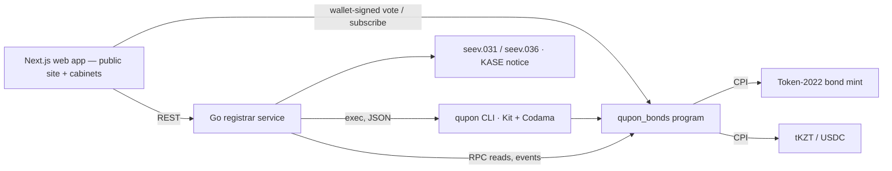

# Qupon — technical overview

Corporate-actions engine for tokenized bonds on Solana: **identify holders → calculate entitlements → execute settlement → record on-chain**. Everything below runs on devnet: program [`QPN1zdVm6PgMdJo4YxemtDxxbUczqaAk9sDsJQsJ2qd`](https://explorer.solana.com/address/QPN1zdVm6PgMdJo4YxemtDxxbUczqaAk9sDsJQsJ2qd?cluster=devnet) (Anchor 1.2; verifiable build and on-chain IDL — [`reports/verified-build.md`](../reports/verified-build.md)). One command (`make demo`) runs coupon, redemption, bondholder meeting → terms change and early redemption; [`reports/demo-full.md`](../reports/demo-full.md) links all 60 transactions. Judges can start without an account: the landing page's “Try it in 3 minutes” issues a sandbox bond on a compressed clock, the bond board's showcase series are serviced by an autopilot, and every series has a public /proof page that re-verifies each action in the browser.

## 1. Architecture



All corporate-action **state and rules live on-chain**; off-chain code only cranks instructions (in batches), reconciles and renders documents. The Go service re-reads the chain and recomputes every entitlement and the snapshot hash independently (`GET /actions/{pda}/reconcile`).

| Account (PDA) | Seeds | Holds |
|---|---|---|
| `Series` | `["series", mint]` | terms (face, rate, frequency, day count, dates), authorities, schedule, status, the one open action |
| `Investor` | `["investor", series, owner]` | KYC attributes from the SAS attestation (`kyc_ref` = attestation address), tax rate, bond and cash accounts, active/suspended |
| `CorporateAction` | `["action", series, index]` | kind (INTR/REDM/MCAL/PCAL/BMET), dates, rate, per-unit amounts, escrow, status, totals, snapshot hash, votes |
| `Entitlement` | `["entitlement", action, owner]` | units at the record date, gross/tax/net/principal, paid/retired, vote |

### Back office and security model

The product runs on one origin: the Next.js app is the UI, and a Go registrar service is the back office every write goes through. Issuers and registrars are back-office users — email + password sign-in (bcrypt cost 12; 5 failed attempts per email and 20 sign-ins per IP per minute), and the session token is a 32-byte random value stored only as its sha256 digest, kept in an httpOnly `SameSite=Lax` cookie that never reaches client JS (12 h TTL). Investors sign with their own wallets directly against Solana; judges without one use the one-click demo investor — a server-signed custodial wallet labelled DEMO on every screen. The browser cannot talk to a write endpoint directly: it POSTs JSON through one validated proxy (`/api/bo/<allowlisted path>`, same-origin check) that attaches the bearer token server-side. Role checks (RBAC) live only in the Go API — every write route is wrapped in `requireRole`, and the same middleware appends an audit row (user, route, params digest, tx signatures) browsable at `/registrar/activity`. All operator keys (registrar, issuer, paying agent, KYC provider, demo investor) stay server-side on the VPS (mode 600), like keys in an HSM at a depository; the on-chain program still checks every authority itself. Reads stay public with read-only CORS. UI details: `docs/02-architecture.md` (web routes, sessions, proxy, auth endpoints); on-chain trust model: [`docs/SECURITY_NOTES.md`](SECURITY_NOTES.md).

## 2. Record-date logic

Kazakhstan rule (Law "On the Securities Market", art. 31): the coupon goes to holders registered **at the start of the last day of the period**. Qupon makes that moment deterministic:

1. `announce_action` — the program re-derives accrual days from the civil period dates, ties them to Almaty-midnight timestamps, and requires the period start, end and rate to match the series schedule. Only one action can be open per series.
2. `strike_record` — allowed only when `clock ≥ record_at`; it **pauses the Token-2022 mint**, so no transfer, mint or burn can change the register.
3. `snapshot_batch` (≤ 8 holders per tx, idempotent) — writes one `Entitlement` per holder from the frozen balances and chains `sha256(prev ‖ owner ‖ units_le)`.
4. `finalize_snapshot` — **Σ snapshotted units must equal the mint supply** (nobody can be missed while transfers are paused); the rounding bound below must hold.

Only registered wallets can ever hold the bond: token accounts are created frozen (`DefaultAccountState`), and `register_investor` thaws them.

## 3. Entitlement calculations

```
gross     = round_half_up(units × face × rate_bps × accrual_days, 10 000 × basis)   basis 360 (30E/360) or 365 (ACT/365)
tax       = round_half_up(gross × tax_bps, 10 000)        net = gross − tax
principal = units × face  (REDM, MCAL; PCAL × factor_bps / 10 000)        payout = net + principal
```

Integer minor units, u128 intermediates, rounding **once per holder**, and Σ gross within ½ minor unit per holder of supply × the exact per-unit coupon. The same `no_std` Rust crate runs inside the program; Go and TypeScript mirrors pass the same vectors (`fixtures/entitlement.json`).

**The brief's worked example on devnet.** Face 1,000 KZT, 10% annual, semi-annual; 10 / 25 / 65 bonds:

| Step | Devnet transaction |
|---|---|
| Announce INTR #1 (2026-07-03 → 2027-01-03, 180 days) | [announce](https://explorer.solana.com/tx/4NmLEXBSEaiUJw6hs3245AJmFkFSWjStRZTqMaV4VgWZ4iFvmg9FdJoiEfhKBoTQYskF955MvkC1pFthq6EvhEQN?cluster=devnet) |
| Record date — mint paused | [strike](https://explorer.solana.com/tx/4iAutgTMjpM7tG6oct8H7Cb47UedvLf9sqE1HyhYVUiKXFXEF9g4SVS4mLpp5Dhi1SJ3UWr3CVERNhTnzyV6TAZZ?cluster=devnet) |
| Snapshot: 10 → **500.00**, 25 → 1,250.00, 65 → 3,250.00 KZT | [snapshot](https://explorer.solana.com/tx/WoXRQDcwBm2DoykGDCKredgUZKWdJ3hv6tRieUXzRV2VVG8WSqDUBZWY29ktJuoWF7P6ASbTPzdh9LmcFuj7fjM?cluster=devnet) · [finalize](https://explorer.solana.com/tx/VLThaXxfuqgncV5jBg4KMw3DtDsiGp9qd2BeA1nswMGroECgoCGa4qqkrK44vAK1HzthWpz78UuJJsc9yNV4Myv?cluster=devnet) |
| Issuer funds 5,000.00 → holders paid → reconciled, register resumed | [fund](https://explorer.solana.com/tx/SbWkZPAzaQVWDgrg7b9FNyQdMnAP5sB632yxpSpr9WL4nkmUCzMrH5UGnQmgjJUYiAHx8ZgHyVYmKKJMgL69XtL?cluster=devnet) · [pay](https://explorer.solana.com/tx/4timJdNAASBt2MTVgWR9ryUxk5SAeaDdKxw3dFEwdv1KDEnWKmYNtzy4ivY3hpVrX8nqeDG3fA4ooaHumQUFJzye?cluster=devnet) · [complete](https://explorer.solana.com/tx/31LCKEnF9aBkfHYPDvcceHDcQ1YigKYqF6sV8C6uuJK5RWKQdyk6XLKXGsWTsM8t4kHz3TuAF61zjoyrmDQ4WWbZ?cluster=devnet) |
| At maturity: principal 10,000 + final coupon (after the meeting raised the rate to 12%: 600) = **10,600.00** | [pay](https://explorer.solana.com/tx/5dGhg7BjH5pFrVX2gGpGXVUFua94FmDQrexZ4TvvKzuC9q3c2TTz9kkB7biiKK51gkU8xhr5DCs8EdYkV594yMQR?cluster=devnet) · [burn](https://explorer.solana.com/tx/5EyyhishaQbpTAG4xP6FeY7HGBsk8Wv4tibn5RqqToyvvzixYVUFKvUSk1XCFcuiJ17sMHJoZmWf7SZyuEFAC8pd?cluster=devnet) · [close](https://explorer.solana.com/tx/3a7g7HtY68C1t4kEhLYJCnKak9fWVPcbEH4YaQoSbPcPBczhyfLrp9Nv2Lr5dTQ9d7EgAXk5HWmby3XhVkvsM2N6?cluster=devnet) |

The literal brief figures (500 and 10,000 + 500) are also asserted by the tests `coupon_10_bonds_is_500` and `redemption_pays_principal_plus_final_coupon` (`programs/qupon_bonds/tests/brief.rs`). The brief writes its example in US dollars; the run above reproduces the same numbers 1:1 with KZT labels (face 1,000 ₸), and the early-call scenario repeats them in USDC on the BTRK-demo series — same math, different settlement asset.

## 4. Settlement flow

1. `fund_action` — the issuer (or paying agent) moves cash into an escrow owned by the **action PDA**; the action is `Funded` only when the escrow covers net + tax + principal.
2. `pay_batch` (crank, idempotent) — pays each holder's **registered** cash account and the tax vault; each entitlement is paid once.
3. `complete_action` — reconciliation (every holder paid, `total_paid == total_net + total_principal`), then the mint resumes; coupons advance the schedule (computed from the issue date, so month-end dates never drift); a partial call (PCAL) keeps every unit and lowers the outstanding face by the principal repaid. `fund_action` takes at most the shortfall; `sweep_escrow` (operator, finished actions only) returns leftover escrow cash to the issuer and closes the escrow — the registrar runs it after each completion.
4. Redemptions: `retire_batch` burns every unit through the permanent delegate (suspended holders are thawed first), then `close_series` requires supply 0, writes `status=REDEEMED` to the token metadata and closes the mint.
5. Bondholder meeting: `cast_vote` weighted by snapshot units → `finalize_meeting` (quorum and approval are series configuration, not asserted as law) → `apply_terms_change` updates the rate on the series and in the token metadata; the registrar's signature stands in for the ARDFM registration (SIMULATED).

6. Secondary trades: two registered investors trade bonds against the series' cash asset through the Solana Foundation's DvP program (`dvp34bdb…`), which moves both legs in one transaction with the registrar as settlement authority. Qupon does not call that program. Bond accounts are frozen by default, so its escrow can hold bonds only after `admit_trade`; a paused mint blocks DvP settle, cancel and reclaim alike, so `strike_record` fails with `TradesInFlight` until every admitted trade is settled or cancelled and released; if the DvP program cannot refund (a party closed an account, a cash issuer froze one), `release_trade(force)` returns the bonds to the seller as permanent delegate. Devnet run: [`reports/demo-trade.md`](../reports/demo-trade.md).
7. Plan-15 servicing (all on devnet — [`reports/demo-plan15.md`](../reports/demo-plan15.md)): the holder chooses where payouts go with their own signature (`set_payout_route`; a bank-routed payout goes to the paying agent, and `confirm_bank_payout` records the SIMULATED transfer's reference hash — the registrar cannot redirect a holder's money); anyone can `declare_default` one series day after a missed payment date when the escrow is short, and the issuer's late `fund_action` cures it — the record-date holders keep their claims while the bond keeps trading; `attach_disclosure` anchors the sha256 of the seev.031 notice on the action once; a redemption's `pay_batch` pays principal + final coupon and burns the units in one instruction; new series gate their record date with a transfer hook (`init_hook` / `execute`) instead of pausing the mint, so trading never stops.

Records: 28 event types (one per transition), ISO 20022 `seev.031`/`seev.036` and a KASE-style EN/RU notice generated from chain state.

## 5. Solana components

**Token-2022 bond mint** (0 decimals, 1 token = 1 bond) with `MetadataPointer` + `TokenMetadata`, `DefaultAccountState = Frozen`, `PermanentDelegate`, `Pausable`, `MintCloseAuthority`; mint, freeze, pause, close authorities and the permanent delegate are the series PDA. `init_series` rejects any other extension or authority. Cash: Circle devnet USDC (SPL Token) or test tKZT (Token-2022) via `token_interface`.

| Instruction | Signer | Effect |
|---|---|---|
| `init_series` | registrar | validate the mint, create Series + tax vault |
| `register_investor` / `suspend_investor` / `reinstate_investor` | registrar | verify the KYC provider's SAS attestation, thaw / freeze the bond account |
| `subscribe` / `issue_units` | investor / issuer | placement at par (payment and mint in one instruction) / free allocation |
| `announce_action` / `cancel_action` | registrar (issuer for BMET) / registrar | create the action, verify the math on-chain |
| `strike_record` / `snapshot_batch` / `finalize_snapshot` | registrar or paying agent | record date (pause; refused while a secondary trade is admitted), snapshot, supply check |
| `fund_action` / `pay_batch` / `complete_action` | issuer or paying agent / operator / operator | escrow, payouts, reconcile + resume |
| `retire_batch` / `close_series` | operator / registrar | burn via permanent delegate, close the mint |
| `sweep_escrow` | operator | finished action's leftover escrow → issuer, escrow closed |
| `cast_vote` / `finalize_meeting` / `apply_terms_change` | investor / registrar / registrar | meeting and terms change |
| `admit_trade` / `release_trade` | registrar or paying agent | thaw the bond escrow of a Solana DvP trade between two registered investors / drop the admission (forced: return escrowed bonds to the seller) |
| `init_hook` / `execute` | registrar / program | transfer-hook record-date gate for new series (the register never pauses; transfers are refused only inside the gate) |
| `set_payout_route` / `confirm_bank_payout` | holder / paying agent | the holder alone chooses wallet or bank payout route (bank details hashed on-chain); the agent confirms the SIMULATED bank transfer |
| `declare_default` | anyone | default one series day after a missed payment; late funding cures it |
| `attach_disclosure` | registrar | anchor the sha256 of the seev.031 notice on the action (once) |

Security model and audit notes: [`docs/SECURITY_NOTES.md`](SECURITY_NOTES.md). Compute ([`reports/cu-benchmarks.md`](../reports/cu-benchmarks.md)): the heaviest batch at the size the CLI sends is `snapshot_batch` with 8 holders at 82,790 CU (13.8% of the 600k limit the CLI sets per transaction); the heaviest measured transaction is a 5-holder redemption `pay_batch` (pay + burn) at 84,234 CU, 6.0% of the 1.4M limit; an extra holder costs at most about 14k CU (pay_batch, Token-2022 cash with tax). Tests: 116 program tests (LiteSVM integration + unit) including the brief suite and the secondary-trade suite, which runs the devnet binary of the Solana DvP program; Go and TS mirrors of the math; `make verify` gates every merge.

## Implemented vs simulated

| Element | Status |
|---|---|
| Bond token, holder registry, record date, entitlement math, coupon payment, redemption, burn/close, voting, terms change, on-chain events | **Implemented on Solana devnet** |
| Cash leg | Real token transfers: USDC devnet (Circle) and test tKZT (Token-2022); fiat KZT and Evo/digital tenge are **simulated** by our mint |
| KYC | **Attested on-chain, provider simulated**: a KYC-provider keypair issues a Solana Attestation Service attestation per wallet (type, residency, tax rate); `register_investor` refuses a wallet without a live, matching attestation. The provider is a demo keypair, not a licensed KYC firm |
| KYC document review | **Simulated vendor**: documents are uploaded and stored (content-addressed, owner/registrar access only); a registrar decides by hand. Approval produces real SAS attestations and registrations on devnet |
| ISO 20022 seev.031 / seev.036 | Generated from on-chain state; Swift network delivery **simulated** (downloadable files) |
| ARDFM registration of terms change | **Simulated** by registrar signature step |
| KASE disclosure notice | Generated automatically; publication on kase.kz **not** integrated |
| kase.kz | **Read integration** with public kase.kz data (bond terms, schedule, market data — cached); disclosure-package **submission simulated** |
| Secondary settlement | **Implemented on Solana devnet** through the Solana Foundation's DvP program: Qupon admits the trade's bond escrow, refuses a record date while a trade is open and can return escrowed bonds to the seller. Order matching and a trading venue are not included |
| Term-sheet import | **Experimental** — pasted KASE text is parsed into series terms by an LLM (Z.ai GLM) with a SIMULATED regex fallback; every field is confirmed by the issuer before issuance |
| Multisig issuer approval (Squads) | Demo: a 2-of-3 Squads vault is the paying agent and funds a coupon (`make demo-squads`, report `reports/demo-squads.md`); multisig registrar is roadmap |
| Digital tenge / KZT tokens | Devnet stand-ins KZTE-dev and dKZT (our mints, faucet for investors); Evo KZTE on mainnet is registered as a disabled asset pending its official mint — **no mainnet deployment** |
| Mainnet | **Ready, not deployed** — one code base with a network profile per deployment, typed write confirmations and a dry-run deploy script; everything runs on devnet |

This table is canonical: `README.md` and `docs/SUBMISSION_FINAL.md` copy it verbatim.

## Limitations and next steps

Devnet only; time is compressed in the demo (record date ≈ 45 s after announcement, real civil dates in the math); XSD validation of the ISO files is out of scope; tax-vault remittance is not implemented; single-key registrar. The Solana DvP program is v0.1.0 and upgradeable by the Foundation: Qupon reads its trade record by fixed offsets and refuses to admit a trade if the record's size changes; order matching is out of scope. Next: Token ACL (sRFC-37) for the registry, a Squads multisig registrar (a 2-of-3 Squads vault funding a coupon as paying agent is demonstrated in reports/demo-squads.md), Solana Attestation Service for KYC, confidential coupon amounts, a regulated cash leg (digital tenge or bank deposit token) for mainnet.
