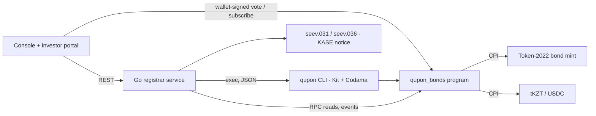

# Qupon — technical overview

Corporate-actions engine for tokenized bonds on Solana: **identify holders → calculate entitlements → execute settlement → record on-chain**. Everything below runs on devnet: program [`QPN1zdVm6PgMdJo4YxemtDxxbUczqaAk9sDsJQsJ2qd`](https://explorer.solana.com/address/QPN1zdVm6PgMdJo4YxemtDxxbUczqaAk9sDsJQsJ2qd?cluster=devnet) (Anchor 1.2; verifiable build and on-chain IDL — [`reports/verified-build.md`](../reports/verified-build.md)). One command (`make demo`) runs coupon, redemption, bondholder meeting → terms change and early redemption; [`reports/demo-full.md`](../reports/demo-full.md) links all 69 transactions.

## 1. Architecture



All corporate-action **state and rules live on-chain**; off-chain code only cranks instructions (in batches), reconciles and renders documents. The Go service re-reads the chain and recomputes every entitlement and the snapshot hash independently (`GET /actions/{pda}/reconcile`).

| Account (PDA) | Seeds | Holds |
|---|---|---|
| `Series` | `["series", mint]` | terms (face, rate, frequency, day count, dates), authorities, schedule, status, the one open action |
| `Investor` | `["investor", series, owner]` | KYC attributes (SIMULATED), tax rate, bond and cash accounts, active/suspended |
| `CorporateAction` | `["action", series, index]` | kind (INTR/REDM/MCAL/PCAL/BMET), dates, rate, per-unit amounts, escrow, status, totals, snapshot hash, votes |
| `Entitlement` | `["entitlement", action, owner]` | units at the record date, gross/tax/net/principal, paid/retired, vote |

## 2. Record-date logic

Kazakhstan rule (Law "On the Securities Market", art. 31): the coupon goes to holders registered **at the start of the last day of the period**. Qupon makes that moment deterministic:

1. `announce_action` — the program re-derives accrual days from the civil period dates, ties them to Almaty-midnight timestamps, and requires the period start, end and rate to match the series schedule. Only one action can be open per series.
2. `strike_record` — allowed only when `clock ≥ record_at`; it **pauses the Token-2022 mint**, so no transfer, mint or burn can change the register.
3. `snapshot_batch` (≤ 8 holders per tx, idempotent) — writes one `Entitlement` per holder from the frozen balances and chains `sha256(prev ‖ owner ‖ units_le)`.
4. `finalize_snapshot` — **Σ snapshotted units must equal the mint supply** (nobody can be missed while transfers are paused); the rounding bound below must hold.

Only registered wallets can ever hold the bond: token accounts are created frozen (`DefaultAccountState`), and `register_investor` thaws them.

## 3. Entitlement calculations

```
gross     = round_half_up(units × face × rate_bps × accrual_days, 10 000 × basis)   basis 360 (30E/360) or 365 (ACT/365)
tax       = round_half_up(gross × tax_bps, 10 000)        net = gross − tax
principal = units × face  (REDM, MCAL; PCAL × factor_bps / 10 000)        payout = net + principal
```

Integer minor units, u128 intermediates, rounding **once per holder**, and Σ gross within ½ minor unit per holder of supply × the exact per-unit coupon. The same `no_std` Rust crate runs inside the program; Go and TypeScript mirrors pass the same vectors (`fixtures/entitlement.json`).

**The brief's worked example on devnet.** Face 1,000 KZT, 10% annual, semi-annual; 10 / 25 / 65 bonds:

| Step | Devnet transaction |
|---|---|
| Announce INTR #1 (2026-07-03 → 2027-01-03, 180 days) | [announce](https://explorer.solana.com/tx/4NmLEXBSEaiUJw6hs3245AJmFkFSWjStRZTqMaV4VgWZ4iFvmg9FdJoiEfhKBoTQYskF955MvkC1pFthq6EvhEQN?cluster=devnet) |
| Record date — mint paused | [strike](https://explorer.solana.com/tx/4iAutgTMjpM7tG6oct8H7Cb47UedvLf9sqE1HyhYVUiKXFXEF9g4SVS4mLpp5Dhi1SJ3UWr3CVERNhTnzyV6TAZZ?cluster=devnet) |
| Snapshot: 10 → **500.00**, 25 → 1,250.00, 65 → 3,250.00 KZT | [snapshot](https://explorer.solana.com/tx/WoXRQDcwBm2DoykGDCKredgUZKWdJ3hv6tRieUXzRV2VVG8WSqDUBZWY29ktJuoWF7P6ASbTPzdh9LmcFuj7fjM?cluster=devnet) · [finalize](https://explorer.solana.com/tx/VLThaXxfuqgncV5jBg4KMw3DtDsiGp9qd2BeA1nswMGroECgoCGa4qqkrK44vAK1HzthWpz78UuJJsc9yNV4Myv?cluster=devnet) |
| Issuer funds 5,000.00 → holders paid → reconciled, register resumed | [fund](https://explorer.solana.com/tx/SbWkZPAzaQVWDgrg7b9FNyQdMnAP5sB632yxpSpr9WL4nkmUCzMrH5UGnQmgjJUYiAHx8ZgHyVYmKKJMgL69XtL?cluster=devnet) · [pay](https://explorer.solana.com/tx/4timJdNAASBt2MTVgWR9ryUxk5SAeaDdKxw3dFEwdv1KDEnWKmYNtzy4ivY3hpVrX8nqeDG3fA4ooaHumQUFJzye?cluster=devnet) · [complete](https://explorer.solana.com/tx/31LCKEnF9aBkfHYPDvcceHDcQ1YigKYqF6sV8C6uuJK5RWKQdyk6XLKXGsWTsM8t4kHz3TuAF61zjoyrmDQ4WWbZ?cluster=devnet) |
| At maturity: principal 10,000 + final coupon (after the meeting raised the rate to 12%: 600) = **10,600.00** | [pay](https://explorer.solana.com/tx/5dGhg7BjH5pFrVX2gGpGXVUFua94FmDQrexZ4TvvKzuC9q3c2TTz9kkB7biiKK51gkU8xhr5DCs8EdYkV594yMQR?cluster=devnet) · [burn](https://explorer.solana.com/tx/5EyyhishaQbpTAG4xP6FeY7HGBsk8Wv4tibn5RqqToyvvzixYVUFKvUSk1XCFcuiJ17sMHJoZmWf7SZyuEFAC8pd?cluster=devnet) · [close](https://explorer.solana.com/tx/3a7g7HtY68C1t4kEhLYJCnKak9fWVPcbEH4YaQoSbPcPBczhyfLrp9Nv2Lr5dTQ9d7EgAXk5HWmby3XhVkvsM2N6?cluster=devnet) |

The literal brief figures (500 and 10,000 + 500) are also asserted by the tests `coupon_10_bonds_is_500` and `redemption_pays_principal_plus_final_coupon` (`programs/qupon_bonds/tests/brief.rs`).

## 4. Settlement flow

1. `fund_action` — the issuer (or paying agent) moves cash into an escrow owned by the **action PDA**; the action is `Funded` only when the escrow covers net + tax + principal.
2. `pay_batch` (crank, idempotent) — pays each holder's **registered** cash account and the tax vault; each entitlement is paid once.
3. `complete_action` — reconciliation (every holder paid, `total_paid == total_net + total_principal`), then the mint resumes; coupons advance the schedule (computed from the issue date, so month-end dates never drift).
4. Redemptions: `retire_batch` burns every unit through the permanent delegate (suspended holders are thawed first), then `close_series` requires supply 0, writes `status=REDEEMED` to the token metadata and closes the mint.
5. Bondholder meeting: `cast_vote` weighted by snapshot units → `finalize_meeting` (quorum and approval are series configuration, not asserted as law) → `apply_terms_change` updates the rate on the series and in the token metadata; the registrar's signature stands in for the ARDFM registration (SIMULATED).

Records: 18 event types (one per transition), ISO 20022 `seev.031`/`seev.036` and a KASE-style EN/RU notice generated from chain state.

## 5. Solana components

**Token-2022 bond mint** (0 decimals, 1 token = 1 bond) with `MetadataPointer` + `TokenMetadata`, `DefaultAccountState = Frozen`, `PermanentDelegate`, `Pausable`, `MintCloseAuthority`; mint, freeze, pause, close authorities and the permanent delegate are the series PDA. `init_series` rejects any other extension or authority. Cash: Circle devnet USDC (SPL Token) or test tKZT (Token-2022) via `token_interface`.

| Instruction | Signer | Effect |
|---|---|---|
| `init_series` | registrar | validate the mint, create Series + tax vault |
| `register_investor` / `suspend_investor` / `reinstate_investor` | registrar | KYC record, thaw / freeze the bond account |
| `subscribe` / `issue_units` | investor / issuer | atomic DvP at par / free allocation |
| `announce_action` / `cancel_action` | registrar (issuer for BMET) / registrar | create the action, verify the math on-chain |
| `strike_record` / `snapshot_batch` / `finalize_snapshot` | registrar or paying agent | record date (pause), snapshot, supply check |
| `fund_action` / `pay_batch` / `complete_action` | issuer or paying agent / operator / operator | escrow, payouts, reconcile + resume |
| `retire_batch` / `close_series` | operator / registrar | burn via permanent delegate, close the mint |
| `cast_vote` / `finalize_meeting` / `apply_terms_change` | investor / registrar / registrar | meeting and terms change |

Security model and audit notes: [`docs/SECURITY_NOTES.md`](SECURITY_NOTES.md). Tests: 50 program tests (LiteSVM integration + unit) including the brief suite; Go and TS mirrors of the math; `make verify` gates every merge.

## Implemented vs simulated

| Element | Status |
|---|---|
| Bond token, holder registry, record date, entitlement math, coupon payment, redemption, burn/close, voting, terms change, on-chain events | **Implemented on Solana devnet** |
| Cash leg | Real token transfers: USDC devnet (Circle) and test tKZT (Token-2022); fiat KZT and Evo/digital tenge are **simulated** by our mint |
| KYC | **Simulated**: registrar records attributes (type, residency, tax rate); no KYC provider integrated |
| ISO 20022 seev.031 / seev.036 | Generated from on-chain state; Swift network delivery **simulated** (downloadable files) |
| ARDFM registration of terms change | **Simulated** by registrar signature step |
| KASE disclosure notice | Generated automatically; publication on kase.kz **not** integrated |
| Multisig issuer approval (Squads), SAS KYC attestation | Optional T2; if not shipped, listed as roadmap |

## Limitations and next steps

Devnet only; time is compressed in the demo (record date ≈ 45 s after announcement, real civil dates in the math); XSD validation of the ISO files is out of scope; tax-vault remittance and escrow refunds are not implemented; single-key registrar. Next: Token ACL (sRFC-37) for the registry, Squads multisig for issuer/registrar, Solana Attestation Service for KYC, confidential coupon amounts, a regulated cash leg (digital tenge or bank deposit token) for mainnet.
