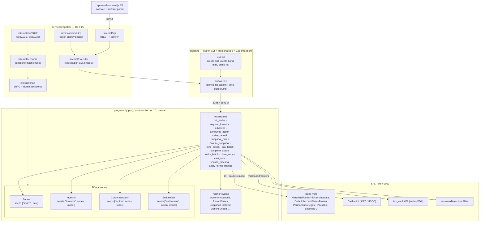
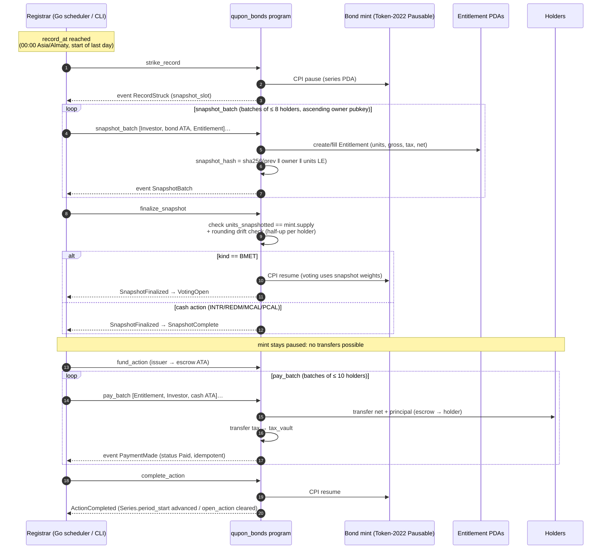

# Qupon diagrams

Source `.mmd` files live next to this README; the same diagrams are embedded below as ```mermaid blocks so GitHub renders them natively.

## Architecture



## Corporate-action state machine

```mermaid
stateDiagram-v2
    direction LR
    [*] --> Announced: announce_action<br/>(registrar/issuer)

    Announced --> Cancelled: cancel_action
    Cancelled --> [*]

    Announced --> RecordStruck: strike_record<br/>(CPI pause mint, ≥ record_at)
    RecordStruck --> RecordStruck: snapshot_batch*<br/>(≤8 holders/tx, idempotent)
    RecordStruck --> SnapshotComplete: finalize_snapshot<br/>(units == supply, rounding check)

    SnapshotComplete --> Funded: fund_action*<br/>(escrow ≥ total)
    Funded --> Settling: pay_batch*<br/>(≤10 holders/tx)
    Settling --> Completed: complete_action<br/>(CPI resume; INTR)

    Settling --> Retiring: complete_action<br/>(REDM / MCAL / PCAL)
    Retiring --> Retiring: retire_batch*<br/>(permanent-delegate burn)
    Retiring --> Completed: close_series<br/>(supply == 0, Series → Closed)

    SnapshotComplete --> VotingOpen: finalize_snapshot<br/>(BMET: CPI resume)
    VotingOpen --> VotingOpen: cast_vote*<br/>(weight = snapshot units)
    VotingOpen --> Finalized: finalize_meeting<br/>(quorum + approval)
    Finalized --> Completed: apply_terms_change<br/>(Approved only; CHAN)

    Completed --> [*]
    note right of Announced
        One open action per Series
        (open_action is None required)
    end note
```



## Record-date snapshot sequence


