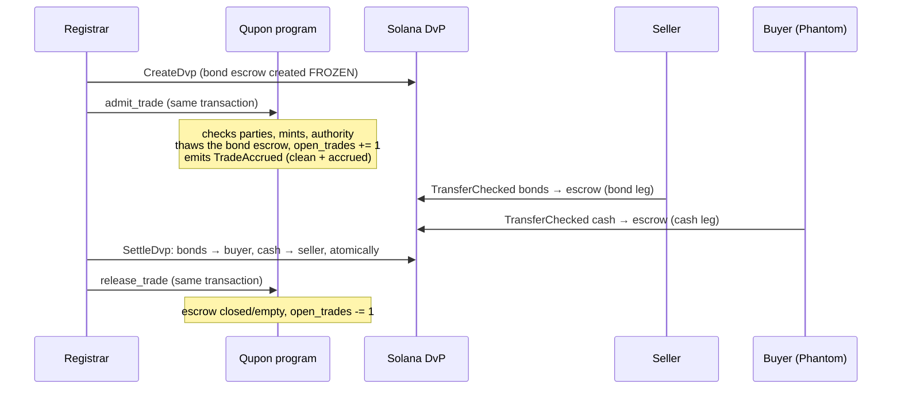

# How Qupon uses DvP (delivery versus payment)

[Русская версия](DVP.ru.md) · [User scenarios](USAGE.en.md) · [README](../../README.md)

DvP — *delivery versus payment* — means the bonds and the cash change hands together or not at all: nobody can end up
with the cash without delivering the bonds, or with the bonds without paying. Qupon uses DvP in two places:

| | Primary placement (subscription) | Secondary trade |
| --- | --- | --- |
| Who | investor buys new bonds from the issuer at par | two registered investors trade existing bonds |
| Settles through | Qupon's own `subscribe` instruction | the Solana Foundation's **Solana DvP** program `dvp34bdbcEm4f4FCUjGV4mDAkDshaQR4LkK8fdcsyZq` |
| Atomic unit | one instruction: cash investor → issuer **and** bonds minted to the investor | `SettleDvp`: both escrowed legs move in one transaction |
| Who signs | the investor (Phantom) | registrar creates/settles; each investor funds its own leg (Phantom) |
| In the UI | Investor → **Placement → Subscribe (DvP)** | Registrar → **Trades**; Investor → **Portfolio → Open trades** |

Everything below was run on devnet on 2026-10-12 through the web app, the investor signing in the real Phantom
extension; transaction links are in [§6](#6-the-devnet-run-behind-this-page).

## 1. Primary placement: `subscribe` is DvP by construction

`subscribe` (program `QPN1zdVm6PgMdJo4YxemtDxxbUczqaAk9sDsJQsJ2qd`) takes the investor's cash and mints the bonds in
the **same instruction**:

1. `TransferChecked` — `units × face value` of the series' cash asset (tKZT, USDC, …) from the investor's registered
   cash account to the issuer's cash account;
2. `MintTo` — `units` bonds from the series PDA (the mint authority) to the investor's bond account.

If either fails, the whole transaction fails: no cash without bonds, no bonds without cash. The bond account must
belong to a **registered** investor — bond mints are *frozen by default*, only the registrar thaws a KYC'd wallet —
so an unregistered wallet cannot subscribe. Walkthrough with screenshots: [User scenarios §8](USAGE.en.md#8-investor-test-cash-and-subscription-with-phantom).

## 2. Secondary trades: the Solana DvP program, governed by Qupon

On 6 October 2026 the Solana Foundation released **Solana DvP**: an audited program for atomic settlement of
tokenized securities. Each party moves its leg into an escrow with a plain token transfer; a **settlement
authority** then moves both legs in one transaction (or cancels and refunds both). It is a settlement engine — it
knows nothing about KYC, registers or record dates.

Qupon is the servicing layer on top. It never moves the trade's tokens itself; it decides **which DvP escrow may hold
a regulated bond** and makes sure a trade in flight can never break a corporate action.

### 2.1 Roles

| Role | Does |
| --- | --- |
| Registrar (or paying agent) | the trade's **settlement authority**: creates the trade, settles or cancels it, releases it |
| Seller | registered investor; funds the **bond leg** (bonds → escrow) |
| Buyer | registered investor; funds the **cash leg** (cash → escrow) |
| Qupon program | `admit_trade` / `release_trade`: lets the escrow hold bonds, tracks open trades, guards the record date |
| Solana DvP program | `CreateDvp`, `SettleDvp`, `CancelDvp`, `ReclaimDvp`: escrows and atomic settlement |

### 2.2 Lifecycle

| Step | Who | Instructions (one transaction each) | UI |
| --- | --- | --- | --- |
| 1. Create | registrar | `CreateDvp` + `admit_trade` | Registrar → Trades → **New trade** → **Create trade** |
| 2. Fund bond leg | seller | `TransferChecked` (bonds → escrow; the transfer hook runs) | Portfolio → Open trades → **Deliver N bonds** |
| 3. Fund cash leg | buyer | `TransferChecked` (cash → escrow) | Portfolio → Open trades → **Pay X ₸** (Phantom) |
| 4a. Settle | registrar | `SettleDvp` + `release_trade` | Trades → **Settle** (enabled when both legs are *in escrow*) |
| 4b. Cancel | registrar | `CancelDvp` (refunds both legs) + `release_trade` | Trades → **Cancel** |
| 4c. Forced release | registrar | `release_trade(force = true)`; buyer takes the cash back with `ReclaimDvp` | Trades → **Return bonds to seller** |

The CLI does the same steps: `ops/qupon trade:create | trade:fund | trade:settle | trade:cancel | trade:list`; the
create, settle and cancel commands always pair the DvP instruction with `admit_trade` / `release_trade`, so no command
that reports success leaves a trade admitted.

### 2.3 What `admit_trade` checks

The bond escrow is the associated token account of the DvP record. Because the bond mint has
`DefaultAccountState = Frozen`, `CreateDvp` creates it **frozen** — it cannot receive bonds until Qupon thaws it.
`admit_trade` (signed by the registrar or paying agent) thaws it only if **all** of these hold, otherwise
`InvalidTrade`:

- the trade is bonds of **this series** against **this series' cash asset**;
- seller and buyer are **Active** registered investors of the series (KYC'd, not suspended);
- the legs are delivered to the parties themselves (bonds → the buyer's registered bond account, cash → the seller);
- the settlement authority is this series' registrar or paying agent;
- the series is Active, the mint is not paused (`MintPaused`), and no redemption has locked the register
  (`RecordLocked`).

So DvP can never deliver a bond to an unregistered wallet: delivery needs the buyer's own thawed account, which only
exists after KYC.

### 2.4 Price and accrued interest

The cash amount is agreed by the parties (the UI proposes *cash at par = units × face value*). At admission Qupon
splits it on-chain into **clean price + accrued interest** and emits `TradeAccrued` (units, cash amount, settlement
date, accrued days, accrued, clean): accrued runs from the current period start with the series' day count, rounded
half-up once per trade. Between an open coupon's record date and its payment the accrued is **negative** — the seller
keeps that coupon (ex-coupon). The sandbox has a one-click **Trade 5 bonds** with accrued interest.

### 2.5 The record-date guard: a trade in flight never costs anyone a coupon

Units sitting in a DvP escrow belong to neither party's register position. A coupon snapshot taken while a trade is
open would miss them (and the snapshot must equal the mint supply). So:

- Every admitted trade increments `Series.open_trades`; `release_trade` decrements it.
- On series that pause the mint at the record date, `strike_record` fails with **`TradesInFlight`** ("Admitted
  secondary trades are open; settle or cancel and release them before the record date") while any trade is open. A
  paused mint would also block `SettleDvp`, `CancelDvp` and `ReclaimDvp`.
- On series with the transfer-hook record-date gate the register never pauses; an admitted trade must be settled or
  unwound **before** `record_at`, after which the gate is armed. `make demo-trade` shows exactly this: a second trade
  funded only by the seller is cancelled before the record date, the seller stays the holder of record, and the coupon
  is paid on 15 / 25 / 60 bonds.
- `release_trade` requires the escrow to be closed or empty (`TradeStillOpen` otherwise) and freezes an escrow that
  still exists, so no unit can slip into it afterwards.
- If `CancelDvp` cannot run (a refund account is missing or frozen), `release_trade(force = true)` returns the escrowed
  bonds to the seller's registered bond account using the series' permanent-delegate authority; the buyer reclaims the
  cash with `ReclaimDvp`. A record date never depends on a counterparty.

## 3. Step by step in the web app

1. **Registrar → Trades → New trade** (series selector on top). Pick seller and buyer (registered investors of the
   series, with their holdings), the number of bonds (up to what the seller holds); the cash amount at par is shown.
   **Create trade** → the row appears as *Awaiting funding*, both legs *not funded*.

   

   
2. **Buyer → Portfolio → Open trades**: *Almaty-Power · You buy 2 bonds for 2,000.00 ₸*, counterparty, **Pay 2,000.00 ₸**.
   Phantom shows the balance change (−2,000 tKZT) → **Confirm**. The row now says *Your leg is in escrow · Waiting for
   the other party*.

   

   
3. **Seller → Portfolio → Open trades → Deliver 2 bonds** (for the custodial demo investor the registrar also has
   **Fund both legs (demo)**).
4. **Registrar → Trades**: both legs *in escrow*, status *Ready to settle* → **Settle**. One transaction moves 2 bonds
   to the buyer and 2,000 tKZT to the seller, closes the escrows and releases the trade; the trade leaves the open
   list and the series no longer blocks its next record date.

   

   

Instead of settling, **Cancel** returns both legs (*Both legs go back to their owners in one transaction and the trade
stops blocking the record date*), and **Return bonds to seller** is the forced release.

## 4. Errors you may see

| Error | Meaning |
| --- | --- |
| `InvalidTrade` | not a DvP trade of this series between its registered investors under our settlement authority |
| `TradesInFlight` | a record date was struck while trades are open — settle or cancel them first |
| `TradeStillOpen` | `release_trade` on an escrow that still holds units — settle, cancel, or force the release |
| `RecordLocked` | a redemption has locked the register; no new trades |
| `MintPaused` | the mint is paused for a record date; DvP cannot move the bond |

## 5. What is and is not included

Included and running on devnet: admission, both legs funded by the parties' own wallets, atomic settlement,
cancellation, forced release, accrued-interest split, record-date guard. **Not** part of Qupon: order matching, price
discovery and a trading venue — the registrar records a trade the two investors have already agreed on.

## 6. The devnet run behind this page

Series **Almaty-Power**, seller the demo investor `6g4F…9rdC`, buyer the Phantom wallet `65SQ…YeGQ`, 2 bonds for
2,000.00 tKZT. After settlement the buyer's wallet holds 2 Almaty-Power bonds on-chain.

| Step | Transaction |
| --- | --- |
| DvP record (`SwapDvp`) | [`ELfw…31o`](https://explorer.solana.com/address/ELfwUyn7RSACwRfPM83bw364mzEBVutaawL4nGJqR31o?cluster=devnet) |
| `CreateDvp` + `admit_trade` (registrar) | [`4qg4…nNxz`](https://explorer.solana.com/tx/4qg49ixQBSGaTzidhRxkUFaTCkzFFUB9kNegK6XxZv3u9JbHiAGddmVSUwuHbtpQS8BPEVo1EPUWpR64tEusnNxz?cluster=devnet) |
| cash leg: 2,000 tKZT → escrow (buyer, Phantom) | [`65qS…uLnX`](https://explorer.solana.com/tx/65qSV1hD7ztF1xfcpcdNb6vBq52vroJ7ox8oiSCf8xaDcSDiUwKe4JierAwcK8U5ynks6wPZsBZQTqJVXZPcuLnX?cluster=devnet) |
| bond leg: 2 bonds → escrow (seller) | [`3eZd…wQUty`](https://explorer.solana.com/tx/3eZdo6YMjUpbB3c9CwqoidKAFstoUkVDkBXzij5T81LkFTq1MvjKQ6Ejh9q85YMoGYbT7nHDQpoKyivbzxBwQUty?cluster=devnet) |
| `SettleDvp` + `release_trade` (registrar) — 2× `TransferChecked`, transfer-hook `Execute`, escrows closed, `ReleaseTrade` | [`3zwj…gs49`](https://explorer.solana.com/tx/3zwjEV7HmYDSvpsHaKiwq7i5yDvhiKNkR7SkpqQFK8nAgs8x468G1AauK8BGuE3m9hEh4VV4tPDezEmgdLxrgs49?cluster=devnet) |

A scripted run with the record-date guard (a second trade cancelled before the record date, coupon paid on the
post-trade register): [`reports/demo-trade.md`](../../reports/demo-trade.md) (`make demo-trade`). Domain rules:
[`docs/03-domain.md` §4a](../03-domain.md); program code: `programs/qupon_bonds/src/instructions/trade.rs`; CLI:
`clients/ts/src/commands/trade.ts`.
