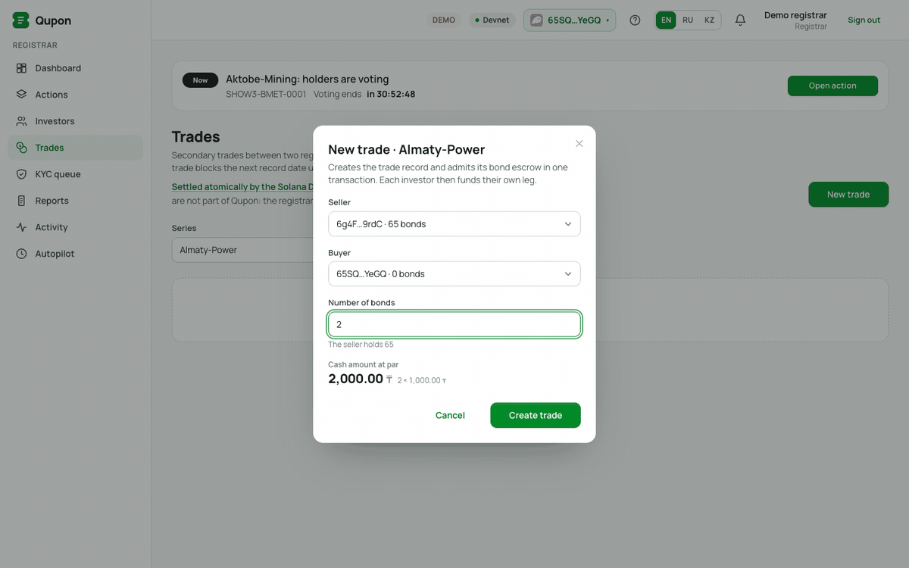
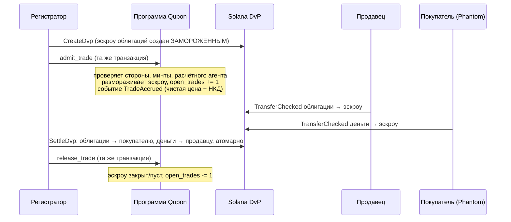
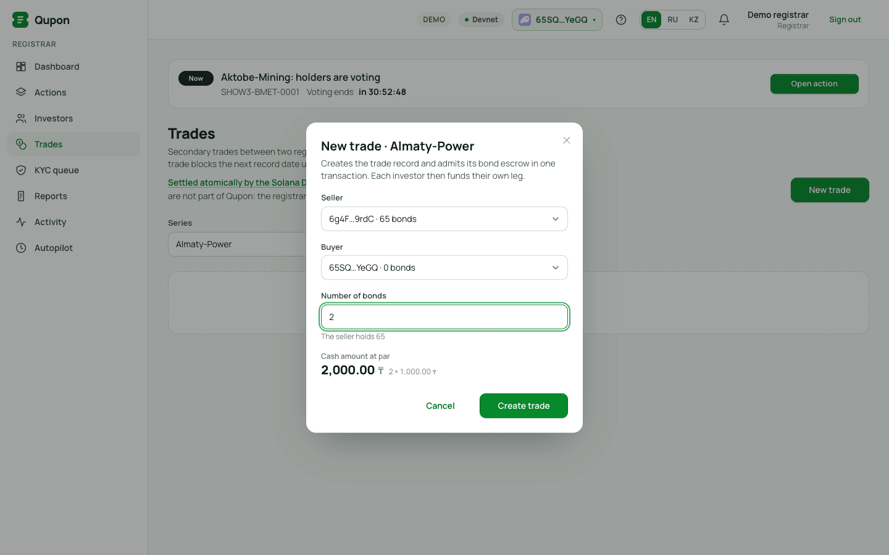
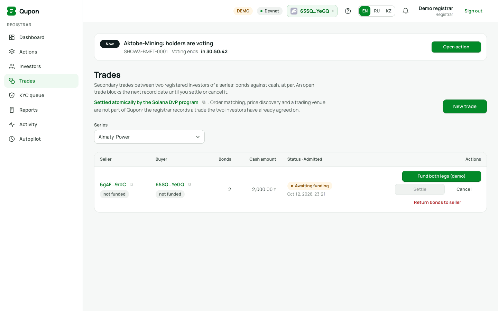
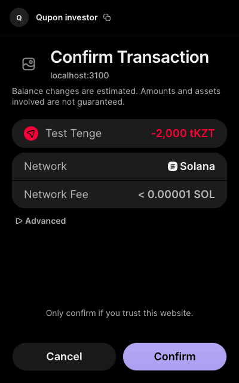
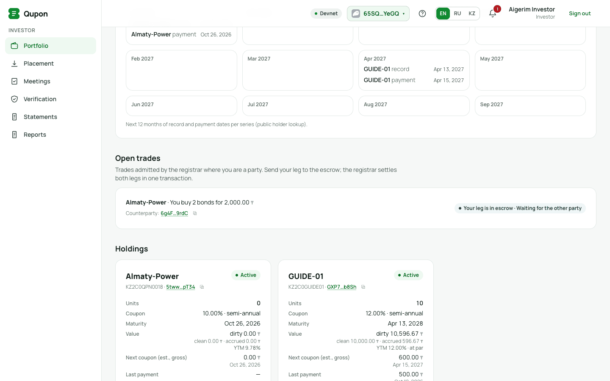
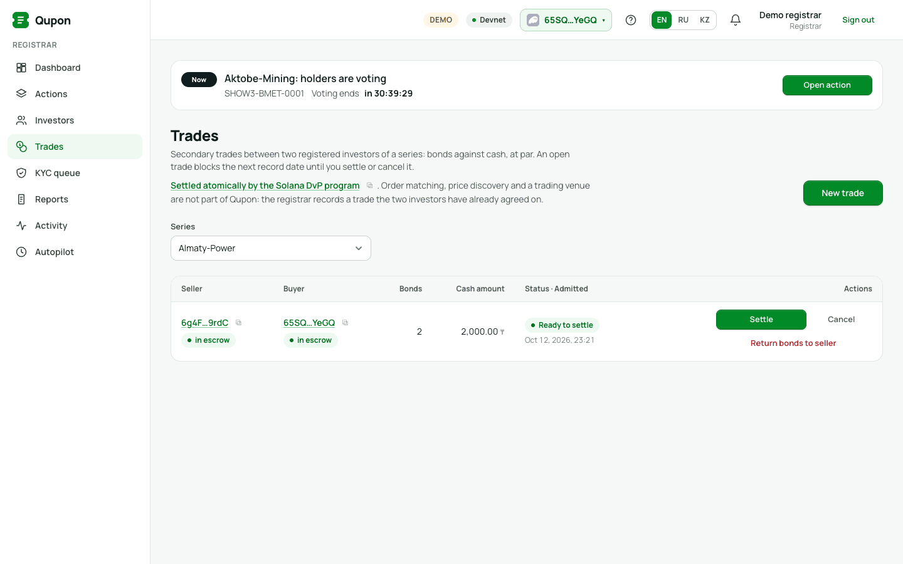
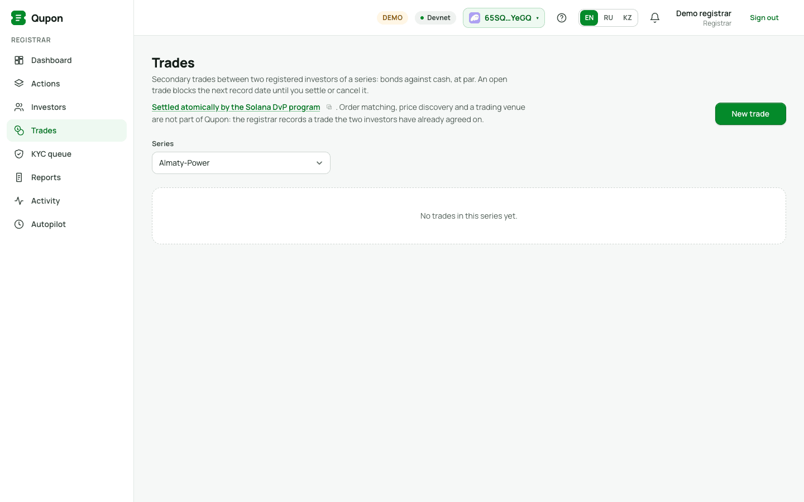

# Как Qupon использует DvP (поставка против платежа)

[English version](DVP.en.md) · [Сценарии использования](USAGE.ru.md) · [README](../../README.md)

DvP — *delivery versus payment*, «поставка против платежа»: облигации и деньги переходят из рук в руки одновременно
или не переходят вовсе. Никто не может получить деньги, не поставив облигации, или получить облигации, не заплатив.
В Qupon DvP используется в двух местах:

| | Первичное размещение (подписка) | Вторичная сделка |
| --- | --- | --- |
| Кто | инвестор покупает новые облигации у эмитента по номиналу | два зарегистрированных инвестора торгуют существующими облигациями |
| Через что | собственная инструкция Qupon `subscribe` | программа **Solana DvP** от Solana Foundation `dvp34bdbcEm4f4FCUjGV4mDAkDshaQR4LkK8fdcsyZq` |
| Атомарная единица | одна инструкция: деньги инвестора → эмитенту **и** облигации выпускаются инвестору | `SettleDvp`: обе ноги из эскроу переходят одной транзакцией |
| Кто подписывает | инвестор (Phantom) | регистратор создаёт и рассчитывает; каждый инвестор пополняет свою ногу (Phantom) |
| В интерфейсе | Инвестор → **Placement → Subscribe (DvP)** | Регистратор → **Trades**; Инвестор → **Portfolio → Open trades** |

Всё ниже выполнено на devnet 12.10.2026 через веб-приложение, инвестор подписывал в настоящем расширении Phantom;
ссылки на транзакции — в [§6](#6-devnet-прогон-этой-страницы).

## 1. Первичное размещение: `subscribe` — DvP по построению

`subscribe` (программа `QPN1zdVm6PgMdJo4YxemtDxxbUczqaAk9sDsJQsJ2qd`) берёт деньги инвестора и выпускает облигации
в **одной инструкции**:

1. `TransferChecked` — `число облигаций × номинал` в денежном активе выпуска (tKZT, USDC, …) со
   зарегистрированного денежного счёта инвестора на счёт эмитента;
2. `MintTo` — облигации от PDA выпуска (владелец права выпуска) на счёт облигаций инвестора.

Если любая часть не проходит, отменяется вся транзакция: нет денег без облигаций и облигаций без денег. Счёт
облигаций должен принадлежать **зарегистрированному** инвестору — минты облигаций *заморожены по умолчанию*, и только
регистратор размораживает кошелёк после KYC, — поэтому незарегистрированный кошелёк подписаться не может. Пошагово со
скриншотами: [Сценарии §8](USAGE.ru.md#8-инвестор-тестовые-деньги-и-подписка-через-phantom).

## 2. Вторичные сделки: программа Solana DvP под управлением Qupon

6 октября 2026 года Solana Foundation выпустил **Solana DvP** — прошедшую аудит программу атомарного расчёта по
токенизированным ценным бумагам. Каждая сторона переводит свою ногу в эскроу обычным переводом токенов; затем
**расчётный агент** (settlement authority) переводит обе ноги одной транзакцией (или отменяет и возвращает обе). Это
движок расчётов: он ничего не знает о KYC, реестрах и датах фиксации.

Qupon — слой обслуживания поверх него. Он сам не двигает токены сделки; он решает, **какой эскроу DvP может держать
регулируемую облигацию**, и гарантирует, что сделка «в полёте» не сломает корпоративное действие.

### 2.1 Роли

| Роль | Что делает |
| --- | --- |
| Регистратор (или платёжный агент) | **расчётный агент** сделки: создаёт, рассчитывает или отменяет и освобождает её |
| Продавец | зарегистрированный инвестор; пополняет **ногу облигаций** (облигации → эскроу) |
| Покупатель | зарегистрированный инвестор; пополняет **денежную ногу** (деньги → эскроу) |
| Программа Qupon | `admit_trade` / `release_trade`: разрешает эскроу держать облигации, считает открытые сделки, охраняет дату фиксации |
| Программа Solana DvP | `CreateDvp`, `SettleDvp`, `CancelDvp`, `ReclaimDvp`: эскроу и атомарный расчёт |

### 2.2 Жизненный цикл

| Шаг | Кто | Инструкции (по одной транзакции) | Интерфейс |
| --- | --- | --- | --- |
| 1. Создание | регистратор | `CreateDvp` + `admit_trade` | Регистратор → Trades → **New trade** → **Create trade** |
| 2. Нога облигаций | продавец | `TransferChecked` (облигации → эскроу; срабатывает transfer hook) | Portfolio → Open trades → **Deliver N bonds** |
| 3. Денежная нога | покупатель | `TransferChecked` (деньги → эскроу) | Portfolio → Open trades → **Pay X ₸** (Phantom) |
| 4a. Расчёт | регистратор | `SettleDvp` + `release_trade` | Trades → **Settle** (активна, когда обе ноги *in escrow*) |
| 4b. Отмена | регистратор | `CancelDvp` (возврат обеих ног) + `release_trade` | Trades → **Cancel** |
| 4c. Принудительное освобождение | регистратор | `release_trade(force = true)`; покупатель забирает деньги через `ReclaimDvp` | Trades → **Return bonds to seller** |

CLI делает то же: `ops/qupon trade:create | trade:fund | trade:settle | trade:cancel | trade:list`; создание, расчёт
и отмена всегда объединяют инструкцию DvP с `admit_trade` / `release_trade`, поэтому ни одна успешная команда не
оставляет сделку допущенной.

### 2.3 Что проверяет `admit_trade`

Эскроу облигаций — ассоциированный токен-счёт записи DvP. Поскольку у минта облигаций `DefaultAccountState = Frozen`,
`CreateDvp` создаёт его **замороженным** — он не может принять облигации, пока Qupon его не разморозит.
`admit_trade` (подписывает регистратор или платёжный агент) размораживает его, только если выполнено **всё**, иначе
`InvalidTrade`:

- сделка — облигации **этого выпуска** против **денежного актива этого выпуска**;
- продавец и покупатель — **активные** зарегистрированные инвесторы выпуска (прошли KYC, не приостановлены);
- ноги поставляются самим сторонам (облигации → на зарегистрированный счёт покупателя, деньги → продавцу);
- расчётный агент — регистратор или платёжный агент этого выпуска;
- выпуск активен, минт не на паузе (`MintPaused`), погашение не заблокировало реестр (`RecordLocked`).

Поэтому DvP никогда не поставит облигацию на незарегистрированный кошелёк: для поставки нужен собственный
размороженный счёт покупателя, а он появляется только после KYC.

### 2.4 Цена и накопленный купонный доход (НКД)

Сумму сделки определяют стороны (интерфейс предлагает *по номиналу = число × номинал*). При допуске Qupon в блокчейне
делит её на **чистую цену + НКД** и выпускает событие `TradeAccrued` (единицы, сумма, дата расчёта, дни начисления,
НКД, чистая цена): НКД считается от начала текущего купонного периода по базису выпуска, с округлением half-up один
раз на сделку. Между датой фиксации открытого купона и его выплатой НКД **отрицательный** — купон остаётся у продавца
(ex-coupon). В песочнице есть кнопка **Trade 5 bonds** с НКД.

### 2.5 Защита даты фиксации: сделка «в полёте» никому не стоит купона

Облигации в эскроу DvP не принадлежат позиции ни одной из сторон в реестре. Снимок реестра для купона, сделанный при
открытой сделке, их бы пропустил (а снимок обязан равняться эмиссии). Поэтому:

- каждая допущенная сделка увеличивает `Series.open_trades`, `release_trade` — уменьшает;
- у выпусков, где на дату фиксации ставится пауза минта, `strike_record` падает с **`TradesInFlight`** («Admitted
  secondary trades are open; settle or cancel and release them before the record date»), пока есть открытые сделки.
  Пауза минта заблокировала бы и `SettleDvp`, `CancelDvp`, `ReclaimDvp`;
- у выпусков с transfer-hook реестр не останавливается; допущенную сделку нужно рассчитать или отменить **до**
  `record_at`, после чего «шлагбаум» взведён. `make demo-trade` показывает ровно это: вторая сделка, оплаченная только
  продавцом, отменяется до даты фиксации, продавец остаётся держателем на дату фиксации, купон выплачивается на
  15 / 25 / 60 облигаций;
- `release_trade` требует, чтобы эскроу был закрыт или пуст (`TradeStillOpen` иначе), и замораживает оставшийся
  эскроу — после этого в него не попадёт ни одна облигация;
- если `CancelDvp` выполнить нельзя (счёт возврата отсутствует или заморожен), `release_trade(force = true)` возвращает
  облигации из эскроу на зарегистрированный счёт продавца правом permanent delegate выпуска; покупатель забирает деньги
  через `ReclaimDvp`. Дата фиксации никогда не зависит от контрагента.

## 3. Пошагово в веб-приложении

1. **Регистратор → Trades → New trade** (выпуск выбирается сверху). Продавец и покупатель (зарегистрированные
   инвесторы выпуска с их позициями), число облигаций (не больше, чем у продавца); сумма по номиналу показана.
   **Create trade** → строка *Awaiting funding*, обе ноги *not funded*.

   

   
2. **Покупатель → Portfolio → Open trades**: *Almaty-Power · You buy 2 bonds for 2,000.00 ₸*, контрагент,
   **Pay 2,000.00 ₸**. Phantom показывает изменение баланса (−2,000 tKZT) → **Confirm**. Строка: *Your leg is in escrow ·
   Waiting for the other party*.

   

   
3. **Продавец → Portfolio → Open trades → Deliver 2 bonds** (для кастодиального демо-инвестора у регистратора есть
   **Fund both legs (demo)**).
4. **Регистратор → Trades**: обе ноги *in escrow*, статус *Ready to settle* → **Settle**. Одна транзакция переводит 2
   облигации покупателю и 2 000 tKZT продавцу, закрывает эскроу и освобождает сделку; она уходит из списка открытых, и
   выпуск больше не блокирует следующую дату фиксации.

   

   

Вместо расчёта **Cancel** возвращает обе ноги владельцам одной транзакцией, а **Return bonds to seller** —
принудительное освобождение.

## 4. Возможные ошибки

| Ошибка | Смысл |
| --- | --- |
| `InvalidTrade` | это не сделка DvP по этому выпуску между его зарегистрированными инвесторами под нашим расчётным агентом |
| `TradesInFlight` | дату фиксации пытаются зафиксировать при открытых сделках — сначала рассчитайте или отмените их |
| `TradeStillOpen` | `release_trade` при эскроу, в котором ещё есть облигации — рассчитайте, отмените или освободите принудительно |
| `RecordLocked` | погашение заблокировало реестр; новых сделок нет |
| `MintPaused` | минт на паузе ради даты фиксации; DvP не может перевести облигацию |

## 5. Что входит и что нет

Входит и работает на devnet: допуск, пополнение обеих ног собственными кошельками сторон, атомарный расчёт, отмена,
принудительное освобождение, разделение на чистую цену и НКД, защита даты фиксации. **Не** входит в Qupon:
сопоставление заявок, ценообразование и торговая площадка — регистратор оформляет сделку, о которой стороны уже
договорились.

## 6. Devnet-прогон этой страницы

Выпуск **Almaty-Power**, продавец — демо-инвестор `6g4F…9rdC`, покупатель — кошелёк Phantom `65SQ…YeGQ`, 2 облигации
за 2 000,00 tKZT. После расчёта на кошельке покупателя в блокчейне 2 облигации Almaty-Power.

| Шаг | Транзакция |
| --- | --- |
| Запись DvP (`SwapDvp`) | [`ELfw…31o`](https://explorer.solana.com/address/ELfwUyn7RSACwRfPM83bw364mzEBVutaawL4nGJqR31o?cluster=devnet) |
| `CreateDvp` + `admit_trade` (регистратор) | [`4qg4…nNxz`](https://explorer.solana.com/tx/4qg49ixQBSGaTzidhRxkUFaTCkzFFUB9kNegK6XxZv3u9JbHiAGddmVSUwuHbtpQS8BPEVo1EPUWpR64tEusnNxz?cluster=devnet) |
| денежная нога: 2 000 tKZT → эскроу (покупатель, Phantom) | [`65qS…uLnX`](https://explorer.solana.com/tx/65qSV1hD7ztF1xfcpcdNb6vBq52vroJ7ox8oiSCf8xaDcSDiUwKe4JierAwcK8U5ynks6wPZsBZQTqJVXZPcuLnX?cluster=devnet) |
| нога облигаций: 2 облигации → эскроу (продавец) | [`3eZd…wQUty`](https://explorer.solana.com/tx/3eZdo6YMjUpbB3c9CwqoidKAFstoUkVDkBXzij5T81LkFTq1MvjKQ6Ejh9q85YMoGYbT7nHDQpoKyivbzxBwQUty?cluster=devnet) |
| `SettleDvp` + `release_trade` (регистратор) — 2× `TransferChecked`, transfer-hook `Execute`, эскроу закрыты, `ReleaseTrade` | [`3zwj…gs49`](https://explorer.solana.com/tx/3zwjEV7HmYDSvpsHaKiwq7i5yDvhiKNkR7SkpqQFK8nAgs8x468G1AauK8BGuE3m9hEh4VV4tPDezEmgdLxrgs49?cluster=devnet) |

Скриптовый прогон с защитой даты фиксации (вторая сделка отменена до даты фиксации, купон выплачен по реестру после
сделки): [`reports/demo-trade.md`](../../reports/demo-trade.md) (`make demo-trade`). Правила предметной области:
[`docs/03-domain.md` §4a](../03-domain.md); код программы: `programs/qupon_bonds/src/instructions/trade.rs`; CLI:
`clients/ts/src/commands/trade.ts`.
