# Qupon — пользовательские сценарии с настоящим кошельком

[English version](USAGE.en.md) · [Гайд по установке](SETUP.ru.md) · [README](../../README.md)

Все сценарии Qupon по шагам для каждой роли: посетитель без входа, инвестор со своим кошельком, эмитент,
регистратор и администратор. Скриншоты и GIF сняты за **один непрерывный прогон на Solana devnet 12.10.2026**:
локальный стек (`make up`, [гайд по установке](SETUP.ru.md)) и **настоящее расширение Phantom** (v26.33,
импортированный devnet-ключ, Testnet Mode). Каждое «Confirm» в Phantom ниже подписало реальную devnet-транзакцию;
ссылки на них — в [приложении](#приложение-devnet-транзакции-этого-прогона).

Те же экраны работают на https://qupon.fun — отличается только адрес в браузере. Интерфейс на скриншотах английский;
переключатель **RU** в шапке переводит его целиком (EN / RU / KZ).

## Содержание

1. [Перед началом: devnet-кошелёк](#1-перед-началом-devnet-кошелёк)
2. [Роли и вход](#2-роли-и-вход)
3. [Публичные страницы (без входа)](#3-публичные-страницы-без-входа)
4. [Подключение кошелька](#4-подключение-кошелька)
5. [Эмитент: выпуск облигаций](#5-эмитент-выпуск-облигаций)
6. [Инвестор: аккаунт, привязка кошелька, заявка KYC](#6-инвестор-аккаунт-привязка-кошелька-заявка-kyc)
7. [Регистратор: проверка KYC и регистрация в блокчейне](#7-регистратор-проверка-kyc-и-регистрация-в-блокчейне)
8. [Инвестор: тестовые деньги и подписка через Phantom](#8-инвестор-тестовые-деньги-и-подписка-через-phantom)
9. [Купон: от объявления до выплаты](#9-купон-от-объявления-до-выплаты)
10. [Собрание держателей: голосование через Phantom и смена условий](#10-собрание-держателей-голосование-через-phantom-и-смена-условий)
11. [Инвестор: маршрут выплат (кошелёк или банк)](#11-инвестор-маршрут-выплат-кошелёк-или-банк)
12. [Инвестор: портфель, выписки, отчёты, уведомления](#12-инвестор-портфель-выписки-отчёты-уведомления)
13. [Погашение, досрочное погашение, дефолт и его исправление](#13-погашение-досрочное-погашение-дефолт-и-его-исправление)
14. [Вторичные сделки (Solana DvP)](#14-вторичные-сделки-solana-dvp)
15. [Бэк-офис регистратора](#15-бэк-офис-регистратора)
16. [Организация эмитента, команда, документы](#16-организация-эмитента-команда-документы)
17. [Панель администратора](#17-панель-администратора)
18. [Песочница: вся жизнь облигации за минуты](#18-песочница-вся-жизнь-облигации-за-минуты)
19. [Язык, телефон, помощь](#19-язык-телефон-помощь)
- [Приложение: devnet-транзакции этого прогона](#приложение-devnet-транзакции-этого-прогона)

---

## 1. Перед началом: devnet-кошелёк

Как инвестор вы подписываете своим кошельком: **Phantom**, **Solflare** или **Backpack** (любой кошелёк Wallet
Standard). Qupon работает только на devnet, поэтому:

1. Установите расширение и создайте или импортируйте кошелёк.
2. Переключите его на devnet. Phantom: **Settings → Developer Settings → Testnet Mode** (сеть Solana Devnet).
   Кошелёк покажет «You are currently in Testnet Mode».
3. Возьмите devnet SOL на комиссии: https://faucet.solana.com (вставьте свой адрес). ~0,1 SOL хватит — инвестор платит
   только комиссии и ренту своих аккаунтов.

Тестовый тенге (tKZT и другие денежные активы) выдаёт кран внутри Qupon после KYC ([§8](#8-инвестор-тестовые-деньги-и-подписка-через-phantom)).

> **Что вы подписываете и почему это безопасно.** Qupon сам собирает каждую транзакцию и явно задаёт compute
> budget; перед отправкой сравнивает подписанные кошельком байты с собранными и не отправляет ничего, что кошелёк
> (или другое расширение) изменил. Привязка кошелька подписывает только текстовое сообщение — без транзакции и
> комиссии.

## 2. Роли и вход

Откройте **Sign in** (`/login`).

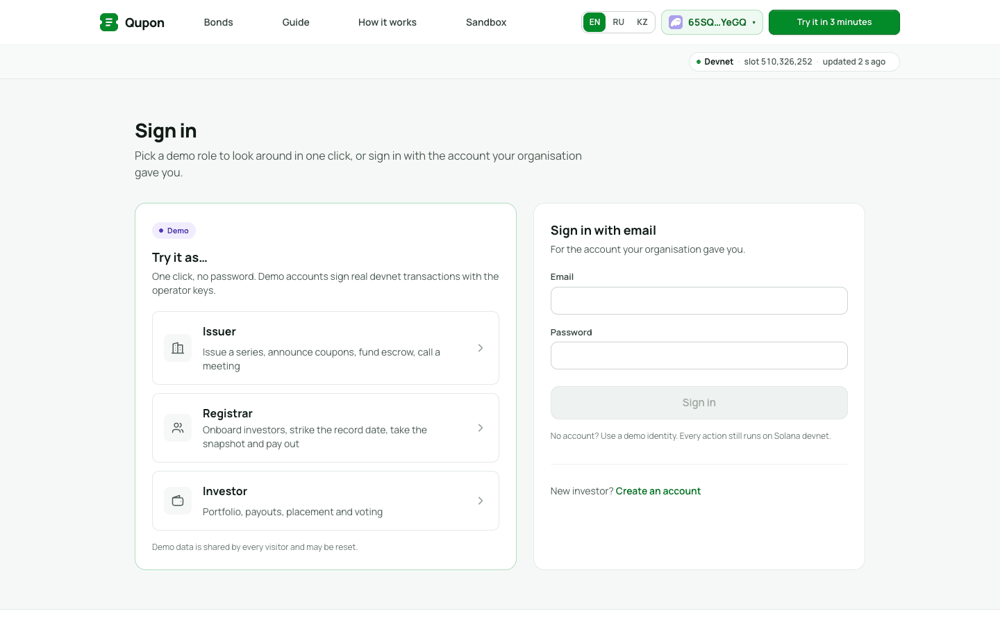

| Способ входа | Кто | Как |
| --- | --- | --- |
| **Demo → Issuer / Registrar / Investor** | кто угодно, в один клик | демо-аккаунты подписывают реальные devnet-транзакции ключами операторов; демо-данные общие для всех посетителей. Демо-инвестор — кастодиальный кошелёк (это подписано на экране) |
| **Sign in with email** | зарегистрированные инвесторы, сотрудники организаций, администраторы | почта + пароль |
| **New investor? Create an account** | новый инвестор | `/signup`, см. [§6](#6-инвестор-аккаунт-привязка-кошелька-заявка-kyc) |

Каждая роль попадает в свой кабинет: `/issuer`, `/registrar`, `/investor`, `/admin`. В шапке: сеть (Devnet),
кнопка кошелька, переключатель языка (EN / RU / KZ), колокольчик уведомлений, пользователь и **Sign out**.

## 3. Публичные страницы (без входа)

| Страница | Что показывает |
| --- | --- |
| `/` — главная | что делает Qupon, живой слот devnet, «Try it in 3 minutes» (песочница), переключатель «View as»: Public / Issuer / Registrar / Investor |
| `/bonds` — доска облигаций | все обслуживаемые выпуски: номинал, купон, дата следующего купона, стадия (Issued, Voting, …) |
| `/bonds/<mint>` — страница выпуска | условия, график, держатели, все корпоративные действия с транзакциями, публичные документы, данные KASE |
| `/proof/<mint>` — сертификат | перечитывает devnet **в вашем браузере** и пересчитывает каждую проверку: отпечаток реестра, расчёт на каждого держателя, деньги в эскроу и из него |
| `/holder/<address>` — досье держателя | позиции, выплаты и маршруты выплат любого адреса — публично, без входа |
| `/learn` — как это работает | жизнь облигации простым языком, один купон за шесть шагов |
| `/sandbox/new` — песочница | своя облигация на ускоренных часах, [§18](#18-песочница-вся-жизнь-облигации-за-минуты) |

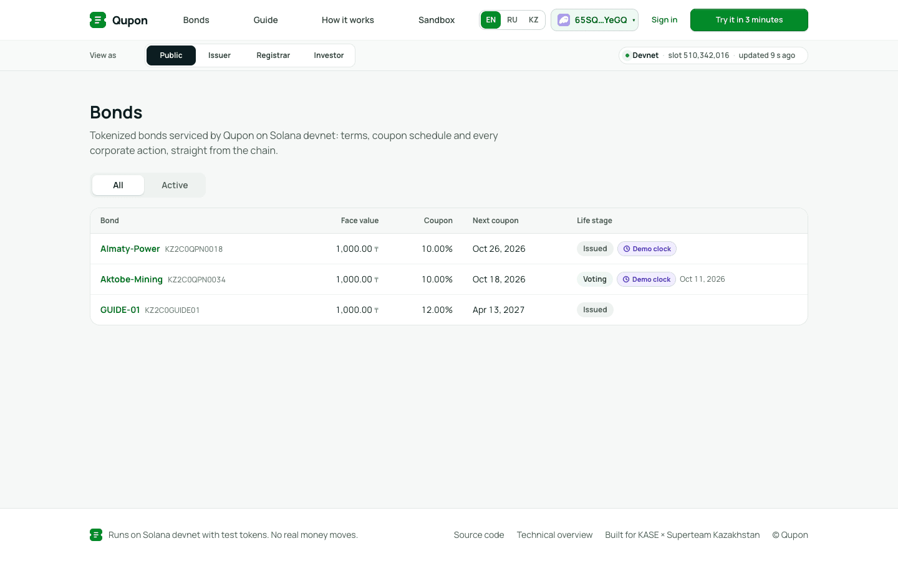

Страница выпуска из этого прогона (после купона и собрания, описанных ниже):

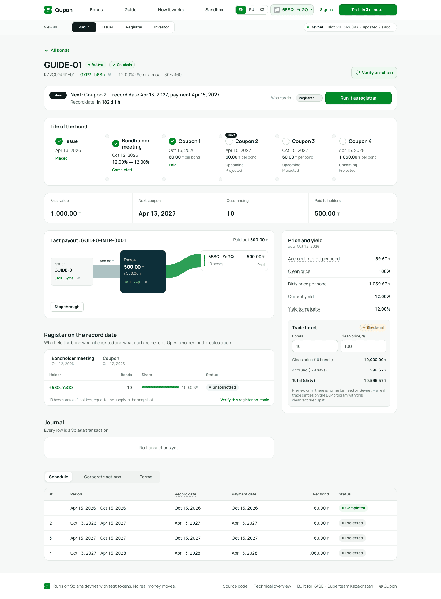

Страница proof перепроверяет тот же выпуск в браузере:

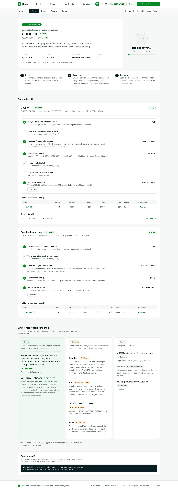

Досье держателя и «Как это работает»:

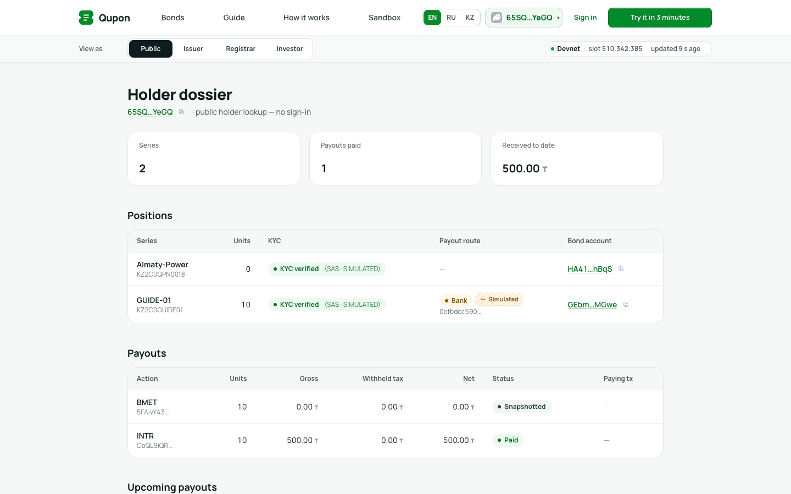

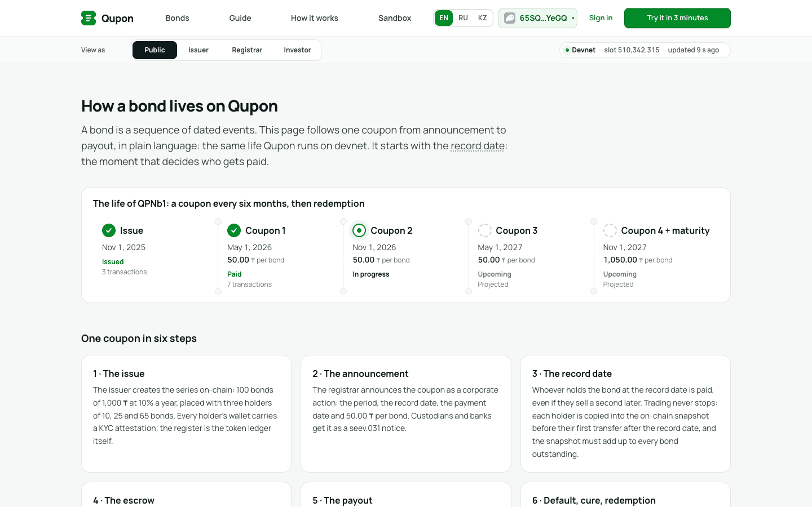

## 4. Подключение кошелька

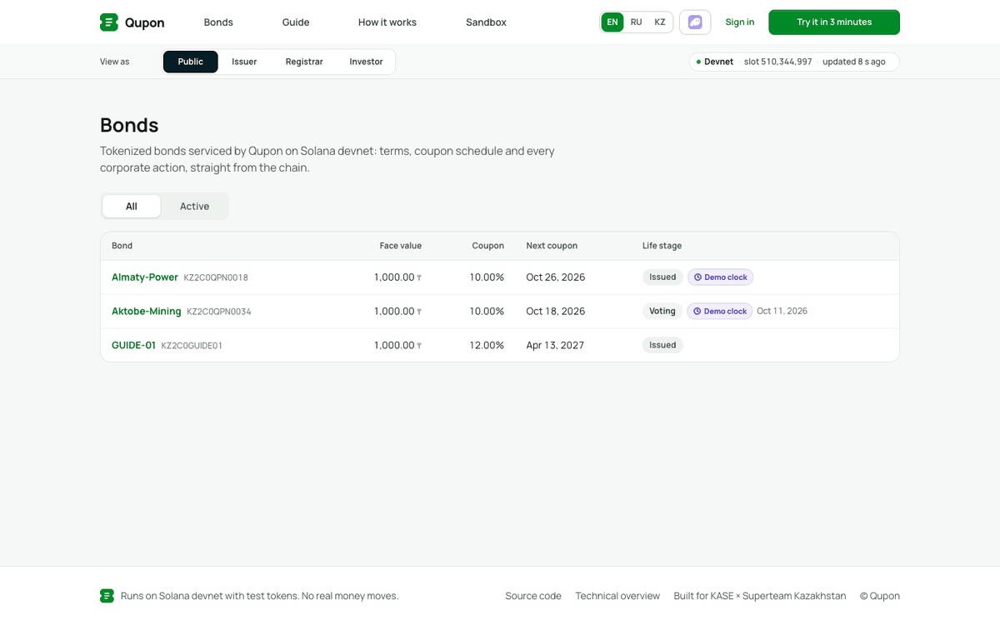

1. Нажмите **Connect** в шапке. Если установлен один кошелёк, кнопка называет его (**Connect Phantom**) и подключает
   в один клик; если несколько — диалог со списком найденных; если ни одного — инструкция по установке (ссылки для
   компьютера и телефона) или **просмотр любого адреса только для чтения**.
2. Phantom открывает **Connect — localhost:3100 / qupon.fun**: проверьте сайт и аккаунт, нажмите **Connect**.

   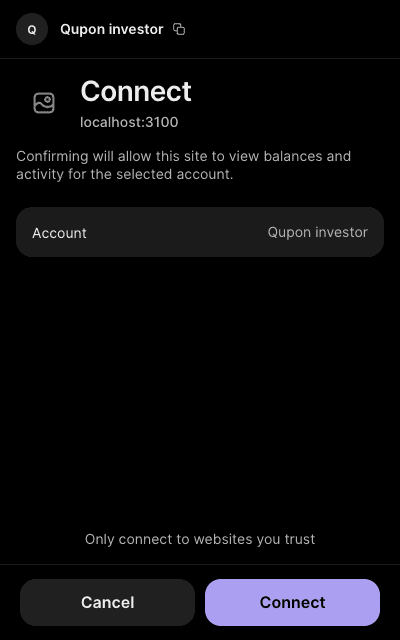
3. В шапке появился ваш адрес (`65SQ…YeGQ`). Его меню: **Copy address**, **View in Solana Explorer**,
   **Link to my Qupon account**, **Disconnect**.

   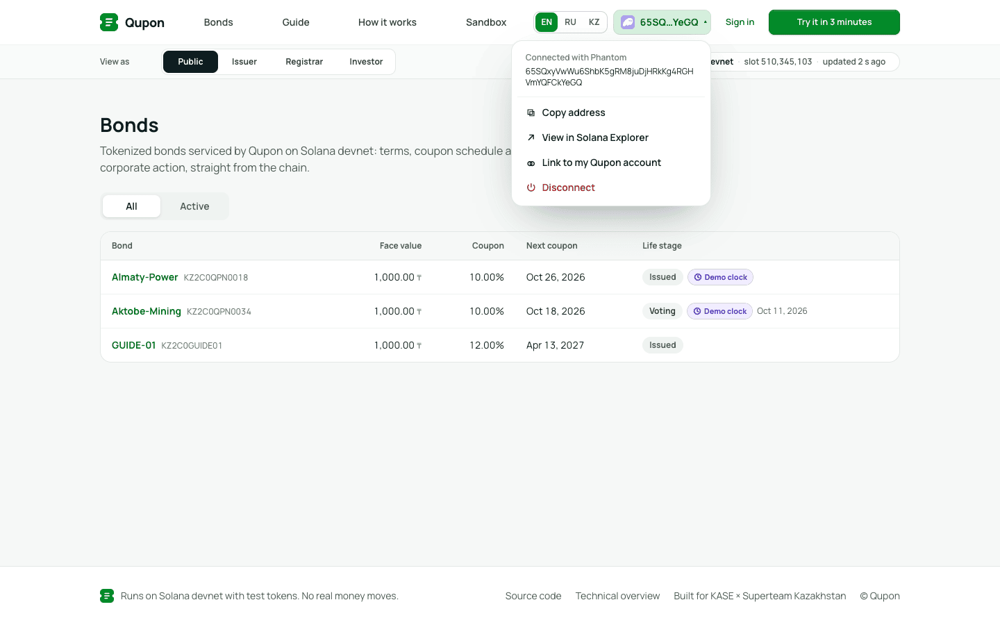

Подключение только сообщает сайту адрес. Подписи — позже, на каждое действие, и каждый раз Phantom показывает, что вы
подписываете.

## 5. Эмитент: выпуск облигаций

Войдите как **Issuer** → **New series** (`/issuer/series/new`). Три шага: **Terms → Schedule → Review**.

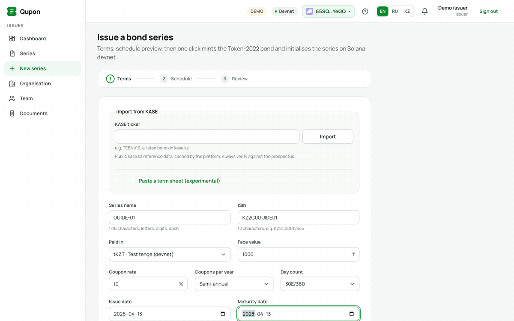

1. **Terms (условия).** По желанию **Import from KASE** (тикер с kase.kz, например `TEBNb10`, заполнит ISIN, номинал,
   ставку, периодичность, базис и даты из публичных данных KASE) или **Paste a term sheet** (эксперимент: LLM разбирает
   текст, вы подтверждаете каждое поле). Затем заполните или проверьте:
   - *Series name* (1–16 символов: буквы, цифры, дефис) — `GUIDE-01`
   - *ISIN* (12 символов) — `KZ2C0GUIDE01`
   - *Paid in* — денежный актив: tKZT, KZTE-dev, dKZT (тестовые заменители тенге) или USDC (Circle devnet)
   - *Face value* `1000` ₸, *Coupon rate* `10` %, *Coupons per year* — полугодовой, *Day count* 30E/360
   - *Issue date* `2026-04-13`, *Maturity date* `2028-04-13`

   Собрания по умолчанию: кворум 50% облигаций, одобрение ⅔ поданных голосов (настройка выпуска, не норма закона).

   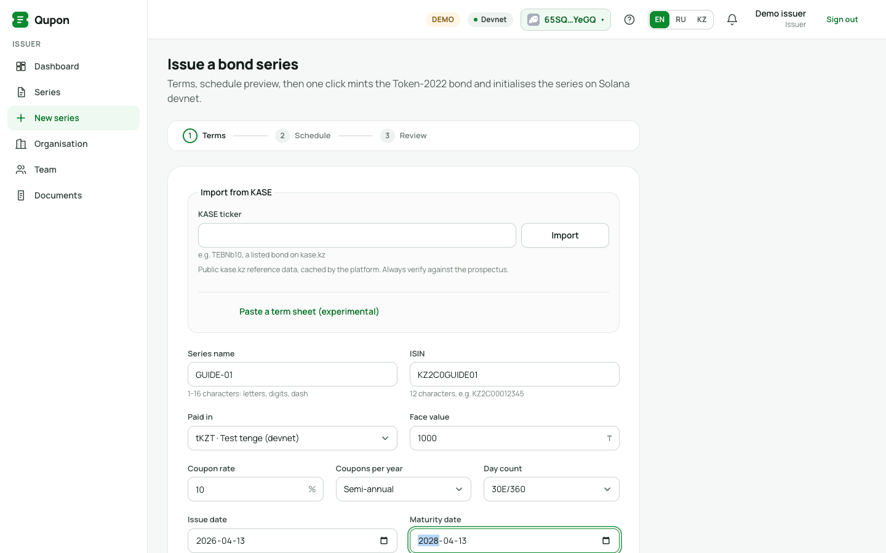
2. **Schedule (график).** Купонные периоды и сумма на облигацию — так же, как их посчитает программа (здесь 4 купона
   × 50,00 ₸).

   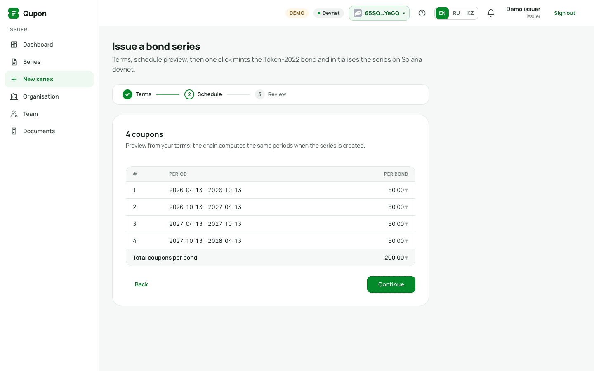
3. **Review → Issue on Solana.** Реальные devnet-транзакции: минт облигации Token-2022 (аккаунты заморожены по
   умолчанию, permanent delegate, пауза, право закрытия, метаданные в блокчейне) и аккаунт Series с этими условиями.

   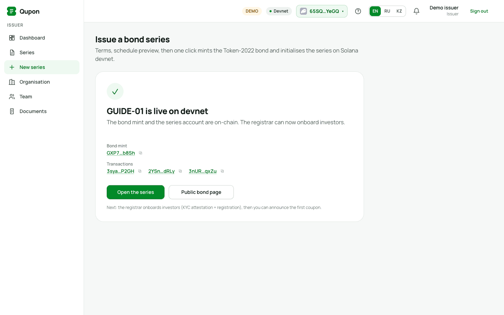

**Open the series** открывает страницу выпуска: статус, номинал, купон, следующий купон, держатели и вкладки
*Corporate actions · Schedule · Holders · Documents*. Здесь же кнопки **Announce** и **Call a meeting**.

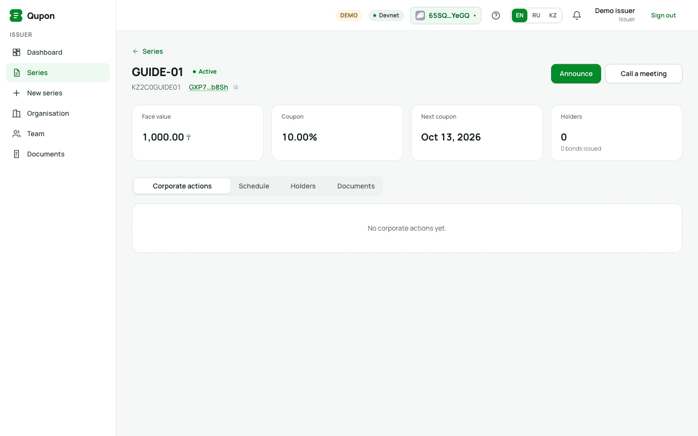

Дальше регистратор подключает инвесторов, а эмитент объявляет первый купон ([§9](#9-купон-от-объявления-до-выплаты)).

## 6. Инвестор: аккаунт, привязка кошелька, заявка KYC

### 6.1 Регистрация

`/signup`: имя, почта, пароль (от 10 символов). После **Create account** вы вошли, и `/investor` показывает чек-лист
из пяти шагов devnet: *Account created → Wallet linked → KYC approved → Test cash received → First subscription*.
Текущий шаг подсвечен вместе со своей кнопкой.

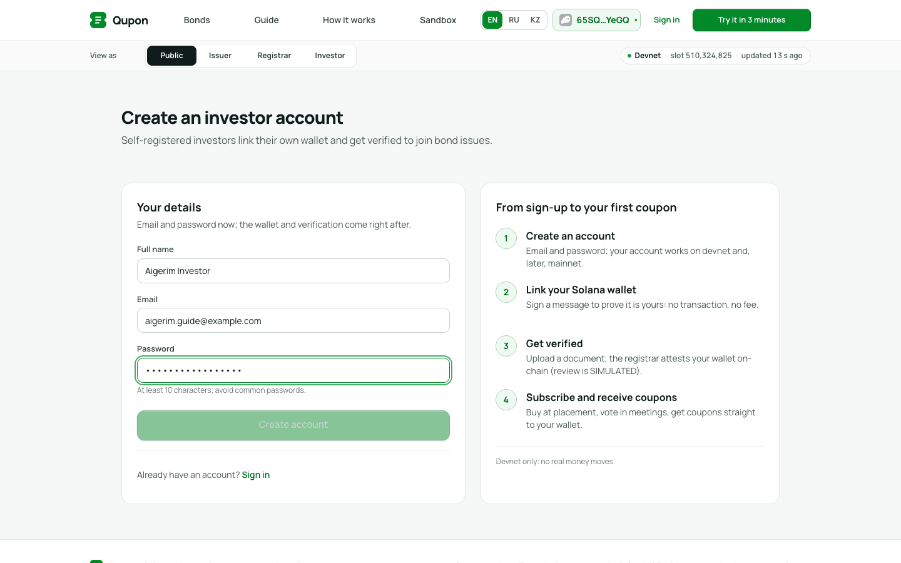

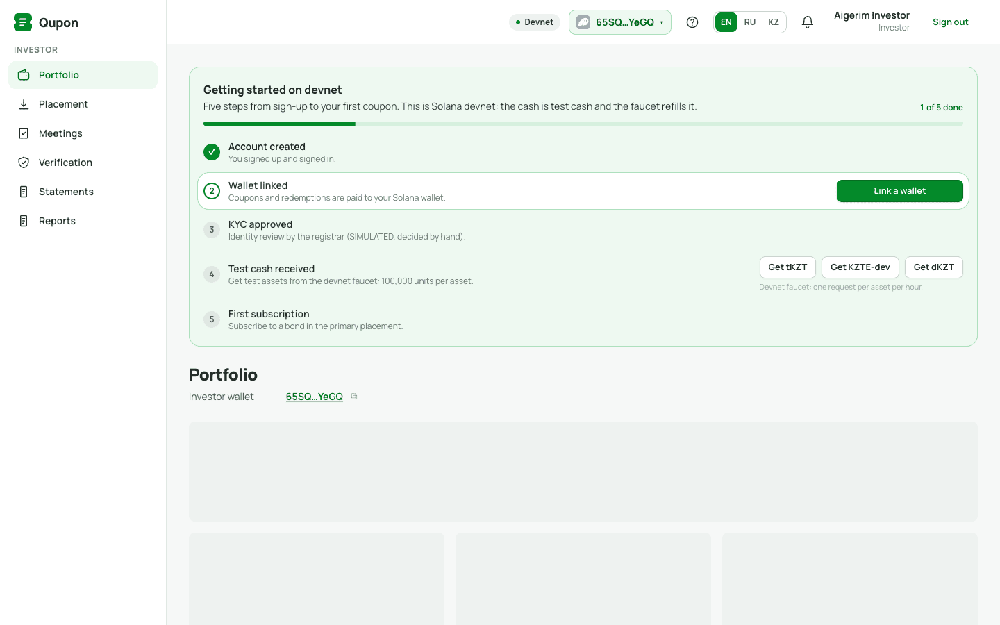

### 6.2 Привязка кошелька (подпись сообщения)

**Link a wallet** открывает **Verification** (`/investor/kyc`), шаг 1 *Wallet*. Подключите Phantom и нажмите
**Sign and link**: Phantom покажет **Sign Message** с текстом `Qupon wallet link / <почта> / <адрес> / nonce:…`.
**Confirm** — без транзакции и комиссии. На этот кошелёк будут приходить купоны и погашения; им же вы подписываете
подписки и голоса.

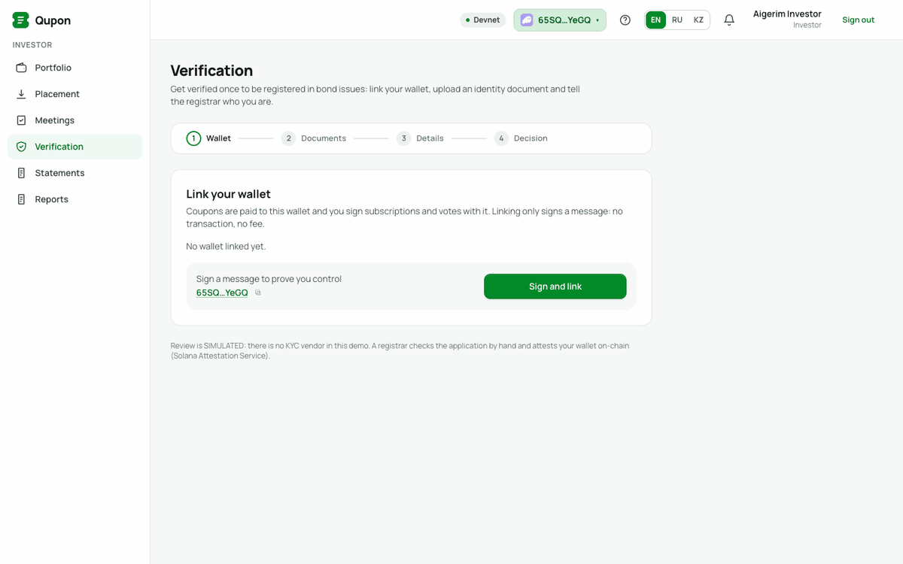

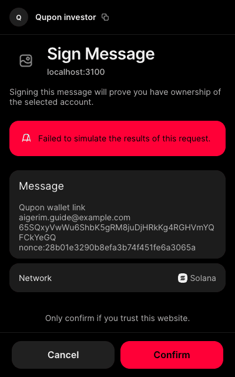

### 6.3 Заявка KYC

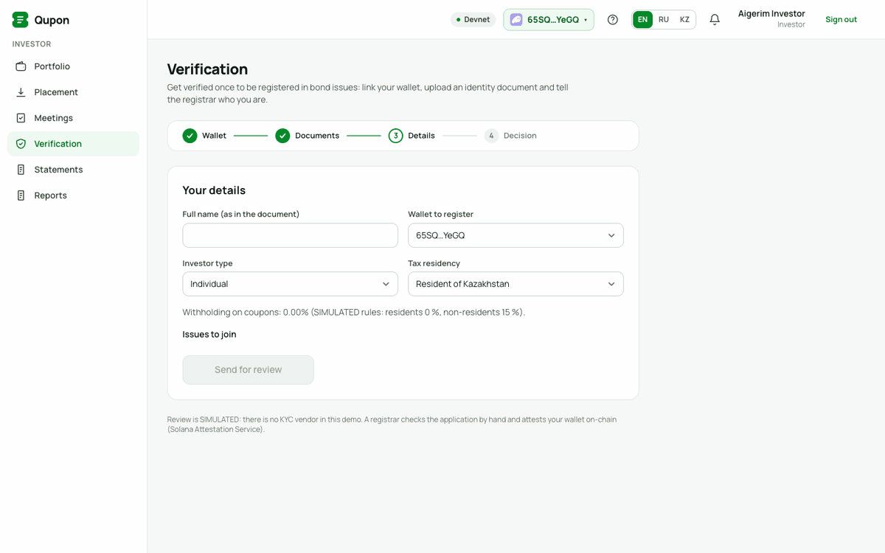

1. **Documents** — удостоверение личности обязательно, подтверждение адреса ускоряет проверку. PDF, PNG или JPEG до
   10 МБ, прогресс загрузки настоящий. (Здесь — образец-заглушка.)
2. **Details** — ФИО как в документе, кошелёк для регистрации, тип инвестора (физлицо / юрлицо), налоговое
   резидентство (резидент 0% / нерезидент 15% удержания — правила СИМУЛИРОВАНЫ) и **выпуски, в которые хотите войти**.

   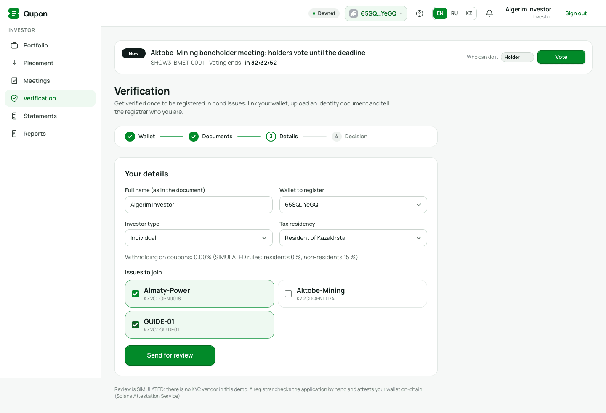
3. **Send for review** → заявка *Under review*; о решении придёт уведомление.

   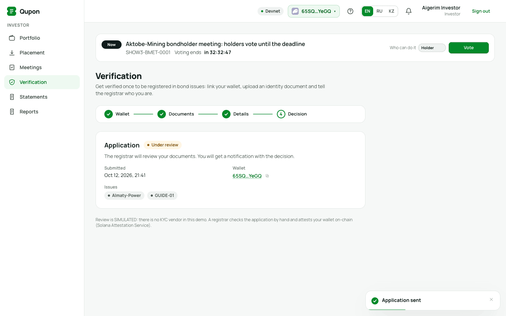

Проверка **СИМУЛИРОВАНА** (KYC-вендора нет): решение принимает регистратор вручную. Аттестация и регистрация, которые
следуют за одобрением, — реальные devnet-транзакции.

## 7. Регистратор: проверка KYC и регистрация в блокчейне

Войдите как **Registrar** → **KYC queue** (`/registrar/kyc`). Вкладки: Under review / Approved / Rejected.

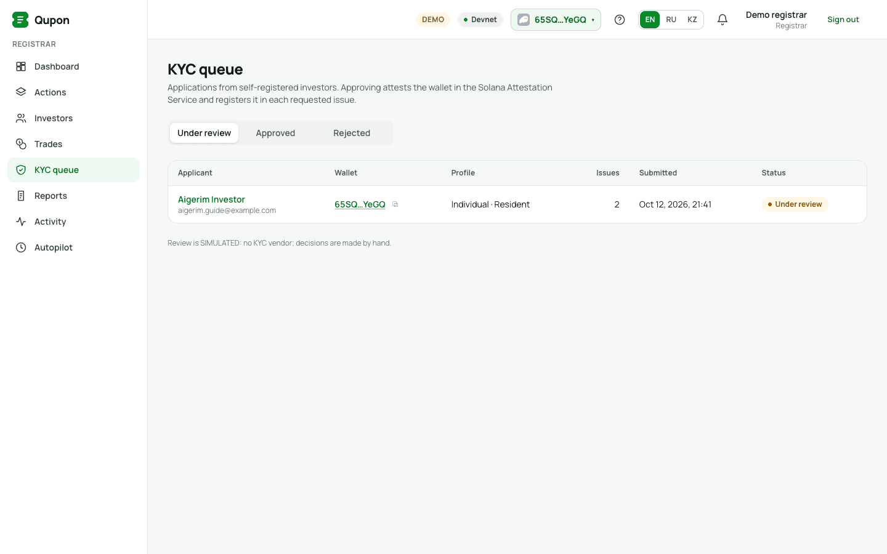

Откройте заявку: заявитель, кошелёк, тип, резидентство, удержание, загруженные документы (доступ только владельцу и
регистратору) и запрошенные выпуски.

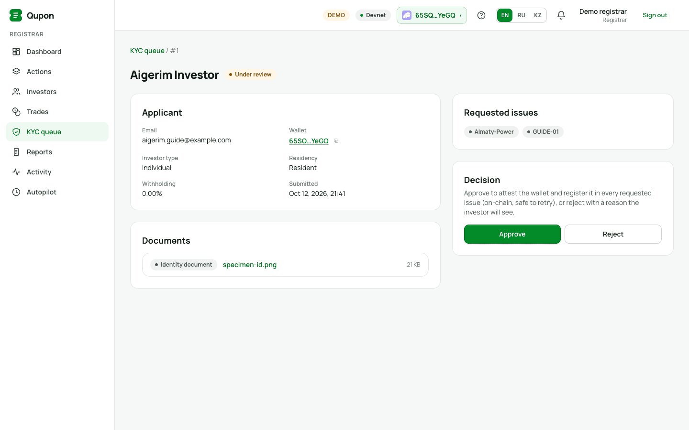

- **Approve** — KYC-провайдер (СИМУЛИРОВАННАЯ фирма, настоящий ключ) аттестует кошелёк в **Solana Attestation
  Service**, затем регистратор регистрирует его в каждом запрошенном выпуске: по транзакции на шаг, у каждой своя
  ссылка. Повтор безопасен.
- **Reject** — с причиной, которую увидит инвестор.

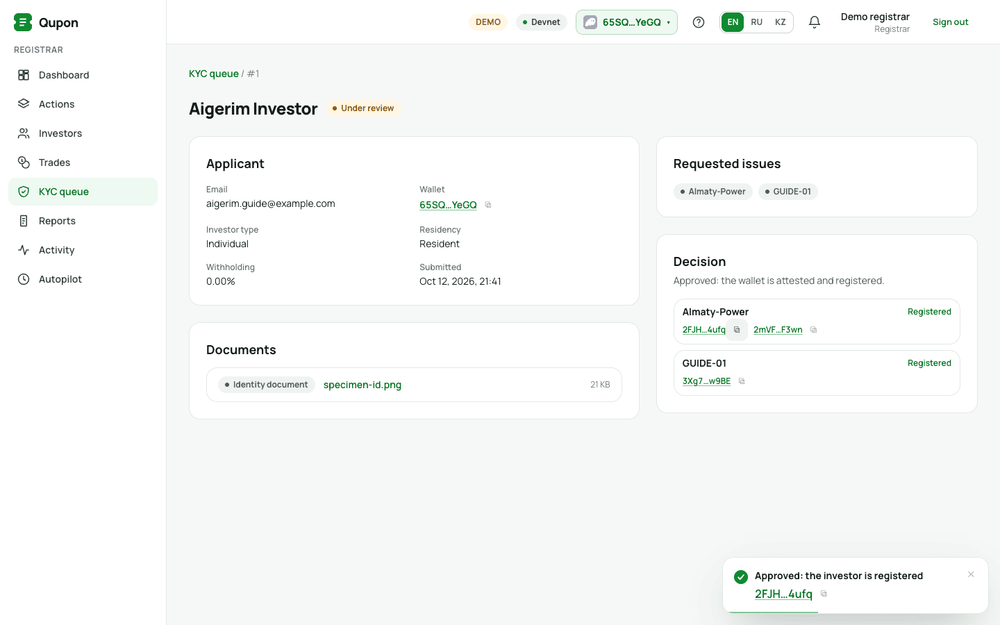

В блокчейне это размораживает аккаунт облигаций инвестора: минты облигаций *заморожены по умолчанию*, поэтому держать
облигацию может только зарегистрированный (прошедший KYC) кошелёк. В чек-листе инвестора теперь **KYC approved**.

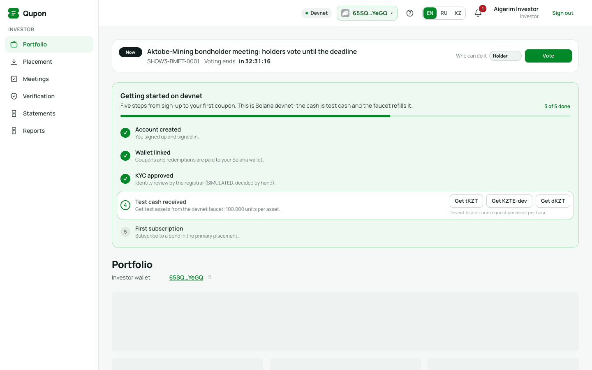

Регистратор может подключить кошелёк и напрямую: **Investors → Onboard investor** (выпуск, адрес кошелька, тип,
резидентство, удержание в базисных пунктах, срок действия аттестации в днях) — [§15](#15-бэк-офис-регистратора).

## 8. Инвестор: тестовые деньги и подписка через Phantom

### 8.1 Тестовые деньги

В чек-листе **Get tKZT** (или KZTE-dev, dKZT): devnet-кран отправляет на кошелёк 100 000 единиц, один запрос на актив
в час.

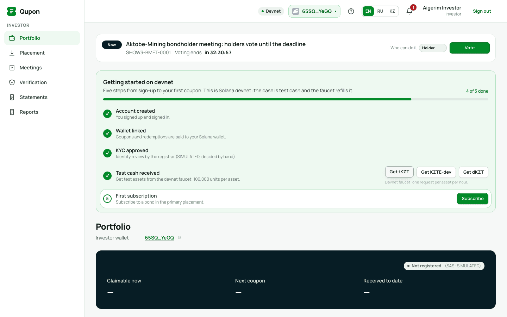

### 8.2 Подписка по номиналу (DvP)

**Placement** (`/investor/placement`): выберите выпуск и число облигаций; страница показывает цену за штуку (по
номиналу) и итог. **Subscribe (DvP)** собирает одну транзакцию: ваши деньги уходят эмитенту, облигации выпускаются
вам — атомарно. Phantom покажет **Confirm Transaction** — нажмите **Confirm**.

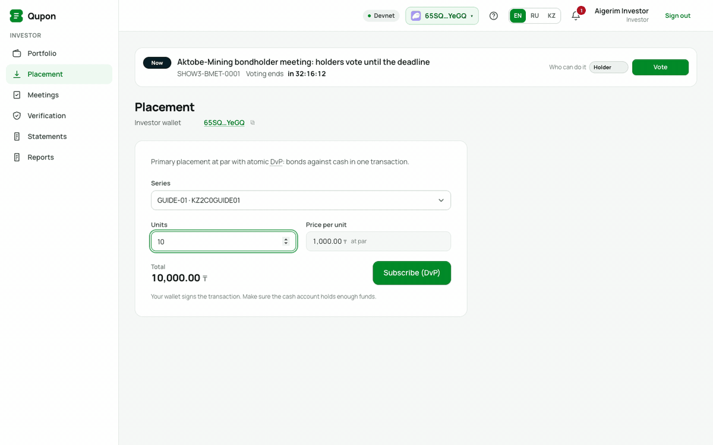

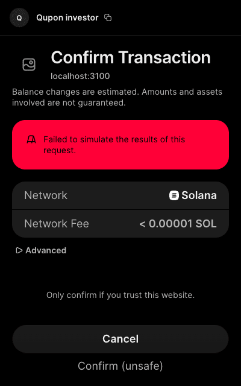

Уведомление *Subscribed: 10 × GUIDE-01* со ссылкой на транзакцию. В портфеле — облигации, оценка следующего купона и
календарь выплат.

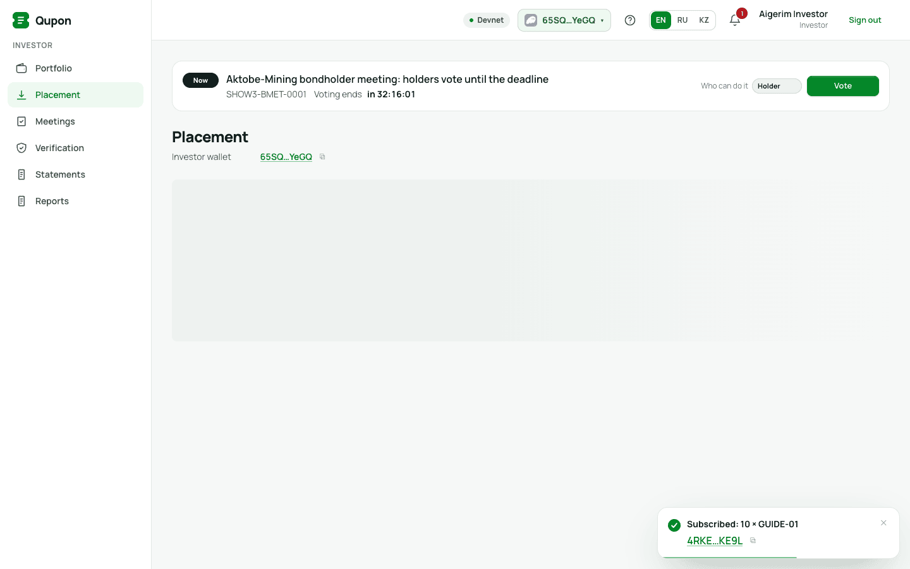

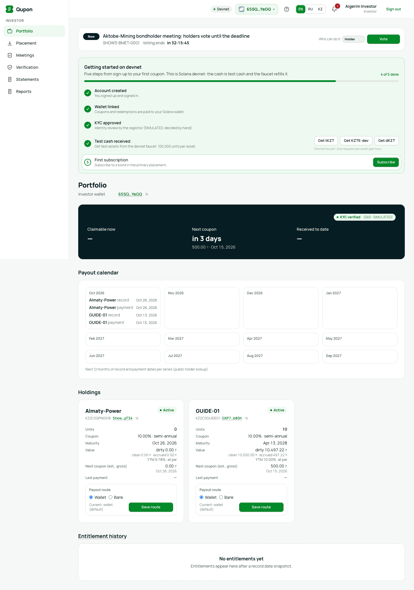

## 9. Купон: от объявления до выплаты

Весь цикл в интерфейсе: эмитент объявляет → регистратор (или любой) запускает каждый шаг → держатель получает деньги.

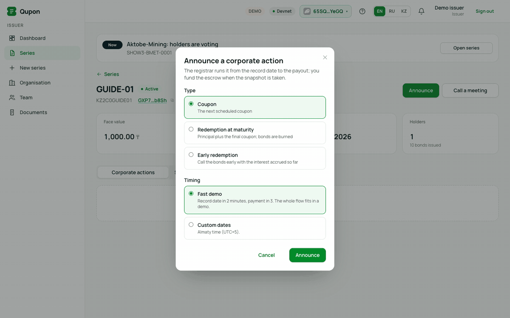

### 9.1 Эмитент: объявление

Страница выпуска → **Announce**. Тип: **Coupon** (следующий по графику), **Redemption at maturity** (номинал + последний
купон, облигации сжигаются) или **Early redemption** (досрочный выкуп с накопленным купоном). Сроки: **Fast demo**
(дата фиксации через 2 минуты, выплата через 3) или **Custom dates** (время Алматы, UTC+5). **Announce** отправляет
транзакцию; у выпуска одно открытое корпоративное действие (только одно за раз).

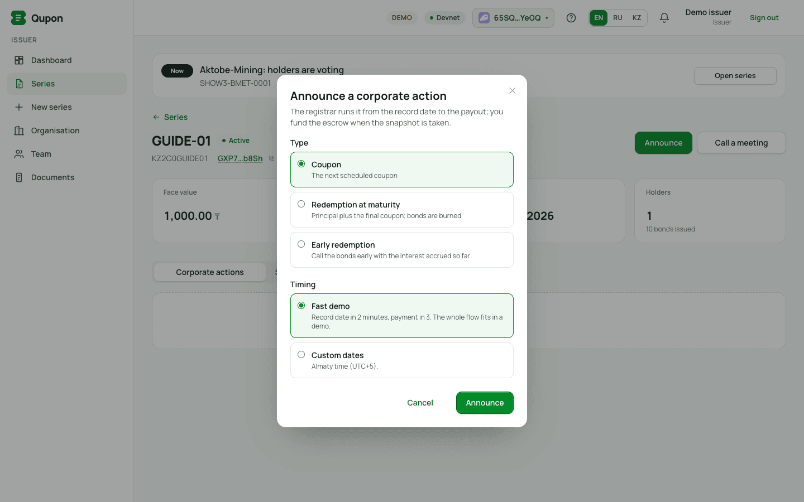

### 9.2 Регистратор: по шагам

**Actions** → действие (`/registrar/actions/<pda>`). Страница всегда называет **следующий шаг**, кто может его
выполнить и когда (обратный отсчёт до даты фиксации). Таймлайн показывает каждый шаг с транзакцией; *Facts* — ID
действия, даты фиксации и выплаты, период начисления (здесь 13 апр – 13 окт 2026 · 180 дней · 10%).

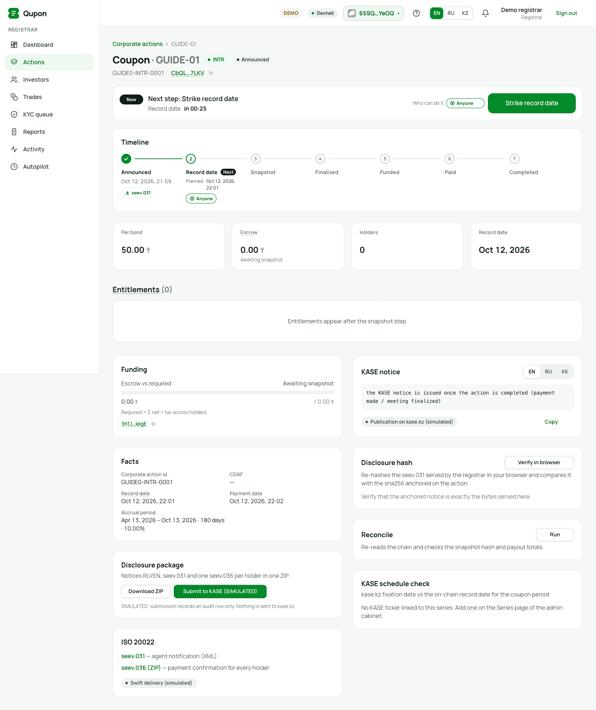

1. **Strike record date (фиксация реестра).** Если нажать до даты фиксации, программа откажет, а страница объяснит
   ошибку из блокчейна (*record date not reached*). Ничего не отправляется.

   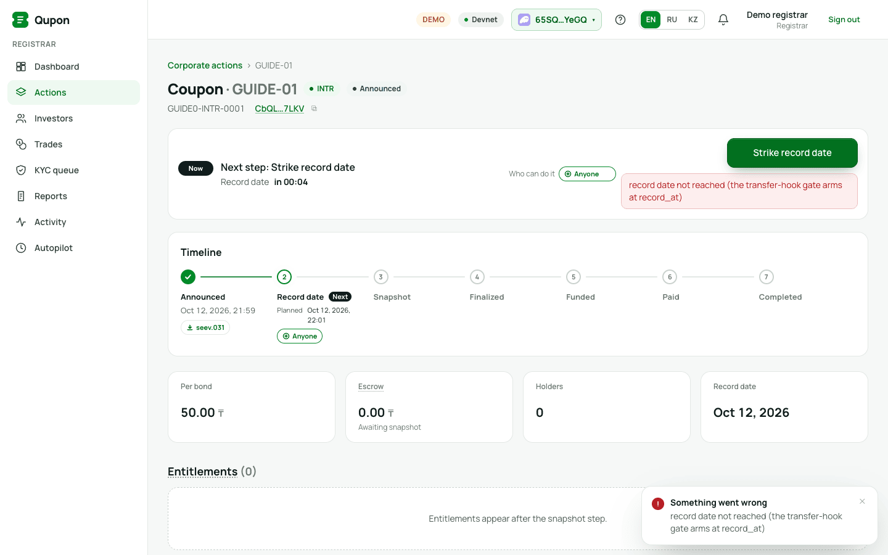

   После даты фиксации реестр для этого действия заморожен (transfer-hook у новых выпусков, пауза минта у старых), и
   каждый держатель попадает в снимок реестра в блокчейне.
2. **Finalize snapshot** — сумма единиц в снимке обязана равняться эмиссии; появляются права по каждому держателю
   (единицы, брутто, налог, нетто).
3. **Fund escrow** — деньги эмитента (или платёжного агента) уходят в эскроу, которым владеет действие; статус
   *Funded* только когда покрыто нетто + налог (+ номинал).
4. **Pay holders** — пакеты выплат на зарегистрированный денежный счёт каждого держателя (или по маршруту,
   [§11](#11-инвестор-маршрут-выплат-кошелёк-или-банк)).
5. **Complete** — сверка (все оплачены, суммы сходятся), реестр снова открыт, график сдвигается; остаток эскроу
   возвращается эмитенту.

Шаги, где программа это допускает, может выполнить любой («Who can do it: Anyone») — правила проверяет программа.

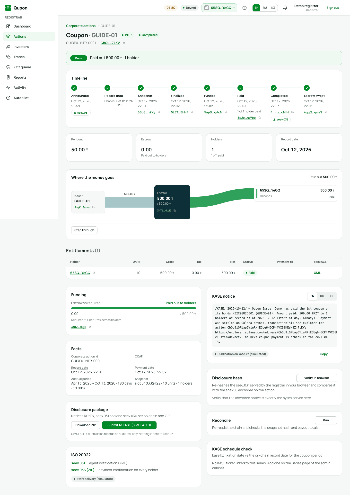

На завершённом действии: *Where the money goes* (эмитент → эскроу → держатели), таблица прав с каждой выплатой,
файлы ISO 20022 **seev.031** (уведомление) и **seev.036** (подтверждение по держателю), **уведомление KASE** на EN / RU
/ KK (выпускается после завершения), ZIP **disclosure package**, **Submit to KASE (SIMULATED)**, **Disclosure hash →
Verify in browser** (перехеширует отдаваемый seev.031 и сравнивает с sha256, закреплённым в блокчейне),
**Reconcile → Run** (перечитывает блокчейн, проверяет хеш снимка и итоги) и **KASE schedule check** (дата фиксации
kase.kz против даты фиксации в блокчейне, если у выпуска есть тикер KASE).

Инвестор видит выплату: *Received to date*, *Last payment 500.00 ₸*, строка в **Statements** со скачиванием seev.036.

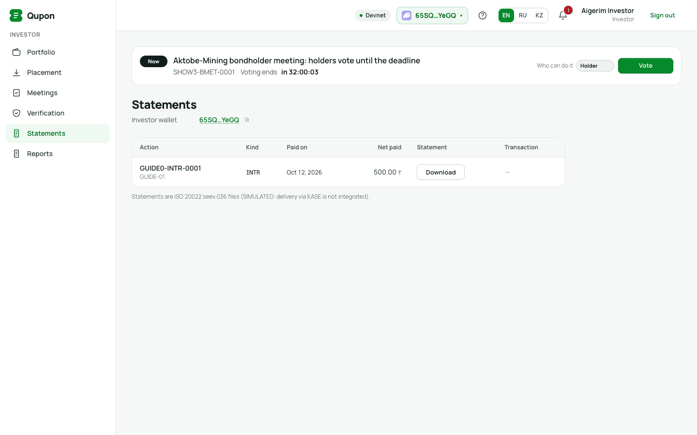

## 10. Собрание держателей: голосование через Phantom и смена условий

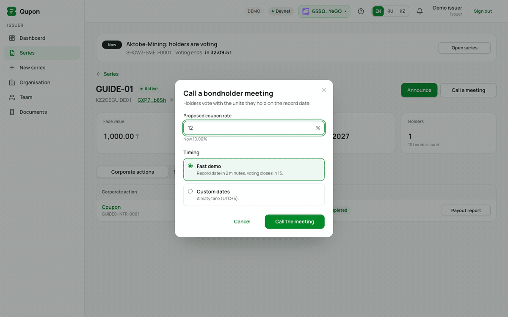

1. **Эмитент → Call a meeting**: предлагаемая ставка купона (здесь 10% → **12%**) и сроки (Fast demo: фиксация через
   2 минуты, голосование закрывается через 15; или свои даты).

   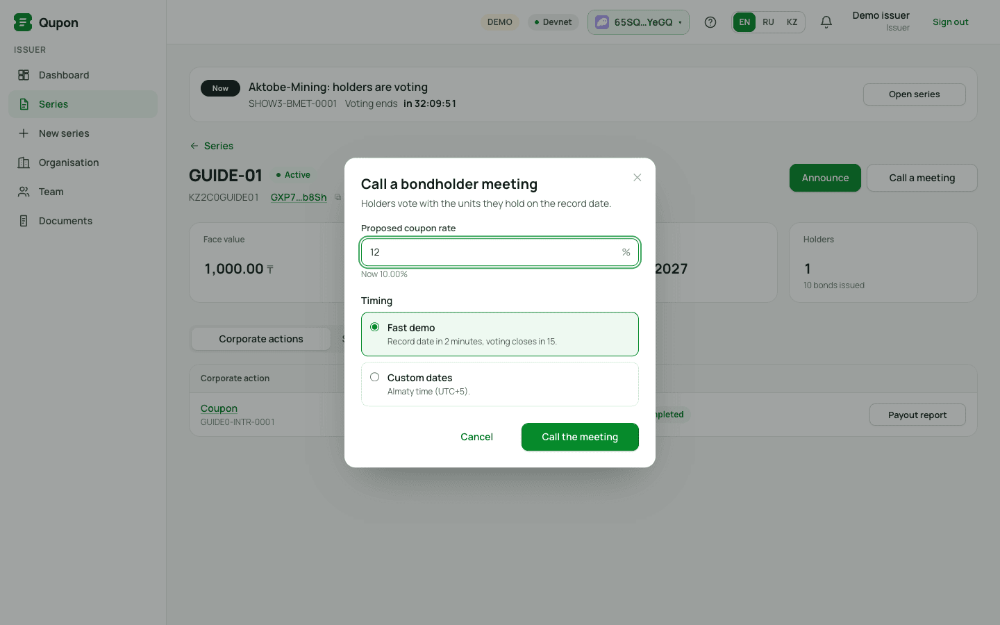
2. **Регистратор**: **Strike record date** → **Finalize snapshot**: вес голоса каждого держателя фиксируется на дату
   фиксации. Статус — *Voting open*.
3. **Инвестор → Meetings** (`/investor/meetings`): предложение, срок, *Your weight: 10 units*, кнопки
   **For / Against / Abstain**. Выберите, подтвердите *Vote "For"?* (голос нельзя изменить) → **Cast vote** →
   **Confirm** в Phantom. Итог обновится: *for 10 · against 0 · abstain 0 of 10 units*.

   

   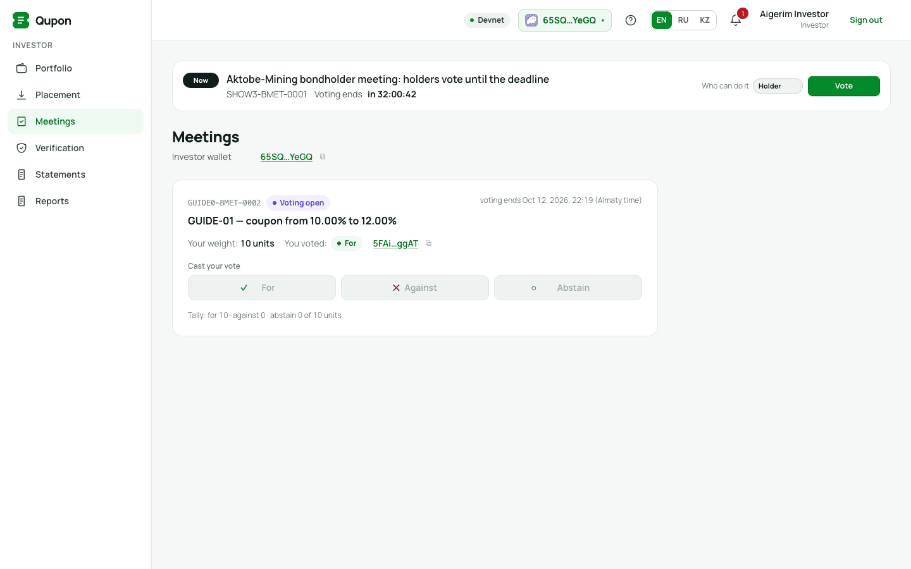
4. **Регистратор** после срока: **Count the votes** (кворум и одобрение проверяются в блокчейне: здесь явка 100%,
   одобрено) → **Apply terms change**: ставка купона в выпуске и в метаданных токена становится 12%. Подпись
   регистратора заменяет регистрацию в АРРФР (СИМУЛЯЦИЯ).

   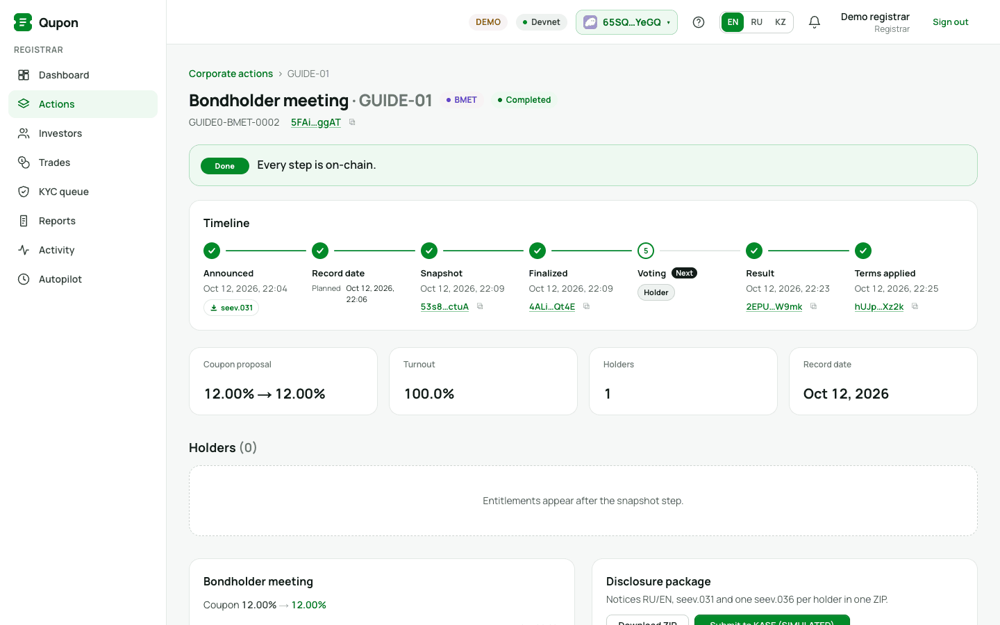

Следующий купон считается по новой ставке: в портфеле *Coupon 12.00%*, *Next coupon 600.00 ₸* на 10 облигаций.

## 11. Инвестор: маршрут выплат (кошелёк или банк)

В карточке каждой позиции есть **Payout route**: *Wallet* (по умолчанию — купоны на кошелёк) или *Bank*. Для Bank
введите IBAN: он хешируется в браузере, в блокчейн уходит только sha256. **Save route** → **Confirm** в Phantom
(`set_payout_route`, подписывает держатель). Выплаты по банковскому маршруту идут платёжному агенту, который
подтверждает банковский перевод инструкцией `confirm_bank_payout` — сам перевод СИМУЛИРОВАН.

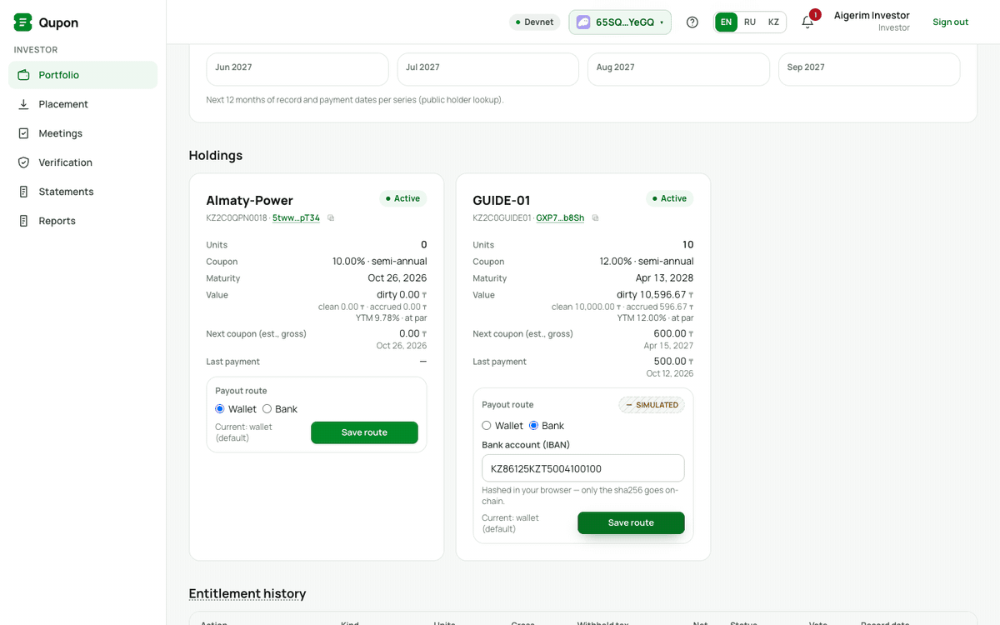

## 12. Инвестор: портфель, выписки, отчёты, уведомления

- **Портфель** (`/investor`): статус KYC, *Claimable now*, *Next coupon*, *Received to date*, календарь выплат на 12
  месяцев (даты фиксации и выплаты по выпускам), позиции (единицы, купон, погашение, грязная/чистая стоимость, НКД,
  доходность, оценка следующего купона, последняя выплата, маршрут выплат) и история прав с каждой выплатой и голосом.

  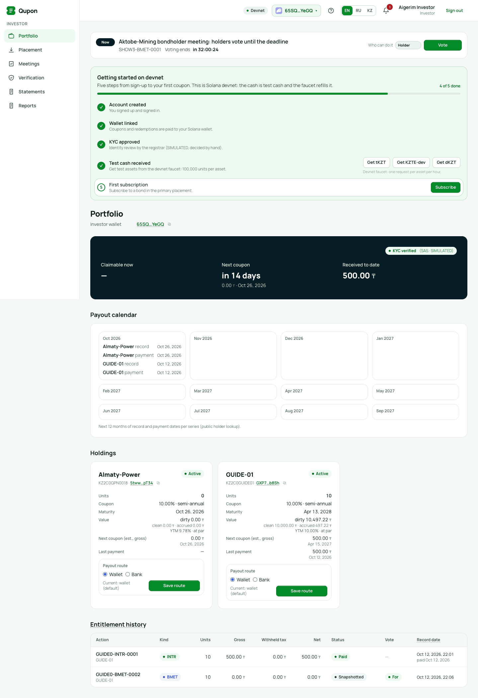
- **Statements**: строка на каждую выплату со скачиванием ISO 20022 **seev.036** и транзакцией.
- **Reports** (`/investor/reports`): выписка выплат за период и годовая налоговая справка (CSV и версия для печати/PDF).
- **Уведомления**: колокольчик в каждом кабинете и `/account/notifications` — объявлен купон/погашение, открыто/закрыто
  собрание, получена выплата, решение по KYC.
- **Аккаунт** (`/account`): профиль, язык интерфейса, пароль, привязанные кошельки.

## 13. Погашение, досрочное погашение, дефолт и его исправление

Тот же диалог **Announce** ([§9.1](#91-эмитент-объявление)) предлагает:

- **Redemption at maturity (REDM)** — номинал + последний купон. После выплаты следующие шаги гасят облигации
  (сжигание через permanent delegate) и закрывают выпуск (эмиссия 0 → метаданные `REDEEMED`, минт закрыт).
- **Early redemption (MCAL)** — досрочный выкуп с купоном, накопленным к этой дате.

Оба идут по шагам [§9.2](#92-регистратор-по-шагам). Прогоны на devnet со ссылкой на каждую транзакцию:
[`reports/demo-full.md`](../../reports/demo-full.md) (S2 — погашение, S4 — MCAL).

**Дефолт и исправление**: если эскроу не пополнен, через один день выпуска после даты выплаты любой может
зафиксировать дефолт в блокчейне (`declare_default`); позднее пополнение исправляет его, и держатели на дату фиксации
получают деньги. Попробуйте в один клик в песочнице ([§18](#18-песочница-вся-жизнь-облигации-за-минуты)):
**Skip funding** → **Fund and cure**.

## 14. Вторичные сделки (Solana DvP)

Подробно о том, как используется DvP (первичное размещение и вторичные сделки, проверки, защита даты фиксации, НКД, живой прогон на devnet): [гайд по DvP](DVP.ru.md).

Сделки между двумя зарегистрированными инвесторами одного выпуска рассчитываются программой **DvP** от Solana
Foundation: облигации против денег одной транзакцией.

1. **Регистратор → Trades** (`/registrar/trades`) → **New trade**: продавец, покупатель, число облигаций (не больше,
   чем у продавца), сумма по номиналу → **Create trade**. Одна транзакция создаёт запись сделки и допускает её эскроу
   облигаций.
2. **Инвесторы**: каждый пополняет свою ногу (продавец — облигации, покупатель — деньги) в **Портфель → Open trades**;
   подписывает Phantom. В строке видно по каждой ноге *in escrow* / *not funded*.
3. **Регистратор → Settle** (обе ноги пополнены): облигации и деньги переходят одной транзакцией. Или **Cancel**: обе
   ноги возвращаются владельцам. Открытая сделка **блокирует следующую дату фиксации** (`TradesInFlight`), пока её не
   рассчитают или не отменят, — сделка «в полёте» не может лишить держателя купона. Сопоставление заявок и торговая
   площадка в Qupon не входят.

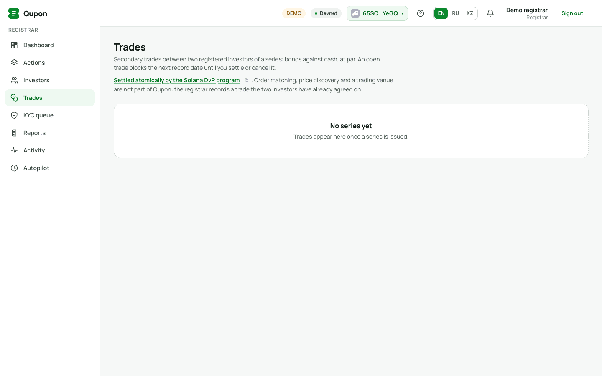

В этом прогоне сделка не выполнялась; прогон на devnet со ссылкой на каждую транзакцию:
[`reports/demo-trade.md`](../../reports/demo-trade.md) (`make demo-trade`). В песочнице есть кнопка **Trade 5 bonds** с
накопленным купоном.

## 15. Бэк-офис регистратора

| Страница | Что делает |
| --- | --- |
| **Dashboard** | активные выпуски, открытые действия, зарегистрированные инвесторы, выплачено за месяц, предупреждения, конвейер действий |
| **Actions** | все купоны / погашения / собрания (Open · Completed · All); откройте действие, чтобы выполнить следующий шаг |
| **Investors** | по выпуску: владелец, единицы, тип, резидентство, налог, KYC-аттестация, статус; **Suspend / Reinstate**; **Onboard investor** |
| **Trades** | вторичные сделки, [§14](#14-вторичные-сделки-solana-dvp) |
| **KYC queue** | [§7](#7-регистратор-проверка-kyc-и-регистрация-в-блокчейне) |
| **Reports** | реестр держателей выпуска (CSV, версия для печати) |
| **Activity** | каждое событие в блокчейне и каждая запись оператора, новые сверху |
| **Autopilot** | шаги, запланированные автопилотом и ждущие одобрения (если одобрение включено), и выполненные |

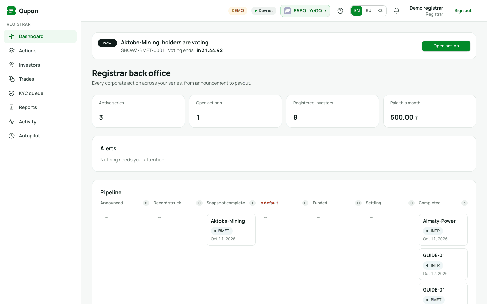

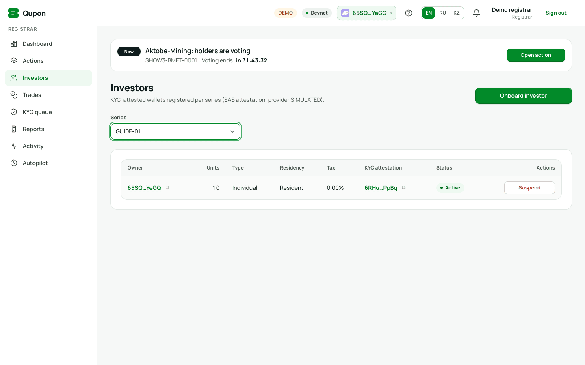

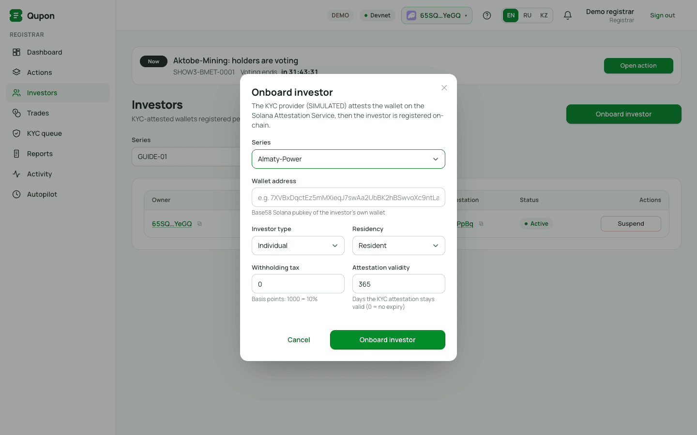

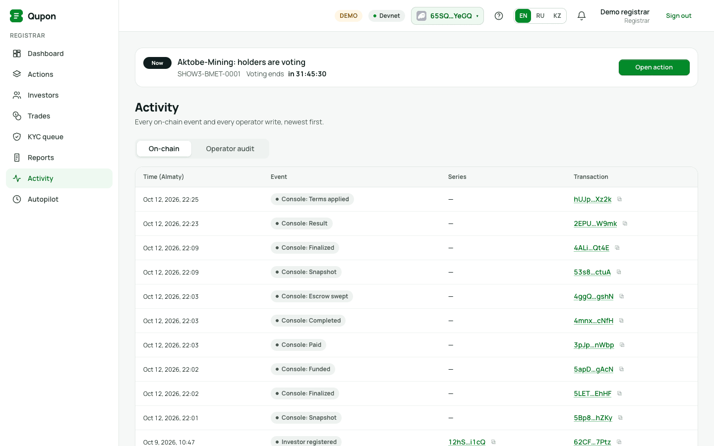

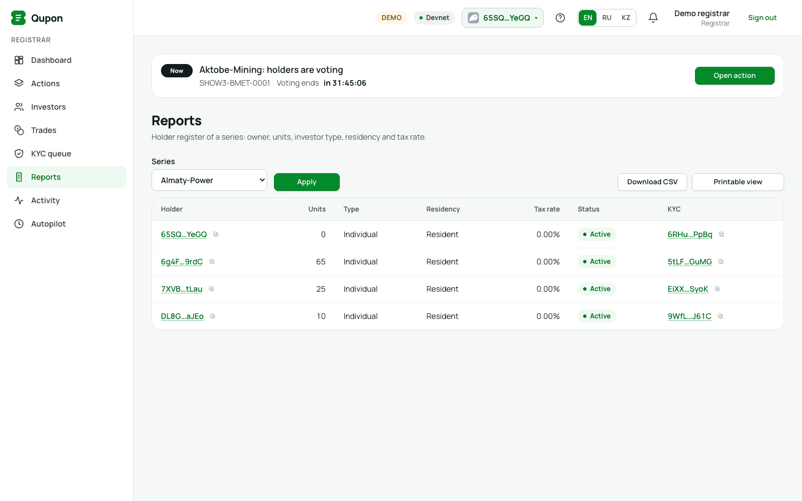

## 16. Организация эмитента, команда, документы

- **Dashboard** (`/issuer`): активные выпуски, следующий купон, эскроу к пополнению, действия, требующие вас.
- **Series**: все выпуски вашей организации.
- **Organisation**: профиль компании; определяет, с какими выпусками может работать команда.
- **Team**: одноразовые ссылки-приглашения для коллег.
- **Documents**: проспекты и решения, прикрепляются к выпуску и публичны на его странице.

Демо-аккаунты общие для всех посетителей, поэтому их организация, команда и документы только для чтения; аккаунт
организации (создаёт администратор) может их менять.

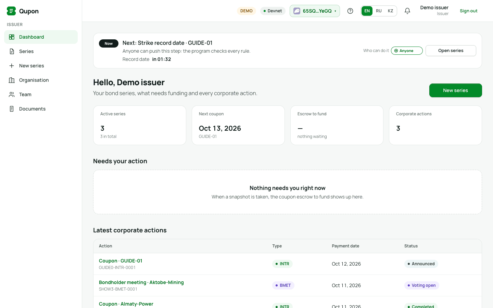

## 17. Панель администратора

Войдите аккаунтом администратора ([установка §7](SETUP.ru.md#7-учётная-запись-администратора)) → `/admin`.

| Страница | Что делает |
| --- | --- |
| **Overview** | пользователи, заявки KYC, выпуски, открытые действия, операторы с низким балансом |
| **Users** | создание, роли, отключение, одноразовые ссылки сброса пароля |
| **Organisations** | компании-эмитенты и регистраторы |
| **Series** | видимость (скрыть тестовые выпуски), «избранное» на доске, тикер KASE, организация-владелец, пополнение автопилотом |
| **Cash assets** | расчётные токены, каждый проверяется в блокчейне при добавлении (минт, decimals, токен-программа, предупреждения о правах); включить/выключить |
| **Digital tenge** | кастодиан dKZT (СИМУЛЯЦИЯ): депозиты (выпуск) и выводы (сжигание) |
| **System** | RPC, балансы кошельков операторов, исполнитель, планировщик, отставание индексации, кэш kase.kz |
| **Audit log** | каждая запись оператора, фильтры и выгрузка CSV |
| **Network** | какой кластер обслуживает развёртывание и готовность к mainnet |

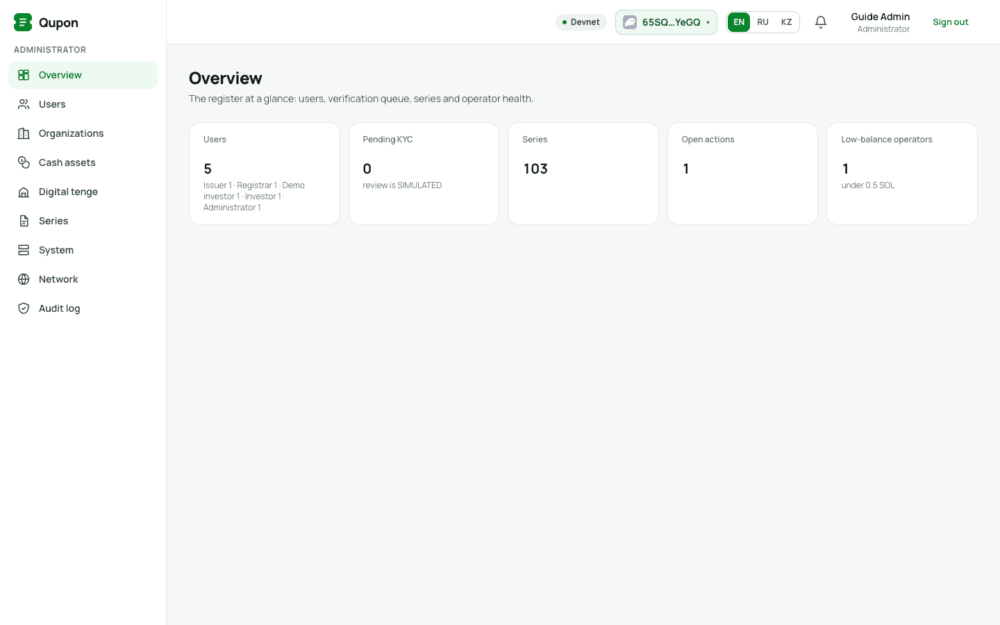

## 18. Песочница: вся жизнь облигации за минуты

`/sandbox/new` (**Try it in 3 minutes**) выпускает на devnet **вашу собственную облигацию** на демо-часах (день
облигации = 1 секунда, год ≈ 6 минут) с тремя кастодиальными инвесторами. `/sandbox/new?wallet=<ваш адрес>` ещё и
размещает 5 облигаций на ваш кошелёк — Phantom получает настоящие купоны. Без входа.

Автопилот объявляет, фиксирует реестр, снимает снимок, пополняет и платит; страница объясняет каждый шаг и кто может
его выполнить (шаги «Anyone» можете выполнить вы). Свой купон можно **забрать своим кошельком** (claim), пока его не
выплатил автопилот. Кнопки **Try it yourself**: **Skip funding** (→ дефолт) и **Fund and cure**, **Try the transfer** на
кошелёк без KYC (отказ Token-2022 и transfer hook), **Trade 5 bonds** с накопленным купоном. **View as** переключает
вид эмитента, регистратора и инвестора. Песочница живёт 24 часа.

## 19. Язык, телефон, помощь

- **EN / RU / KZ** в шапке переключает весь интерфейс; даты и числа — по локали.
- Каждая страница работает на телефоне (390 px) без горизонтальной прокрутки.
- **?** в шапке: перезапустить обучающий тур текущего кабинета, открыть *How it works*, открыть глоссарий. Термины
  глоссария в тексте (DvP, record date, entitlement …) подчёркнуты — нажмите, чтобы увидеть определение.

---

## Приложение: devnet-транзакции этого прогона

| Что | Ссылка |
| --- | --- |
| Кошелёк инвестора (Phantom) | [`65SQ…YeGQ`](https://explorer.solana.com/address/65SQxyVwWu6ShbK5gRM8juDjHRkKg4RGHVmYQFCkYeGQ?cluster=devnet) |
| Выпуск GUIDE-01 (минт облигации) | [`GXP7…b8Sh`](https://explorer.solana.com/address/GXP7VBSvYMBuPinWrj3Z5DdabkdVV8Q4un2emLE7b8Sh?cluster=devnet) |
| Кран: 100 000 tKZT инвестору | [`4UbZ…UrEj`](https://explorer.solana.com/tx/4UbZUyTroHtdyx8VQX1Yo85povHnUUe2Zs9DNK3KcVhyTLZWzwnwbPQEJCUH6GyTvb2peRXAc6SPTsoFg2gUUrEj?cluster=devnet) |
| Подписка на 10 облигаций (подписано в Phantom) | [`4RKE…KE9L`](https://explorer.solana.com/tx/4RKEBd9b8EGPhUFjMgSFjv7d7m69TBGbMLh1HqUDF28mt84ugmzDVWUrs3c2NAEqjcrs946Vvus5jVAT4r2KKE9L?cluster=devnet) |
| Купон INTR #1 (выплачено 500,00 ₸) | [`CbQL…7LKV`](https://explorer.solana.com/address/CbQL9iQRUap6YiuRKjEGUg6H6CP44VXB8KEsN8Zj7LKV?cluster=devnet) |
| Собрание 10% → 12% | [`5FAi…ggAT`](https://explorer.solana.com/address/5FAivY434SX8cgy1jWo6PUrgG9aKktHiJ8MBY1XbggAT?cluster=devnet) |
| Голос «За» (подписано в Phantom) | [`EdkX…CmH`](https://explorer.solana.com/tx/EdkX1iwJtQmbDCnG4uzy5g3b5N7N6mAsthvkxA8AC2xQHNosjRaQNgqRZSNjtnap1rZu915dpvhpSjZFpFssCmH?cluster=devnet) |
| Маршрут выплат → банк (подписано в Phantom) | [`XVTk…odR`](https://explorer.solana.com/tx/XVTkqbvk5qipMHn8LvqZCzDqXKKD3ASqG7KMG99aZB35PGY9M18FkrT1y3FLeaHNeMXoCZFcCpgC9E5rEyERodR?cluster=devnet) |
| Песочница SBX-JSGB5R (минт облигации) | [`G4VD…CTq4`](https://explorer.solana.com/address/G4VDHsk6sMVzxJHLT5J7AEzpEAcV7DSyjULsqdt7CTq4?cluster=devnet) |

**О снимках экрана.** Красная плашка «Failed to simulate the results of this request» в некоторых окнах Phantom
появлялась, пока собственный сервис предпросмотра Phantom не отвечал браузеру, в котором шла съёмка; тогда Phantom
подписывает кнопку *Confirm (unsafe)*. Сами транзакции в порядке (каждая ссылка выше — успешная транзакция), а более
поздние окна (например, маршрут выплат) показывают обычный предпросмотр баланса. Прогон нашёл две ошибки при работе с
кошельком, их исправили до финальных снимков: Phantom добавляет свои инструкции compute budget, если их нет в
транзакции (и защита Qupon по сравнению байтов её отклоняла — теперь транзакции кошелька несут явный compute budget), а
подписка читала аккаунт Token-2022 в кодировке base58 по умолчанию, которую devnet не принимает для аккаунтов больше
128 байт.
