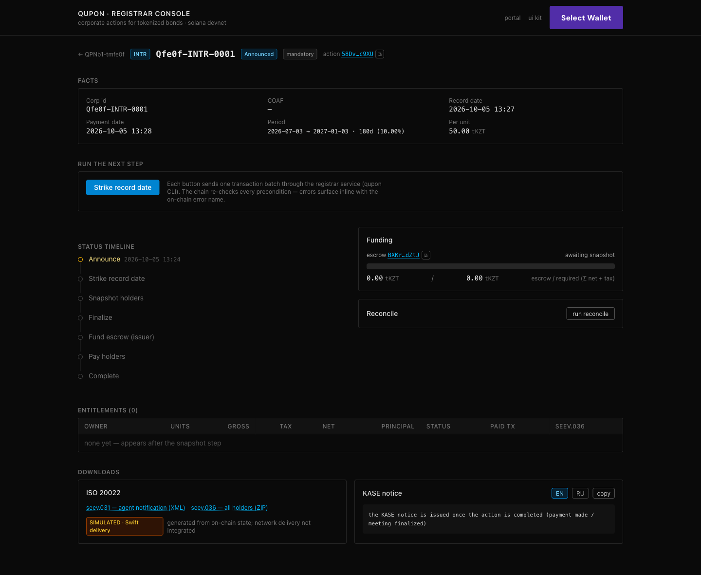
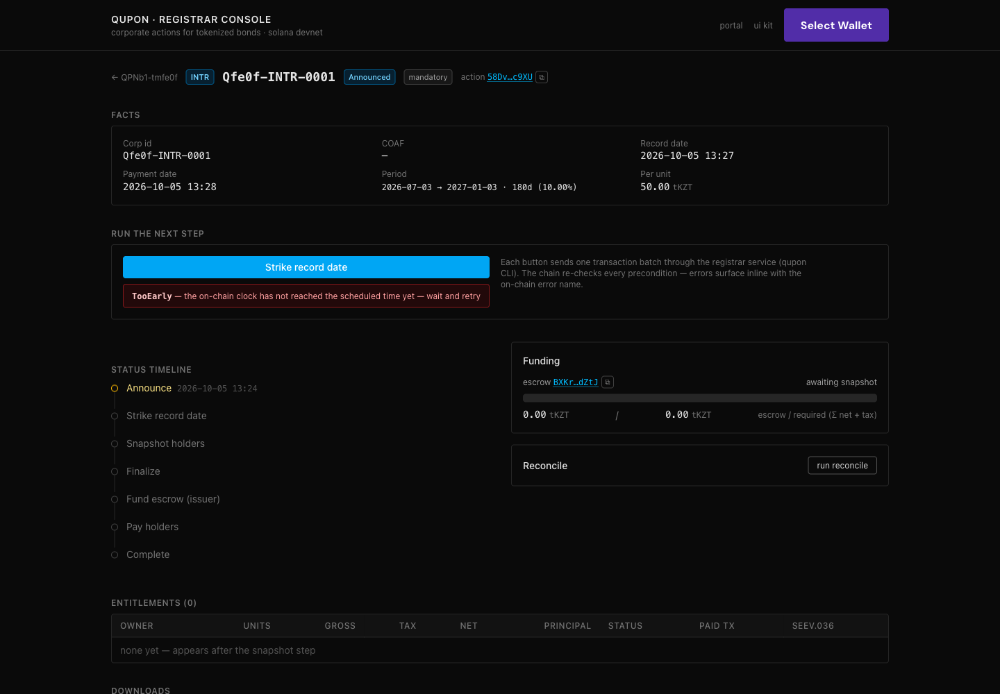
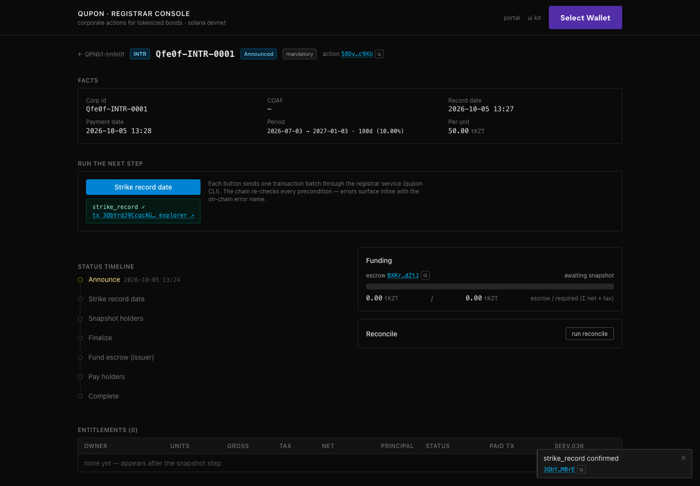
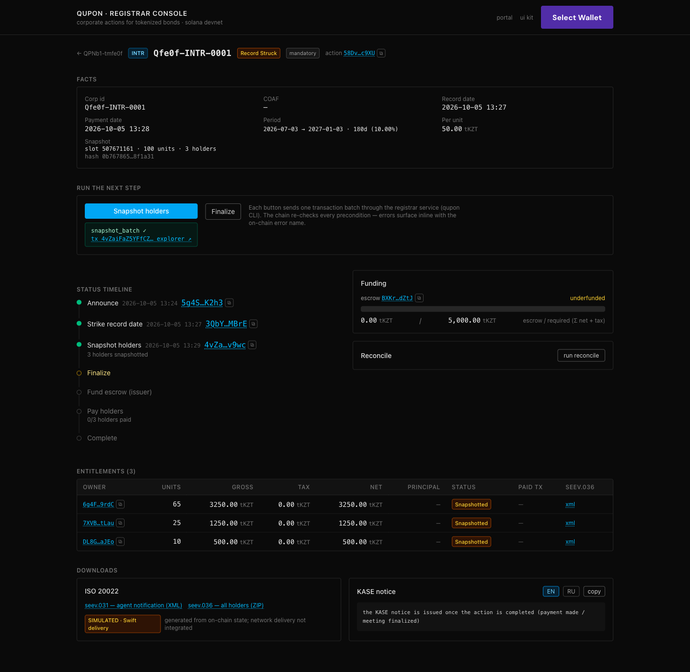
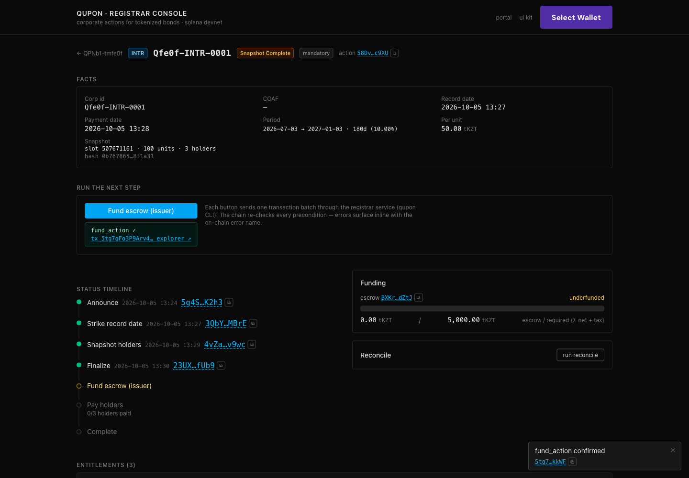
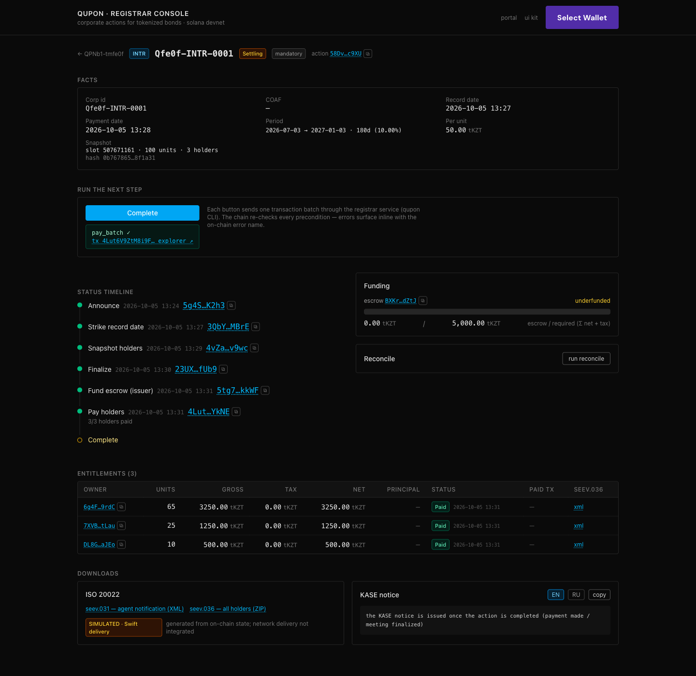
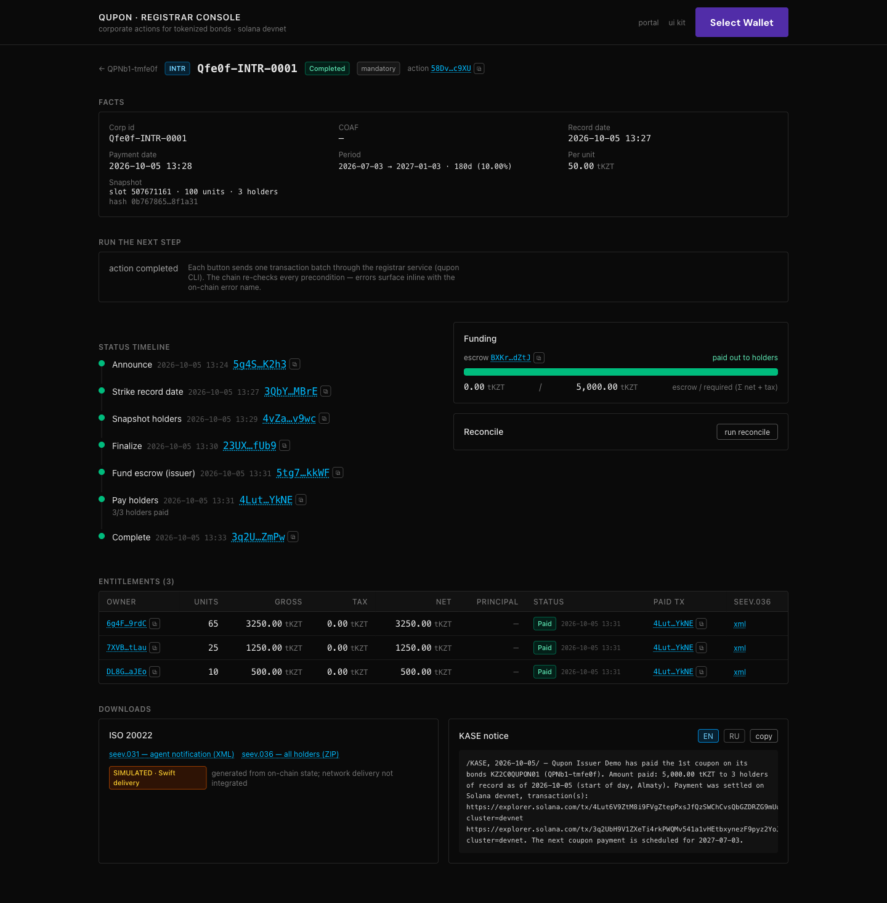

# UI walkthrough — one coupon from announcement to completion, clicked in the console (devnet)

Recorded 2026-10-05 13:24–13:35 Almaty on Solana devnet against the real registrar API and a production build of the
web app (`next build && next start`). Every step after the announcement was one button press on
`/actions/[pda]`; no terminal was used between steps.

- Series **QPNb1-tmfe0f** (face 1,000 tKZT, 10% semi-annual, 30E/360): holders 65 / 25 / 10 bonds
- Action **Qfe0f-INTR-0001** — [`58Dv…c9XU`](https://explorer.solana.com/address/58DviWH2mCr1XrBeK32m5rNnndjaLybCjDDuFscAc9XU?cluster=devnet)
- Reproduce: `make demo-ui` (fresh series + announced coupon, prints the next commands) → `QUPON_CONFIG=<printed> make api`
  → `NEXT_PUBLIC_API_URL=http://localhost:8080 make web` → open `/actions/<pda>`.

| # | Step (button) | Result | Transaction |
|---|---|---|---|
| 1 | — (`make demo-ui` announces INTR #1) | Announced; per unit 50.00 tKZT; record date shown | [5g4S…K2h3](https://explorer.solana.com/tx/5g4SZtuSXhGy5SBCkptJthvqVHaA2WrFdaP7rxhebZTVwGgtHm3QvUCpUMZXiQaXQ6p5E73cxdmzAFwMSBMRK2h3?cluster=devnet) |
| 2 | Strike record date — clicked before the record date | Refused on-chain: **TooEarly** with its explanation inline | — (simulation only) |
| 3 | Strike record date | Record Struck — the bond mint is paused | [3QbY…MBrE](https://explorer.solana.com/tx/3QbYrdJ9CcqcAGvxTA65xeyGwoBEGK9JjEjmF1PwV8SWtqkCL7Ns2ieNMuTtS3qRUfADHmjgG8XpWMjFLp8VMBrE?cluster=devnet) |
| 4 | Snapshot holders | 3 entitlements: 3,250.00 / 1,250.00 / 500.00 tKZT; snapshot hash | [4vZa…v9wc](https://explorer.solana.com/tx/4vZaiFaZ5YFfCZ4HLtr2pPBDJSDf5XPsV3jLP5oRxWYyLdZUEFB1oRjdX23m2ybfX1AWw6sWWo31vMzmu5vbv9wc?cluster=devnet) |
| 5 | Finalize → Fund escrow (issuer) | Snapshot Complete (Σ units = supply) → Funded, escrow 5,000.00 / 5,000.00 | [23UX…fUb9](https://explorer.solana.com/tx/23UXMvtw5NXx7KkGFr1bQR3gLWJnsQ9qdNBgYkb3tR8AFxPVWrL8APweW6u3NdTwZbybG32KhsURPrFvQU8pfUb9?cluster=devnet) · [5tg7…kkWF](https://explorer.solana.com/tx/5tg7qFo3P9Arv4QmxiXmaQhDEHp49b5nzqJg9186spGomYn2EHv5FfmQz1WHhzyM6PrzXP1VURVPQx6JDjpDkkWF?cluster=devnet) |
| 6 | Pay holders | Settling; 3/3 holders paid, each row Paid with its tx | [4Lut…YkNE](https://explorer.solana.com/tx/4Lut6V9ZtM8i9FVgZtepPxsJfQzSWChCvsQbGZDRZG9mUuctEXpdRqMS64DiUPnpwFvd7Vub7CHSCa9jT3rLYkNE?cluster=devnet) |
| 7 | Complete | Completed; register resumed; KASE notice (EN/RU) now issued with the payout tx links; seev.031 / seev.036 downloads | [3q2U…ZmPw](https://explorer.solana.com/tx/3q2UbH9V1ZXeTi4rkPWQMv541a1vHEtbxynezF9pyz2YoJu9XCnJrpRqpg8MXC8zH5CipQ7XS9ZevTXijVHTZmPw?cluster=devnet) |

## Screens

1. Announced — facts, next step, timeline, funding, downloads 
2. Clicked too early — the on-chain error name and its explanation inline 
3. Record struck 
4. Snapshot — entitlements per holder, the brief's 500 / 1,250 / 3,250 
5. Funded 
6. Paid 
7. Completed — every step with its transaction, KASE notice, ISO 20022 

## Found and fixed during this walkthrough (task 9030)

- On-chain errors reached the console as "Transaction simulation failed": the CLI read Kit's preflight logs from the
  wrong field. It now names the program error (`TooEarly (6006): …`), which the console explains.
- After a step the page kept the old status: devnet RPC reads lag a confirmed transaction by up to ~20 s, and the
  console stopped refreshing after 15 s. It now refreshes until the status changes (max 60 s); Next's dev-mode fetch
  cache is off so `pnpm dev` behaves like production.
- Batch steps (snapshot, pay, retire) showed no transaction: the executor now reports the last batch's signature.
- The KASE notice said "has paid … to 0 holders" before any payment; the API now answers 409 until the action is
  completed (or the meeting finalized) and the console shows that reason.
- The funding panel said "underfunded" after the escrow had been paid out; it now says "paid out to holders".
